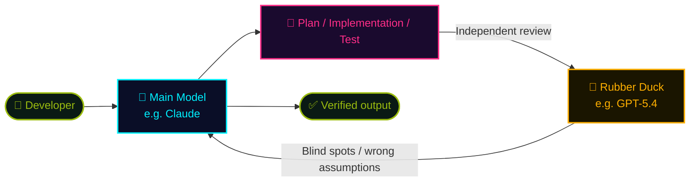

## In a nutshell

  

    <strong>Copilot CLI</strong> is Copilot living inside the terminal.
  

  

    It helps you ask, plan, edit, and execute — just like Copilot in VS Code. But it has CLI-specific features and harness, so let's explore those together.
  

## Key Features

A full-stack AI environment packed into a single terminal.

- **Multi-file context awareness**: Treats the entire repository as a single workspace.
- **Code generation & editing**: Make edits from the terminal, review diffs, and approve.
- **Command execution**: Run builds, tests, lint, and more — read the results and proceed.
- **IDE-agnostic**: Works anywhere there's a terminal: VS Code, Vim, over SSH, etc.
- **Skills / MCP support**: Add the capabilities and external tools you need.
- **Non-interactive execution**: Run via CI, cron, or scripts with `copilot -p "..."`.

## CLI vs VS Code Chat

🖥️UI

Copilot CLIVery lightweight. Terminal-centric, so there's a learning curve for commands and a minimal editor UI. On the other hand, since the CLI opens instantly, it's easy to work with local computer resources like folders, PowerPoint, and Excel files.

VS Code ChatEasier to handle options, settings, file navigation, inline diffs, and the debugger on screen.

🧪Speed of new features

Copilot CLINew experiments like <code>/limits</code>, <code>/fleet</code>, <code>/share</code>, and Rubber Duck tend to land here first.

VS Code ChatMore stability-oriented. Often adopts good ideas that matured in the CLI.

🤖Sub-agents

Copilot CLIHas many built-in agents — Explore, Task, Rubber Duck, Code Review — and can launch them natively.

VS Code ChatCurrently limited, but gradually catching up.

🧭Session management

Copilot CLIFine-grained session control with <code>/context</code>, <code>/compact</code>, <code>/session</code>, etc.

VS Code ChatImproving, but not as granular as the CLI right now.

🔀Partner agents

Copilot CLICopilot CLI runs within Copilot's harness. Codex / Claude harnesses are not available — you can use their <strong>models</strong>, but not their native harnesses.

VS Code ChatInside VS Code, it's easy to switch between Copilot, Codex, Claude, and other agents / extensions.

🔎Code search

CLI / appLocal text search and semantic search of indexed GitHub repositories. <a class="retro-link" href="https://github.com/github/copilot-cli/blob/main/changelog.md" target="_blank" rel="noopener noreferrer">CLI release notes ↗</a>

VS Code ChatWorkspace text/semantic search, plus editor context and symbol navigation. <a class="retro-link" href="https://code.visualstudio.com/docs/agents/reference/workspace-context" target="_blank" rel="noopener noreferrer">Docs ↗</a>

BlackbirdGitHub-hosted code search, not an editor-only index. <a class="retro-link" href="https://github.blog/engineering/architecture-optimization/the-technology-behind-githubs-new-code-search/" target="_blank" rel="noopener noreferrer">Architecture ↗</a>

## Powerful Built-in Agents <a class="h2-doc" href="https://docs.github.com/en/copilot/concepts/agents/copilot-cli/about-custom-agents#built-in-agents" target="_blank" rel="noopener noreferrer">📖 Docs</a> <input type="checkbox" id="demo-cli-agent-definitions" class="demo-toggle" /><label class="h2-demo" for="demo-cli-agent-definitions">&#9658; DEMO</label>

<label class="demo-scrim" for="demo-cli-agent-definitions" aria-label="Close demo steps"></label>

DEMOAgent definitionsFOR PRESENTER ONLY<label class="demo-close" for="demo-cli-agent-definitions" aria-label="Close">&#10005;</label>

<ol class="demo-steps">
<li>

CHECK THE INSTALLED VERSION

<code class="demo-cmd">copilot --version</code>

Note the installed CLI version.

</li>
<li>

OPEN THE DEFINITIONS FOLDER

Find <code class="demo-path">definitions/</code> in your local CLI installation. Example for macOS on Apple silicon:

<code class="demo-path">~/.copilot/pkg/darwin-arm64/&lt;version&gt;/definitions/</code>

Replace <code class="demo-path">&lt;version&gt;</code> with your installed version. The location depends on the platform and installation method.

</li>
<li>

READ AN AGENT DEFINITION

Open <code class="demo-path">explore.agent.yaml</code> or another <code class="demo-path">*.agent.yaml</code> in an editor.

Inspect the built-in agent's definition without modifying the installed files.

</li>
</ol>

Copilot CLI includes built-in agents for common tasks. Check them and configure their models with **`/subagents`**.

🔎Explore

What it doesQuickly analyzes the codebase and lets you ask questions about it, without adding it to the main context.

🛠️Task

What it doesRuns commands like tests and builds, returning a short summary on success or the full output on failure.

🧠General purpose

What it doesHandles complex multi-step tasks that require all tools and advanced reasoning, in a separate context from the main conversation.

📝Code review

What it doesReviews code changes focusing solely on issues that genuinely matter, minimizing noise.

📚Research

What it doesConducts deep research across the codebase, related repositories, and the web, producing detailed reports with citations.

🦆Rubber duck

What it doesReturns constructive critical feedback for complex tasks. Used automatically by Copilot CLI.

## Rubber Duck — Cross-model Review

> 🦆 **Experimental**: A **different model family** from the main model provides a "second opinion" as a constructive critic, independently reviewing each phase of planning, implementation, and testing.

**Why does it work?** ── When the same model checks its own output, it gets caught by the **same assumptions and the same blind spots**. A model from a different family has different training data and different values, so it can catch **logic errors that were invisible** to the first model.

## Other Useful Commands

The CLI lets you instantly check models, sharing, experimental features, and environment info via slash commands.

| Command | When to use |
|---|---|
| `/help` | Check available commands and shortcuts. |
| `/model` | Check or switch the model in use. |
| `/ide` | Connect to an IDE such as VS Code. |
| `/share` | Share the current session. |
| `/experimental` | Check and enable experimental features. |
| `/chronicle` | Review the session history and work log. |
| `/task` | Check agents and tasks running in the background. |
| `/fleet [PROMPT]` | Split a plan across parallel subagents. <a class="retro-link" href="https://docs.github.com/en/copilot/concepts/agents/copilot-cli/fleet" target="_blank" rel="noopener noreferrer">Docs ↗</a> |
| `/limits set max-ai-credits N` | Set a soft cap on the session's AI Credits. <a class="retro-link" href="https://docs.github.com/en/copilot/how-tos/copilot-cli/use-copilot-cli/set-session-limit" target="_blank" rel="noopener noreferrer">Docs ↗</a> |
| `/ask` | Consult Copilot as a question before proceeding. |
| `/env` | Check the environment information visible to the CLI. |

> 💰 **The agent knows its budget**: used, remaining, and max credits reach the model as `<session_limits_status>`, so it skips optional exploration. On its final call it uses no tools, summarizes progress and what remains, then stops. `/fleet` subagents share the same limit. Non-interactive: `--max-ai-credits N`.

## 🖥️ TUI (Terminal UI)

Run `/experimental on` to try the redesigned terminal UI with theme-aware semantic colors — check them with `/theme`. Inside a GitHub repository, use `Tab` to move between the menus in the table below.

| Tab | What's in it |
|---|---|
| **Session** | The normal interactive session (default) |
| **Issues** | Browse the repository's issues |
| **Pull requests** | Browse pull requests |
| **Gists** | Browse your personal gists |

> 📝 Screen-reader support and many other UI improvements landed too — see the <a class="retro-link" href="https://github.blog/changelog/2026-06-02-copilot-cli-improved-ui-rubber-duck-prompt-scheduling-and-voice-input/" target="_blank" rel="noopener noreferrer">changelog ↗</a>.

## 🛡️ Sandbox — Safe Execution Environment

Copilot runs the shell commands it executes inside an **isolated environment**, restricting access to your filesystem, network, and system — so you can hand off agentic work with confidence. (Public preview)

| | 🖥️ Local sandbox | ☁️ Cloud sandbox |
|---|---|---|
| **Enable** | `/sandbox enable` in a session | `copilot --cloud` |
| **Runs on** | Your machine (isolated) | GitHub-hosted ephemeral Linux |
| **Built on** | Microsoft MXC | Azure Container Apps Sandboxes |
| **Support** | macOS / Linux (Windows on Insiders) | Any device |
| **Policy** | Centrally managed via Intune / MDM | Inherits Cloud Agent policies |

- 🔒 **What's isolated**: filesystem / network / system capabilities for Copilot-initiated shell execution.
- 🔁 **Cloud keeps state**: Active → Stopped (snapshot) → Deleted. Resume from another device and run heavy tasks in parallel.
- 🧩 **Same auth**: uses your Copilot CLI sign-in — no separate cloud setup required.

## Non-interactive Mode (Programmatic Execution) ★

Copilot CLI can be run with a single command using `copilot -p "..."`. It executes one turn and exits without opening an interactive session, so it can be called from shell scripts, cron, **batch files**, and **GitHub Actions**. Delegate routine work — PR auto-review, lint fixes, release notes — to Copilot whenever a human doesn't need to be in the loop.

### Key flags

- `-p "..."` / `--prompt "..."` — Pass a prompt and exit after one turn
- `-s` (silent) — Output response text only to stdout (ideal for variable assignment or piping)
- `--no-ask-user` — Skip clarifying questions; make decisions autonomously
- `--allow-tool='shell(npm:*), write'` — Allow only the necessary tools (`--allow-all` is for sandboxes only)
- `--model gpt-5.5` — Pin the model to reduce variance
- `--share='./session.md'` — Save the entire session as Markdown

### Common use cases

- 📝 Commit message generation / 📰 Release note drafting
- 🐛 Bulk lint error fixes / 🧪 Tests for untested modules
- 🔍 AI PR review (script `/review`) / 🔐 Dependency vulnerability audit
- 📚 Bulk README & JSDoc generation / 🌏 Document translation

### Operational tips

- 🔑 Pass auth via env vars: `COPILOT_GITHUB_TOKEN` → `GH_TOKEN` → `GITHUB_TOKEN`
- 🧾 Use **fine-grained PAT (v2)** with the "Copilot Requests" permission (old `ghp_` format isn't supported)
- 🛡️ `--allow-tool` with a whitelist is the rule. Never use `--allow-all` outside a sandbox
- 🎯 Be specific in prompts — pinning the output format ("Number only.", "YES/NO") makes parsing easy
- 📊 Save sessions with `--share` so you can trace the reasoning behind results later
- 🧩 Iterate the prompt in interactive mode first, then port it to `-p` once it's solid

📘 Details:
- <a class="retro-link" href="https://docs.github.com/en/copilot/how-tos/copilot-cli/automate-copilot-cli/run-cli-programmatically" target="_blank" rel="noopener noreferrer">Running GitHub Copilot CLI programmatically ↗</a>
- <a class="retro-link" href="https://docs.github.com/en/copilot/reference/copilot-cli-reference/cli-programmatic-reference" target="_blank" rel="noopener noreferrer">Programmatic reference (full flag list) ↗</a>
- <a class="retro-link" href="https://docs.github.com/en/copilot/how-tos/copilot-cli/automate-copilot-cli/automate-with-actions" target="_blank" rel="noopener noreferrer">Automating tasks with Copilot CLI and GitHub Actions ↗</a>
