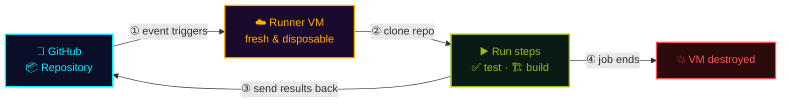

## In a nutshell

<div class="hero-quote">
  <p>
    <strong>GitHub Actions</strong> is a continuous integration and continuous delivery (CI/CD) platform.
  </p>
  <p>
    But it <strong>goes beyond just DevOps</strong>: run workflows when <strong>any event happens in your repository</strong> — push, PR, issue, label, schedule, and more. It's automation for <strong>almost anything</strong>.
  </p>
</div>

## What workflow does it automate?

Beyond CI/CD, GitHub Actions can automate **every stage of the SDLC**, all triggered by events.


## The metrics it improves (DORA)

The point of automation (CI/CD, tests, reviews) is to raise both **speed and stability**. The yardstick is the four <a class="retro-link" href="https://dora.dev/" target="_blank" rel="noopener noreferrer">DORA metrics ↗</a> — push them toward Elite.

<div class="tbl-fit">

| DORA metric | 🟢 Elite | 🟣 High | 🟠 Medium | 🔴 Low |
| --- | --- | --- | --- | --- |
| 🚀 Deployment frequency | Multiple per day | Daily–weekly | Weekly–monthly | Every 1–6 months |
| ⏱️ Lead time for changes | < 1 day | 1 day–1 week | 1 week–1 month | 1–6 months |
| ❌ Change failure rate | 0–15% | 0–15% | 0–15% | 46–60% |
| 🔧 Mean time to recovery | < 1 hour | < 1 day | < 1 day | 1 week–1 month |

</div>

> 🎯 Automation's value: raise speed (frequency, lead time) and stability (failure rate, recovery) **at the same time**.

## Architecture: clone → run → destroy

Your GitHub repo is cloned onto a **disposable cloud VM**; steps (like tests) run there, results are sent back, and the **VM is destroyed**.



> 🔁 Results return as checks, logs, and artifacts; the VM is discarded every run.

## How it works (core concepts)

It's very simple: **when an event fires, borrow a clean VM, clone the repo, and run the steps you wrote — in order**.

- 📁 **Location** — `.github/workflows/*.yml` (multiple files supported)
- ⚡ **Triggers** — `push` / `pull_request` / `schedule` (cron) / `workflow_dispatch` (manual) / `issues` / `release` and 35+ other events
- 🖥️ **Execution environment** — a fresh **GitHub-hosted runner** (Linux / Windows / macOS VM) starts up per job
- 📦 **Repo cloned every time** — `actions/checkout` full-clones into `$GITHUB_WORKSPACE` (no state carried over from previous jobs)
- ⏱️ **Time limits** — 6 hours max per job, 35 days max per workflow (matrix parallelism is supported)
- �� **Secrets** — stored in `Settings → Secrets` → referenced as `${{ secrets.NAME }}` (masked in logs)

> 🧠 "Start from scratch every time" is the golden rule of GitHub Actions. To persist state, use `actions/cache`, artifacts, or rely on already-deployed infrastructure.

## Choose your runners <a class="h2-doc" href="https://docs.github.com/en/actions/concepts/runners/github-hosted-runners" target="_blank" rel="noopener noreferrer">📖 Docs</a>

**GitHub-hosted for managed CI. Self-hosted for infrastructure you control.**

| | GitHub-hosted | Self-hosted |
| --- | --- | --- |
| Maintenance | GitHub manages the environment | You patch and secure it |
| Capacity | On demand, within plan limits | Your machines; ARC for Kubernetes |
| Network | Public or configured private access | Your network and hardware |
| Compute cost | Free standard public CI; otherwise metered | Your infrastructure, no Actions compute charge |

Need more power without managing machines? Use **larger runners** on Team or Enterprise Cloud.

## Reuse Marketplace actions <a class="h2-doc" href="https://docs.github.com/en/actions/reference/security/secure-use" target="_blank" rel="noopener noreferrer">📖 Docs</a>

Compose existing actions instead of writing every step yourself.

| Task | Reusable action |
| --- | --- |
| Check out code | `actions/checkout` |
| Install Node.js | `actions/setup-node` |
| Build a container | `docker/build-push-action` |

- **Review the source**, including actions from verified creators.
- **Lock dependencies or pin full commit SHAs**; tags can move.
- **Set an organization allowlist** in Settings → Actions → General.

## Start with one workflow <a class="h2-doc" href="https://docs.github.com/en/actions/writing-workflows/workflow-syntax-for-github-actions" target="_blank" rel="noopener noreferrer">📖 Docs</a>

For a Node.js project, add <code>.github/<wbr>workflows/<wbr>ci.yml</code>:

```yaml
name: CI
on: { push: { branches: [main] }, pull_request: {} }
permissions: { contents: read }
jobs:
  test:
    runs-on: ubuntu-latest
    steps:
      - uses: actions/checkout@v7
      - uses: actions/setup-node@v7
        with: { node-version: 24 }
      - run: npm ci && npm test
```

Push → **Actions logs + PR checks**. Use a dependency lockfile or full SHA pins for the action references.

## Compute and pricing <a class="h2-doc" href="https://docs.github.com/en/billing/concepts/product-billing/github-actions" target="_blank" rel="noopener noreferrer">📖 Docs</a> <input type="checkbox" id="info-actions-pricing" class="demo-toggle" /><label class="h2-demo h2-info" for="info-actions-pricing">&#9432; INFO</label>

<div class="demo-panel is-info">
<label class="demo-scrim" for="info-actions-pricing" aria-label="Close pricing details"></label>
<div class="demo-window" role="group" aria-label="Compute and storage pricing">
<div class="demo-head"><span class="demo-tag">INFO</span><span class="demo-name">Compute and storage</span><label class="demo-close" for="info-actions-pricing" aria-label="Close">&#10005;</label></div>
<div class="info-body">
<p>USD, as of 2026-11-11. Compute is a monthly monetary allowance, not a fixed minute quota. Eligible runner usage and cloud sandbox compute/memory draw from the same allowance.</p>
<ul class="info-list">
<li><b>Standard rates:</b> Linux x64 2-core $0.006/min, Windows x64 2-core $0.010/min, macOS 3/4-core $0.062/min. See <a class="retro-link" href="https://docs.github.com/en/billing/reference/actions-runner-pricing" target="_blank" rel="noopener noreferrer">all runner sizes and rates ↗</a>.</li>
<li><b>Larger runners:</b> paid even for public repositories. Eligible usage can draw from Team / Enterprise Cloud included compute.</li>
<li><b>Artifact storage:</b> Free 500 MB, Pro 1 GB, Team 2 GB, Enterprise Cloud 50 GB, shared with Packages. Overage: $0.25/GB-month.</li>
<li><b>Cache storage:</b> separate 10 GB per repository; configured extra capacity costs $0.07/GB-month. Custom image storage has a separate allowance and the same overage rate.</li>
<li><b>Billing:</b> the repository owner pays. Storage accrues hourly; deleting an artifact stops future charges, not past usage.</li>
</ul>
</div>
</div>
</div>

**Standard public runners and self-hosted compute are free.** Other eligible usage draws from a shared allowance.

| Plan | Included compute / month |
| --- | ---: |
| Free | $12 |
| Pro / Team | $18 |
| Enterprise Cloud | $300 |

USD, **as of 2026-11-11**. Example: $300 covers **50,000 Linux 2-core minutes** at $0.006/min. Additional usage is billed; storage is separate.

## Budget beyond your CI <a class="h2-doc" href="https://docs.github.com/en/billing/how-tos/set-up-budgets" target="_blank" rel="noopener noreferrer">📖 Docs</a>

**Automation shares compute; AI credits are a separate meter.**

| Consumer | Compute usage |
| --- | --- |
| CI, <a class="retro-link" href="/theomonfort/en/playbook/code-scanning/">CodeQL</a>, <a class="retro-link" href="/theomonfort/en/playbook/code-quality/">Code Quality</a> | Hosted workflow / scan runs |
| <a class="retro-link" href="/theomonfort/en/playbook/copilot-code-review/">Copilot Code Review</a> | Agentic context gathering and tools |
| <a class="retro-link" href="/theomonfort/en/playbook/cloud-agent/">Copilot cloud tasks</a> | Actions or cloud sandbox compute |

- **Monitor first:** soft budgets with **75 / 90 / 100%** alerts; inspect Actions usage metrics.
- **Cap deliberately:** “Stop usage when budget limit is reached” blocks further billed usage **within that budget's scope**.

Code review can still run without its Actions-powered agentic capabilities. An Actions budget does **not** stop every Copilot feature.

## Workflow lockfiles (GA) <a class="h2-doc" href="https://docs.github.com/en/actions/concepts/security/workflow-dependency-lockfiles" target="_blank" rel="noopener noreferrer">📖 Docs</a> <input type="checkbox" id="demo-actions-lockfiles" class="demo-toggle" /><label class="h2-demo" for="demo-actions-lockfiles">&#9658; DEMO</label>

<div class="demo-panel">
<label class="demo-scrim" for="demo-actions-lockfiles" aria-label="Close demo steps"></label>
<div class="demo-window" role="group" aria-label="Demo steps">
<div class="demo-head"><span class="demo-tag">DEMO</span><span class="demo-name">Lock this site's workflow</span><span class="demo-note">FOR PRESENTER ONLY</span><label class="demo-close" for="demo-actions-lockfiles" aria-label="Close">&#10005;</label></div>
<ol class="demo-steps">
<li>
<p class="demo-step-title">COMPARE A TAG AND A COMMIT</p>
<p>Open <a class="retro-link" href="https://github.com/actions/checkout/tree/v4" target="_blank" rel="noopener noreferrer">checkout@v4 ↗</a>, then <a class="retro-link" href="https://github.com/actions/checkout/commit/11d5960a326750d5838078e36cf38b85af677262" target="_blank" rel="noopener noreferrer">the locked commit ↗</a>.</p>
<p class="demo-out">A tag can move; a full SHA identifies one revision. Even <code>v4.4.0</code> is a tag.</p>
</li>
<li>
<p class="demo-step-title">OPEN THE EXISTING LOCKFILE</p>
<p>Open <a class="retro-link" href="https://github.com/theomonfort/theomonfort/blob/main/.github/workflows/actions.lock" target="_blank" rel="noopener noreferrer">this site's actions.lock ↗</a>. Show <code class="demo-path">workflows</code>, then <code class="demo-path">dependencies</code>.</p>
<p class="demo-out">Compare checkout's recorded SHA with the commit page. Show <code>owner_id</code>, <code>repo_id</code> and the transitive <code>upload-artifact</code> dependency.</p>
</li>
<li>
<p class="demo-step-title">VERIFY WITHOUT MODIFYING FILES</p>
<p>In an up-to-date checkout of this site, with <code>gh-actions-lock</code> installed:</p>
<code class="demo-cmd">gh actions-lock --verify .github/workflows/deploy.yml</code>
<p class="demo-out">Verification succeeds when the workflow and lockfile agree. The current <code>v4</code> tag need not match the recorded <code>v4.4.0</code> commit.</p>
</li>
<li>
<p class="demo-step-title">REQUIRE LOCKFILES GRADUALLY</p>
<p>As an authorized administrator, open <a class="retro-link" href="https://github.com/organizations/theomonfort-org/settings/actions/rules" target="_blank" rel="noopener noreferrer">theomonfort-org → Actions Policies ↗</a>.</p>
<p>Path: organization <code class="demo-path">Settings → Actions → Policies → New policy → New policy</code> (in the dropdown). Name the policy, scope the demo repositories/workflows, enable <code class="demo-path">Require lockfile</code>, then save.</p>
<p class="demo-out">On Enterprise Cloud, start in <code>Evaluate</code> and inspect <code>Policy insights</code>. Switch to <code>Active</code> only after targeted workflows are onboarded.</p>
</li>
</ol>
</div>
</div>

**Why it matters:** an action tag like `v4` can be moved to different code. Your next build could run an unreviewed change, or malicious code, without any change to your workflow.

**What it does:** a lockfile records the exact commit of each action, including actions it depends on. GitHub Actions runs those recorded commits instead of following a moving tag.

- **Review updates:** Dependabot proposes <a class="retro-link" href="https://github.com/theomonfort/theomonfort/blob/main/.github/dependabot.yml" target="_blank" rel="noopener noreferrer">action updates ↗</a> and the matching lockfile changes together in a pull request.
- **Require adoption:** administrators can block selected workflows until they use a lockfile.
