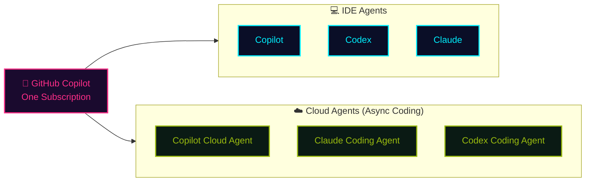
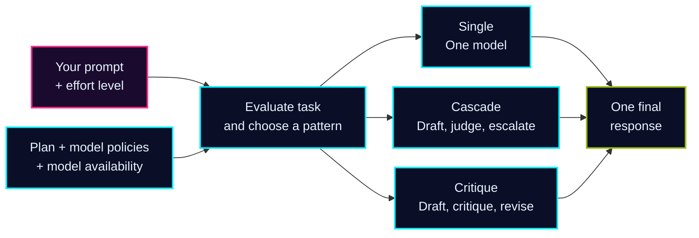

## At a Glance

  
GitHub Copilot is the world's most widely adopted <strong>AI developer tool</strong>.

  
It accelerates your <strong>flow</strong> across every surface — <strong>IDE, terminal, and GitHub.com</strong>.

## The History of GitHub Copilot

  
The "Copilot" (Co-pilot) Era

  
Rise of Agents

  
Beyond the IDE

  

  

    
LLM Code Completion

    
  

  

    
Copilot Chat Ask Mode

    
  

  

    
Copilot Chat Edit Mode

    
  

  

    
GitHub Copilot Agent Mode

    
  

  

    
GitHub Copilot Beyond the IDE

    
  

  
Code completion only

  
Responds to what you ask

  
Acts autonomously

  
Usable outside the IDE

## AI Models & Surfaces <a class="h2-doc" href="https://docs.github.com/en/copilot/reference/ai-models/supported-models" target="_blank" rel="noopener noreferrer">📖 Docs</a>

**Models:** GPT / Claude / Gemini / Grok / MAI / Kimi. Custom models and **BYOK** on supported clients; availability depends on plan, client and policy.

| Work from | What you can do |
| --- | --- |
| **IDE** | Code in VS Code, Visual Studio, JetBrains, Xcode, Eclipse or Neovim |
| <a class="retro-link" href="/theomonfort/en/playbook/copilot-app">Copilot App ↗</a> | Direct parallel agents, triage issues and manage PRs |
| <a class="retro-link" href="/theomonfort/en/playbook/cli">Terminal ↗</a> | Work from your shell with Copilot CLI |
| <a class="retro-link" href="/theomonfort/en/playbook/cloud-agent">Cloud Agent ↗</a> / <a class="retro-link" href="/theomonfort/en/playbook/copilot-code-review">Code Review ↗</a> | Delegate implementation / review PRs |
| <a class="retro-link" href="https://github.com/github/copilot-sdk" target="_blank" rel="noopener noreferrer">SDK ↗</a> | Embed Copilot in your own applications |
| <a class="retro-link" href="/theomonfort/en/playbook/agentic-workflow">Automation ↗</a> | Turn repository tasks into agentic workflows |
| **Web / Mobile** | Chat, steer remote sessions and launch cloud work |

## Developer Impact

The impact GitHub Copilot has on developers  
Results from a 6-month study of 450 Accenture developers (2025)

| Activity | Productivity | Efficiency | Satisfaction |
|---:|---:|---:|---:|
| 94% reported maintaining a "flow state" at work | 90% feel they write better code | 50% increase in number of builds | 96% felt successful from day one |
| 90% spend less time searching for information | 88% of Copilot-suggested code was accepted as-is | 84% improvement in build success rate | 90% improvement in job satisfaction |

## Use Codex & Claude with a Single Subscription

With a GitHub Copilot subscription, you can use the **Codex** and **Claude** **agents (harness)** — both in the **IDE** and as a **Cloud Agent**. Usage is paid directly through **Copilot AI credits**, so no extra contract is needed.

## Fusion: Choose Effort, Not a Model <a class="h2-doc" href="https://docs.github.com/en/copilot/concepts/models/copilot-fusion" target="_blank" rel="noopener noreferrer">📖 Docs</a>

Select **Copilot Fusion** and an effort level. Copilot chooses the models and how they work together, returning **one final response**.

- **Automatic planning:** Uses reasoning, coding, debugging and tool-use signals to choose a pattern and per-step reasoning effort.
- **GA since 2026-10-28:** Available in VS Code, Copilot CLI, Copilot App and JetBrains.

| **60** index score | **About ½** cost and tokens | **About 40%** less time |
| --- | --- | --- |
| Within 2 points of the comparison configuration | Average API cost: **$5.59 vs $11.42** per task | Average time per task |

**Benchmark scope:** Fusion Max in Copilot CLI vs Claude Code with Opus 5.5 Max, Artificial Analysis Coding Agent Index v2.0, reported 2026-10-28. These are benchmark results, not guaranteed savings for your tasks.

## Fusion: Effort & Execution Patterns <a class="h2-doc" href="https://docs.github.com/en/copilot/concepts/models/copilot-fusion" target="_blank" rel="noopener noreferrer">📖 Docs</a>

**You choose effort. Fusion chooses the execution pattern.**

| Effort | Best for | Plans |
| --- | --- | --- |
| **Standard** | Everyday work, one model per task | All plans |
| **High** | Complex bugs and multi-file changes | Pro+, Max, Business, Enterprise |
| **Max** | Deep reasoning and thorough analysis | Pro+, Max, Business, Enterprise |

| Pattern | How it works |
| --- | --- |
| **Single** | One model completes the task |
| **Cascade** | Efficient draft → judge → stronger model if needed |
| **Critique** | Draft → parallel model critiques → combined feedback → revision |

As of **2026-11-11**; model policies apply. **Fast:** VS Code inline chat only, not selectable. Effort level ≠ model reasoning effort.

## Fusion: From Prompt to Response <a class="h2-doc" href="https://docs.github.com/en/copilot/concepts/models/copilot-fusion" target="_blank" rel="noopener noreferrer">📖 Docs</a>

**Public conceptual flow:** Models and reasoning effort vary per step.

Fusion **does not start subagents**. Discarded drafts **do not undo file edits**: review changes before committing.

## Fusion: Billing & the Launch Offer <a class="h2-doc" href="https://docs.github.com/en/copilot/concepts/models/copilot-fusion#billing-for-copilot-fusion" target="_blank" rel="noopener noreferrer">📖 Docs</a>

**Dated offer, verified 2026-11-11.** The published promotion ends **2026-11-30**.

| 30% off model costs | Eligibility | End date |
| --- | --- | --- |
| **Copilot Fusion usage only** | Users on **paid Copilot plans** | **November 30, 2026** |

- **Normal billing:** Per-model standard rates, with no separate Fusion charge.
- **Model costs only:** Not a discount on the subscription price.
- **Budget:** High / Max can use more models and AI credits than Standard.

Do not assume the discount continues after this date. Check the billing docs for current terms.

## Why Enterprises Choose Copilot

-  **Orchestration** 　AI that spans the entire SDLC, not just coding
-  **Freedom of choice across models, agents, and surfaces** 　The best model and interface for every workflow. No vendor lock-in
-  **Enterprise controls** 　Centralized governance, visibility, and security
-  **Compliance** 　Copilot Proxy, policy controls, public-code filtering, and Microsoft IP protection for eligible use
-  **Best cost-performance** 　Pooled usage, rich built-in entitlements, and maximum price advantage via ACD

## Secure & Compliant Architecture

**Prompts and generated code** pass through **Copilot Proxy** — designed for safe enterprise use. 
🔗 See the <a href="https://resources.github.com/copilot-trust-center/" target="_blank" rel="noopener noreferrer" class="retro-link">Copilot Trust Center</a> for full details.

What Copilot Proxy does:

- 🔒 Removes **PII (Personally Identifiable Information)** from context
- 🚫 Filters **inappropriate content** from context
- 🛡️ Checks context for **common security vulnerabilities**
- ⚖️ Passes suggestions through an **IP (Intellectual Property) filter**
- 🔐 All data is **encrypted in transit**
