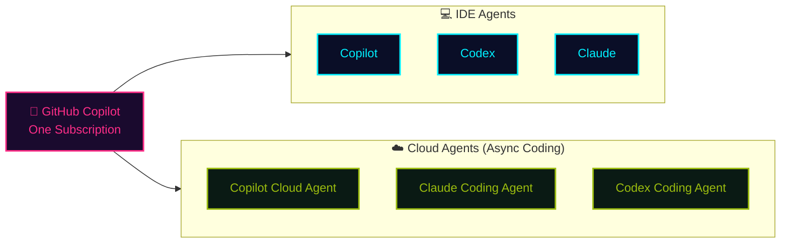

## At a Glance

  
GitHub Copilot is the world's most widely adopted <strong>AI developer tool</strong>.

  
It accelerates your <strong>flow</strong> across every surface — <strong>IDE, terminal, and GitHub.com</strong>.

## The History of GitHub Copilot

  
The "Copilot" (Co-pilot) Era

  
Rise of Agents

  
Beyond the IDE

  

  

    
LLM Code Completion

    
  

  

    
Copilot Chat Ask Mode

    
  

  

    
Copilot Chat Edit Mode

    
  

  

    
GitHub Copilot Agent Mode

    
  

  

    
GitHub Copilot Beyond the IDE

    
  

  
Code completion only

  
Responds to what you ask

  
Acts autonomously

  
Usable outside the IDE

## AI Models & Surfaces <a class="h2-doc" href="https://docs.github.com/en/copilot/reference/ai-models/supported-models" target="_blank" rel="noopener noreferrer">📖 Docs</a>

**Models:** GPT / Claude / Gemini / Grok / MAI / Kimi. Custom models and **BYOK** on supported clients; availability depends on plan, client and policy.

| Work from | What you can do |
| --- | --- |
| **IDE** | Code in VS Code, Visual Studio, JetBrains, Xcode, Eclipse or Neovim |
| <a class="retro-link" href="/theomonfort/en/playbook/copilot-app">Copilot App ↗</a> | Direct parallel agents, triage issues and manage PRs |
| <a class="retro-link" href="/theomonfort/en/playbook/cli">Terminal ↗</a> | Work from your shell with Copilot CLI |
| <a class="retro-link" href="/theomonfort/en/playbook/cloud-agent">Cloud Agent ↗</a> / <a class="retro-link" href="/theomonfort/en/playbook/copilot-code-review">Code Review ↗</a> | Delegate implementation / review PRs |
| <a class="retro-link" href="https://github.com/github/copilot-sdk" target="_blank" rel="noopener noreferrer">SDK ↗</a> | Embed Copilot in your own applications |
| <a class="retro-link" href="/theomonfort/en/playbook/agentic-workflow">Automation ↗</a> | Turn repository tasks into agentic workflows |
| **Web / Mobile** | Chat, steer remote sessions and launch cloud work |

## Developer Impact

The impact GitHub Copilot has on developers  
Results from a 6-month study of 450 Accenture developers (2025)

| Activity | Productivity | Efficiency | Satisfaction |
|---:|---:|---:|---:|
| 94% reported maintaining a "flow state" at work | 90% feel they write better code | 50% increase in number of builds | 96% felt successful from day one |
| 90% spend less time searching for information | 88% of Copilot-suggested code was accepted as-is | 84% improvement in build success rate | 90% improvement in job satisfaction |

## Use Codex & Claude with a Single Subscription

With a GitHub Copilot subscription, you can use the **Codex** and **Claude** **agents (harness)** — both in the **IDE** and as a **Cloud Agent**. Usage is paid directly through **Copilot AI credits**, so no extra contract is needed.

## Copilot Fusion <a class="h2-doc" href="https://docs.github.com/en/copilot/concepts/models/copilot-fusion" target="_blank" rel="noopener noreferrer">📖 Docs</a>

<strong>You choose effort.</strong> Fusion chooses the models.

01
<strong>Stop switching models</strong>
Select Fusion, then Standard, High or Max.

02
<strong>A plan for each prompt</strong>
Match the task to models, reasoning and an execution pattern.

03
<strong>One final response</strong>
Extra review calls only when the task warrants them.

<strong>60</strong>Coding Agent IndexFusion Max, within 2 points of Opus 5.5 Max.

<strong>1/2</strong>Cost / tokensAverage API cost and token usage per task.

<strong>40%</strong>Less timeAbout 40% less time per task.

<strong>77%</strong>Max cost reductionDeepSWE: Fusion High vs GPT-6 Astra (high), with higher accuracy.

<strong>GA, 2026-10-28.</strong> VS Code / Copilot CLI / Copilot App / JetBrains.

77%: supplied original slide, not independently verified. Other three: <a href="https://artificialanalysis.ai/articles/github-copilot-fusion-orchestrates-anthropic-and-openai-models-to-balance-performance-and-cost" target="_blank" rel="noopener noreferrer">Artificial Analysis, 2026-10-28</a> (Fusion Max vs Opus 5.5 Max). Benchmark results, not guaranteed savings.

## Fusion: choose effort <a class="h2-doc" href="https://docs.github.com/en/copilot/concepts/models/copilot-fusion" target="_blank" rel="noopener noreferrer">📖 Docs</a>

Choose the trade-off, <strong>not a fixed workflow.</strong>

<section class="fusion-choice" aria-label="Effort levels">

YOU CHOOSE THE EFFORT

<strong>Standard</strong>
Everyday work, one model.<small>All Copilot plans</small>

<strong>High</strong>
Complex bugs and multi-file changes.

<strong>Max</strong>
Deepest reasoning and thorough analysis.

<b>High / Max:</b> Pro+, Max, Business, Enterprise.

</section>
<section class="fusion-choice" aria-label="Execution patterns">

FUSION CHOOSES THE PATTERN

<strong>Single</strong>
One model solves the task directly.

<strong>Cascade</strong>
Efficient draft → judge → accept or escalate.

<strong>Critique</strong>
Draft → parallel critiques → combine → revise.

The next prompt can use a different pattern.

</section>

<strong>Effort level ≠ per-model reasoning.</strong> Model policies still apply; disabling required models can make Max unavailable.

<b>Fast:</b> VS Code inline chat only, not selectable. Availability checked 2026-11-11.

## Inside Fusion <a class="h2-doc" href="https://docs.github.com/en/copilot/concepts/models/copilot-fusion" target="_blank" rel="noopener noreferrer">📖 Docs</a> <input type="checkbox" id="info-fusion-runtime" class="demo-toggle" /><label class="h2-demo h2-info" for="info-fusion-runtime">&#9432; INFO</label>

<label class="demo-scrim" for="info-fusion-runtime" aria-label="Close Fusion details"></label>

INFOPublic routing concepts<label class="demo-close" for="info-fusion-runtime" aria-label="Close">&#10005;</label>

<b>Policy-aware model pool:</b> Plan, administrator, data-residency and FedRAMP restrictions still apply. The model pool can change.

<b>Adaptive routing:</b> Fusion considers system health and availability. Routing follows natural cache boundaries and large changes in conversation complexity.

<b>Per-step execution:</b> Each step has its own model, reasoning effort and model context limit. You can follow step/model progress; only the final response is shown.

<b>Workspace safety:</b> Fusion does not start subagents. Discarding a draft does not undo its file edits. Review changes before committing.

<section class="fusion-zone fusion-input">

01 / YOUR WORKSPACE

<strong>Prompt + effort</strong>

Standard / High / Max

Plan + model policies

</section>

<section class="fusion-zone fusion-plan">

02 / FUSION PLANNING

ReasoningCodingDebuggingTools

<strong>Choose pattern, models &amp; reasoning per step.</strong>

Respect policies, health and availability.

</section>

↓ Execution plan

<section class="fusion-zone fusion-execution">

03 / EXECUTION + REVIEW
One selected path per prompt

<h3>Single</h3>
Model<b aria-hidden="true">→</b>Answer

Direct solution, no extra review calls.

<h3>Cascade</h3>
Draft<b aria-hidden="true">→</b>Judge

<b>Accept</b> the draft, or <b>escalate</b> to a stronger model.

<h3>Critique</h3>
Draft<b aria-hidden="true">→</b>Parallel critiques

Combine feedback → original model revises.

</section>

04<strong>One final response</strong>Intermediate drafts may be revised or discarded.

No subagents launched. Discarded drafts do not undo file edits.

## Fusion: pricing <a class="h2-doc" href="https://docs.github.com/en/copilot/concepts/models/copilot-fusion#billing-for-copilot-fusion" target="_blank" rel="noopener noreferrer">📖 Docs</a>

LAUNCH OFFER

<strong>30%</strong>off model costsCopilot Fusion usage only

<section class="fusion-zone" aria-label="Offer conditions">

ELIGIBILITY + TIMING

<strong>Plans</strong>
Users on <b>paid Copilot plans</b>.

<strong>Ends</strong>
<strong><time datetime="2026-11-30">2026-11-30</time></strong><small>Published end date</small>

</section>

<strong>Model costs only.</strong> Not a discount on the subscription price.

01
<strong>Normal billing</strong>
Each model's standard rates, with no separate Fusion charge.

02
<strong>Effort affects cost</strong>
High / Max can use more models and AI credits than Standard.

Verified 2026-11-11. Check Docs before assuming any extension beyond the published end date.

## Why Enterprises Choose Copilot

-  **Orchestration** 　AI that spans the entire SDLC, not just coding
-  **Freedom of choice across models, agents, and surfaces** 　The best model and interface for every workflow. No vendor lock-in
-  **Enterprise controls** 　Centralized governance, visibility, and security
-  **Compliance** 　Copilot Proxy, policy controls, public-code filtering, and Microsoft IP protection for eligible use
-  **Best cost-performance** 　Pooled usage, rich built-in entitlements, and maximum price advantage via ACD

## Secure & Compliant Architecture

**Prompts and generated code** pass through **Copilot Proxy** — designed for safe enterprise use. 
🔗 See the <a href="https://resources.github.com/copilot-trust-center/" target="_blank" rel="noopener noreferrer" class="retro-link">Copilot Trust Center</a> for full details.

What Copilot Proxy does:

- 🔒 Removes **PII (Personally Identifiable Information)** from context
- 🚫 Filters **inappropriate content** from context
- 🛡️ Checks context for **common security vulnerabilities**
- ⚖️ Passes suggestions through an **IP (Intellectual Property) filter**
- 🔐 All data is **encrypted in transit**
