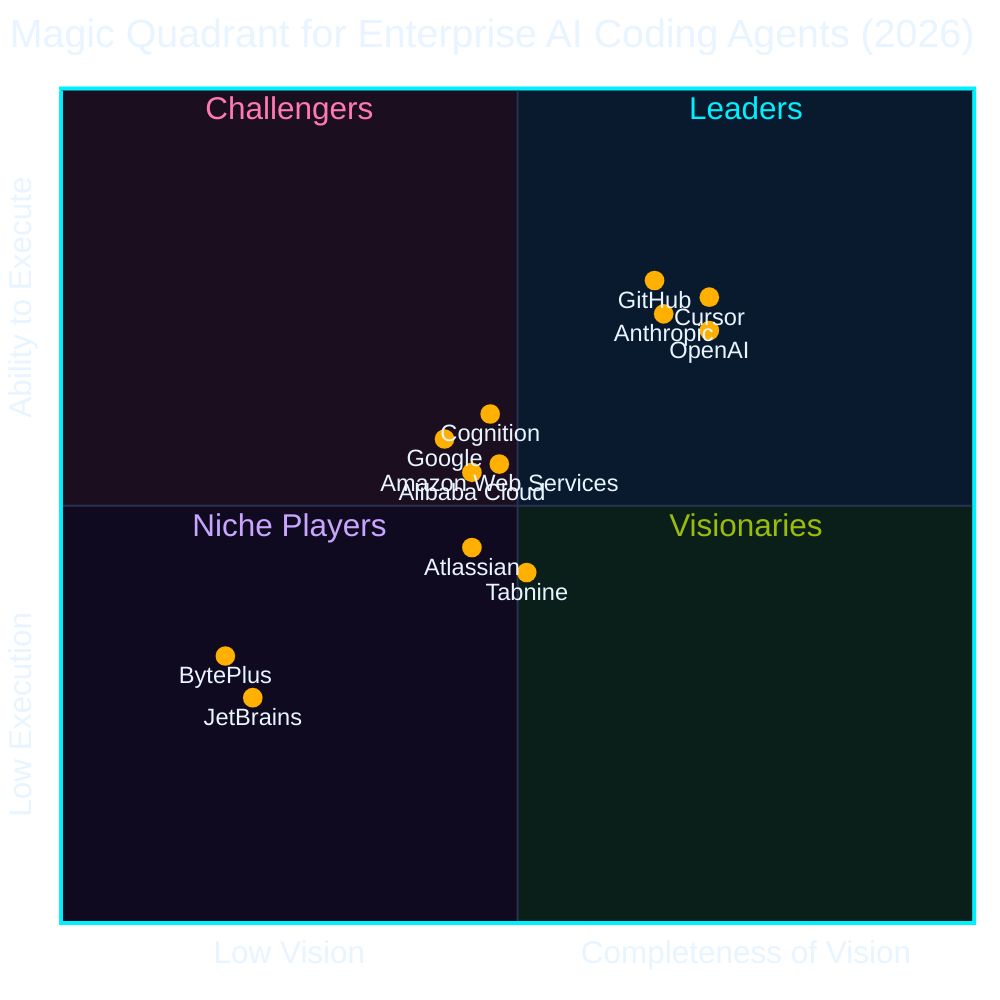

## At a Glance

  
Hi, I'm <strong>Mona</strong> — the face of <strong>GitHub</strong>, watching over developers worldwide.

  
Today's topic, <strong>GitHub</strong>, is the world's largest AI-native developer platform, home to <strong>225 million+</strong> developers (Octoverse, September 2026).

## The Evolution of GitHub <a class="h2-doc" href="https://github.blog/news-insights/company-news/github-universe-2026-evolving-every-layer-of-the-stack/" target="_blank" rel="noopener noreferrer">📖 Docs</a>

From collaborating on code to coordinating work across agents.

<figure class="gh-timeline">

<ol>
<li><time>2008</time><strong>Pull requests</strong>Make collaboration the default.</li>
<li><time>2012</time><strong>GitHub Enterprise</strong>Bring governance to team development.</li>
<li><time>2019</time><strong>Actions / GHAS</strong>Automate delivery and security.</li>
<li><time>2021</time><strong>GitHub Copilot</strong>Build with an AI coding assistant.</li>
<li><time>2025</time><strong>Agent HQ</strong>Delegate tasks and track sessions.</li>
<li class="gh-timeline-now"><time>2026</time><strong>Projects / Agent groups</strong>One goal. Shared context. Parallel work.</li>
</ol>
</figure>

## AI Developer Platform

From **Plan → Code → Review → Test & Security → Operate**, AI on GitHub supports the entire SDLC end-to-end.

<figure class="rpi-pipeline" style="margin:2em 0;">

  <button type="button" data-f="all" class="on">All</button>
  <button type="button" data-f="cop">🤖 Copilot</button>
  <button type="button" data-f="nat">Other</button>

<svg viewBox="0 0 1080 510" xmlns="http://www.w3.org/2000/svg"
     shape-rendering="crispEdges"
     style="width:100%;height:auto;display:block;font-family: 'Noto Sans JP', sans-serif;">
  <rect x="0" y="0" width="1080" height="510" fill="none"/>
  <!-- ── Card 1: PLAN ── green ─────────────────────────────────── -->
  <g>
    <rect x="16" y="64" width="200" height="400" fill="#0f1604"/>
    <rect x="12" y="60" width="200" height="400" fill="#0a0e27" stroke="#9bbc0f" stroke-width="3"/>
    <path d="M 18 66 h 12 M 18 66 v 12 M 206 66 h -12 M 206 66 v 12 M 18 454 h 12 M 18 454 v -12 M 206 454 h -12 M 206 454 v -12" stroke="#9bbc0f" stroke-width="2" fill="none"/>
    <rect x="32" y="38" width="160" height="44" fill="#05060f" stroke="#9bbc0f" stroke-width="3"/>
    <text x="112" y="67" text-anchor="middle" fill="#9bbc0f" font-size="18" font-weight="bold">▮ PLAN</text>
    <line x1="22" y1="100" x2="202" y2="100" stroke="#9bbc0f" stroke-width="1" stroke-dasharray="4 4" opacity="0.55"/>
    <g>
      <g class="plat-item" data-cop="0"><rect x="22" y="118" width="180" height="38" fill="#0e1430" stroke="#9bbc0f" stroke-width="2"/>
      <text x="112" y="143" text-anchor="middle" fill="#e8f4ff" font-size="14">▶ GitHub Projects</text></g>
      <g class="plat-item" data-cop="0"><rect x="22" y="166" width="180" height="38" fill="#0e1430" stroke="#9bbc0f" stroke-width="2"/>
      <text x="112" y="191" text-anchor="middle" fill="#e8f4ff" font-size="13">▶ Issues/Discussions</text></g>
      <g class="plat-item" data-cop="1"><rect x="22" y="214" width="180" height="38" fill="#0e1430" stroke="#9bbc0f" stroke-width="2"/>
      <text x="112" y="239" text-anchor="middle" fill="#e8f4ff" font-size="14">▶ Plan mode</text></g>
      <g class="plat-item" data-cop="1"><rect x="22" y="262" width="180" height="38" fill="#0e1430" stroke="#9bbc0f" stroke-width="2"/>
      <text x="112" y="287" text-anchor="middle" fill="#e8f4ff" font-size="14">▶ MCP</text></g>
      <g class="plat-item" data-cop="1"><rect x="22" y="310" width="180" height="38" fill="#0e1430" stroke="#9bbc0f" stroke-width="2"/>
      <text x="112" y="335" text-anchor="middle" fill="#e8f4ff" font-size="12">▶ Skills/Instructions ...</text></g>
    </g>
  </g>
  <!-- ── Card 2: CODE ── magenta ────────────────────────────────────── -->
  <g>
    <rect x="230" y="64" width="200" height="400" fill="#1a0610"/>
    <rect x="226" y="60" width="200" height="400" fill="#0a0e27" stroke="#ff2e88" stroke-width="3"/>
    <path d="M 232 66 h 12 M 232 66 v 12 M 420 66 h -12 M 420 66 v 12 M 232 454 h 12 M 232 454 v -12 M 420 454 h -12 M 420 454 v -12" stroke="#ff2e88" stroke-width="2" fill="none"/>
    <rect x="246" y="38" width="160" height="44" fill="#05060f" stroke="#ff2e88" stroke-width="3"/>
    <text x="326" y="67" text-anchor="middle" fill="#ff2e88" font-size="18" font-weight="bold">▮ CODE</text>
    <line x1="236" y1="100" x2="416" y2="100" stroke="#ff2e88" stroke-width="1" stroke-dasharray="4 4" opacity="0.55"/>
    <g>
      <g class="plat-item" data-cop="1"><rect x="236" y="118" width="180" height="38" fill="#0e1430" stroke="#ff2e88" stroke-width="2"/>
      <text x="326" y="143" text-anchor="middle" fill="#e8f4ff" font-size="14">▶ Copilot Chat</text></g>
      <g class="plat-item" data-cop="1"><rect x="236" y="166" width="180" height="38" fill="#0e1430" stroke="#ff2e88" stroke-width="2"/>
      <text x="326" y="191" text-anchor="middle" fill="#e8f4ff" font-size="14">▶ Cloud Agent</text></g>
      <g class="plat-item" data-cop="1"><rect x="236" y="214" width="180" height="38" fill="#0e1430" stroke="#ff2e88" stroke-width="2"/>
      <text x="326" y="239" text-anchor="middle" fill="#e8f4ff" font-size="14">▶ CLI</text></g>
      <g class="plat-item" data-cop="1"><rect x="236" y="262" width="180" height="38" fill="#0e1430" stroke="#ff2e88" stroke-width="2"/>
      <text x="326" y="287" text-anchor="middle" fill="#e8f4ff" font-size="14">▶ Copilot App</text></g>
      <g class="plat-item" data-cop="0"><rect x="236" y="310" width="180" height="38" fill="#0e1430" stroke="#ff2e88" stroke-width="2"/>
      <text x="326" y="335" text-anchor="middle" fill="#e8f4ff" font-size="14">▶ Codespaces</text></g>
    </g>
  </g>
  <!-- ── Card 3: REVIEW ── amber ─────────────────────────────────── -->
  <g>
    <rect x="444" y="64" width="200" height="400" fill="#1f1404"/>
    <rect x="440" y="60" width="200" height="400" fill="#0a0e27" stroke="#ffb000" stroke-width="3"/>
    <path d="M 446 66 h 12 M 446 66 v 12 M 634 66 h -12 M 634 66 v 12 M 446 454 h 12 M 446 454 v -12 M 634 454 h -12 M 634 454 v -12" stroke="#ffb000" stroke-width="2" fill="none"/>
    <rect x="460" y="38" width="160" height="44" fill="#05060f" stroke="#ffb000" stroke-width="3"/>
    <text x="540" y="67" text-anchor="middle" fill="#ffb000" font-size="18" font-weight="bold">▮ REVIEW</text>
    <line x1="450" y1="100" x2="630" y2="100" stroke="#ffb000" stroke-width="1" stroke-dasharray="4 4" opacity="0.55"/>
    <g>
      <g class="plat-item" data-cop="0"><rect x="450" y="118" width="180" height="44" fill="#0e1430" stroke="#ffb000" stroke-width="2"/>
      <text x="540" y="146" text-anchor="middle" fill="#e8f4ff" font-size="14">▶ Pull Requests</text></g>
      <g class="plat-item" data-cop="1"><rect x="450" y="178" width="180" height="44" fill="#0e1430" stroke="#ffb000" stroke-width="2"/>
      <text x="540" y="206" text-anchor="middle" fill="#e8f4ff" font-size="14">▶ Code Review</text></g>
      <g class="plat-item" data-cop="1"><rect x="450" y="238" width="180" height="44" fill="#0e1430" stroke="#ffb000" stroke-width="2"/>
      <text x="540" y="266" text-anchor="middle" fill="#e8f4ff" font-size="14">▶ Playwright</text></g>
      <g class="plat-item" data-cop="1"><rect x="450" y="298" width="180" height="44" fill="#0e1430" stroke="#ffb000" stroke-width="2"/>
      <text x="540" y="326" text-anchor="middle" fill="#e8f4ff" font-size="14">▶ Rubber Duck</text></g>
    </g>
  </g>
  <!-- ── Card 4: TEST &amp; SECURE ── cyan ──────────────────────── -->
  <g>
    <rect x="658" y="64" width="200" height="400" fill="#02181c"/>
    <rect x="654" y="60" width="200" height="400" fill="#0a0e27" stroke="#00f0ff" stroke-width="3"/>
    <path d="M 660 66 h 12 M 660 66 v 12 M 848 66 h -12 M 848 66 v 12 M 660 454 h 12 M 660 454 v -12 M 848 454 h -12 M 848 454 v -12" stroke="#00f0ff" stroke-width="2" fill="none"/>
    <rect x="668" y="38" width="172" height="44" fill="#05060f" stroke="#00f0ff" stroke-width="3"/>
    <text x="754" y="67" text-anchor="middle" fill="#00f0ff" font-size="15" font-weight="bold">▮ TEST &amp; SECURE</text>
    <line x1="664" y1="100" x2="844" y2="100" stroke="#00f0ff" stroke-width="1" stroke-dasharray="4 4" opacity="0.55"/>
    <g>
      <g class="plat-item" data-cop="0"><rect x="664" y="118" width="180" height="38" fill="#0e1430" stroke="#00f0ff" stroke-width="2"/>
      <text x="754" y="143" text-anchor="middle" fill="#e8f4ff" font-size="14">▶ Actions</text></g>
      <g class="plat-item" data-cop="1"><rect x="664" y="166" width="180" height="38" fill="#0e1430" stroke="#00f0ff" stroke-width="2"/>
      <text x="754" y="191" text-anchor="middle" fill="#e8f4ff" font-size="14">▶ Autofix</text></g>
      <g class="plat-item" data-cop="0"><rect x="664" y="214" width="180" height="38" fill="#0e1430" stroke="#00f0ff" stroke-width="2"/>
      <text x="754" y="239" text-anchor="middle" fill="#e8f4ff" font-size="14">▶ Code Quality</text></g>
      <g class="plat-item" data-cop="0"><rect x="664" y="262" width="180" height="38" fill="#0e1430" stroke="#00f0ff" stroke-width="2"/>
      <text x="754" y="287" text-anchor="middle" fill="#e8f4ff" font-size="13">▶ Code Scanning</text></g>
      <g class="plat-item" data-cop="0"><rect x="664" y="310" width="180" height="38" fill="#0e1430" stroke="#00f0ff" stroke-width="2"/>
      <text x="754" y="335" text-anchor="middle" fill="#e8f4ff" font-size="13">▶ Secret Protection</text></g>
    </g>
  </g>
  <!-- ── Card 5: OPERATE ── green ──────────────────────────────── -->
  <g>
    <rect x="872" y="64" width="200" height="400" fill="#0f1604"/>
    <rect x="868" y="60" width="200" height="400" fill="#0a0e27" stroke="#9bbc0f" stroke-width="3"/>
    <path d="M 874 66 h 12 M 874 66 v 12 M 1062 66 h -12 M 1062 66 v 12 M 874 454 h 12 M 874 454 v -12 M 1062 454 h -12 M 1062 454 v -12" stroke="#9bbc0f" stroke-width="2" fill="none"/>
    <rect x="888" y="38" width="160" height="44" fill="#05060f" stroke="#9bbc0f" stroke-width="3"/>
    <text x="968" y="67" text-anchor="middle" fill="#9bbc0f" font-size="18" font-weight="bold">▮ OPERATE</text>
    <line x1="878" y1="100" x2="1058" y2="100" stroke="#9bbc0f" stroke-width="1" stroke-dasharray="4 4" opacity="0.55"/>
    <g>
      <g class="plat-item" data-cop="1"><rect x="878" y="118" width="180" height="38" fill="#0e1430" stroke="#9bbc0f" stroke-width="2"/>
      <text x="968" y="143" text-anchor="middle" fill="#e8f4ff" font-size="13">▶ Agentic Workflows</text></g>
      <g class="plat-item" data-cop="1"><rect x="878" y="166" width="180" height="38" fill="#0e1430" stroke="#9bbc0f" stroke-width="2"/>
      <text x="968" y="191" text-anchor="middle" fill="#e8f4ff" font-size="13">▶ Copilot Memory</text></g>
      <g class="plat-item" data-cop="1"><rect x="878" y="214" width="180" height="38" fill="#0e1430" stroke="#9bbc0f" stroke-width="2"/>
      <text x="968" y="239" text-anchor="middle" fill="#e8f4ff" font-size="13">▶ Copilot Metrics</text></g>
      <g class="plat-item" data-cop="0"><rect x="878" y="262" width="180" height="38" fill="#0e1430" stroke="#9bbc0f" stroke-width="2"/>
      <text x="968" y="287" text-anchor="middle" fill="#e8f4ff" font-size="12">▶ REST/GraphQL API</text></g>
      <g class="plat-item" data-cop="0"><rect x="878" y="310" width="180" height="38" fill="#0e1430" stroke="#9bbc0f" stroke-width="2"/>
      <text x="968" y="335" text-anchor="middle" fill="#e8f4ff" font-size="11">▶ Packages/Registry</text></g>
    </g>
  </g>
  <!-- ── scanline overlay (subtle CRT vibe) ──────────────────────── -->
  <g opacity="0.08">
    <line x1="0" y1="80"  x2="1080" y2="80"  stroke="#e8f4ff" stroke-width="1"/>
    <line x1="0" y1="140" x2="1080" y2="140" stroke="#e8f4ff" stroke-width="1"/>
    <line x1="0" y1="200" x2="1080" y2="200" stroke="#e8f4ff" stroke-width="1"/>
    <line x1="0" y1="260" x2="1080" y2="260" stroke="#e8f4ff" stroke-width="1"/>
    <line x1="0" y1="320" x2="1080" y2="320" stroke="#e8f4ff" stroke-width="1"/>
    <line x1="0" y1="380" x2="1080" y2="380" stroke="#e8f4ff" stroke-width="1"/>
    <line x1="0" y1="440" x2="1080" y2="440" stroke="#e8f4ff" stroke-width="1"/>
  </g>
</svg>
</figure>

## GitHub by the Numbers

- GitHub developers: **225 million+** worldwide (as of September 2026, <a class="retro-link" href="https://github.blog/news-insights/octoverse/octoverse-commits-pushes-reach-new-highs-in-2026-as-developers-build-with-agents/" target="_blank" rel="noopener noreferrer">Octoverse 2026 ↗</a>)
- **More than one new developer joined every second**, on average, in 2025 (<a class="retro-link" href="https://github.blog/news-insights/octoverse/octoverse-a-new-developer-joins-github-every-second-as-ai-leads-typescript-to-1/" target="_blank" rel="noopener noreferrer">Octoverse 2025 ↗</a>)
- Public contributions: **2.5 billion** (October 2025 to September 2026, <a class="retro-link" href="https://github.blog/news-insights/octoverse/octoverse-commits-pushes-reach-new-highs-in-2026-as-developers-build-with-agents/" target="_blank" rel="noopener noreferrer">Octoverse 2026 ↗</a>)
- **~90%** of the Fortune 100 have adopted Copilot ([2025](https://www.microsoft.com/en-us/investor/events/fy-2025/earnings-fy-2025-q4.aspx))
- **~42%** market share in paid AI coding tools ([2025](https://www.secondtalent.com/resources/github-copilot-statistics/))

## The agent era, in numbers <a class="h2-doc" href="https://github.blog/news-insights/octoverse/octoverse-commits-pushes-reach-new-highs-in-2026-as-developers-build-with-agents/" target="_blank" rel="noopener noreferrer">📖 Docs</a>

<figure class="gh-octoverse">

OCTOVERSE 2026THE FIRST DRAFT HAS CHANGED

<strong class="gh-octo-number">&gt;40%</strong>of PRs start with an agentSeptember 2026

<strong class="gh-octo-number">110M</strong>agent-started PRsSeptember 2026 alone

<strong class="gh-octo-number">~6×</strong>agent-started PR volumeMarch → September 2026

<strong>ANNUAL ACTIVITY</strong>2026 totals / growth vs. 2025

Pushes
2.7×
<strong class="gh-octo-total">17.9B</strong>

Commits
2.7×
<strong class="gh-octo-total">34.3B</strong>

Actions jobs
3.2×
<strong class="gh-octo-total">45.4B</strong>

Merged PRs
2.4×
<strong class="gh-octo-total">1.3B</strong>

Dashed line: 2025 = 1×. Shared scale: 0–3.5×. B = billion.

<strong>&gt;90%</strong>YoY usage growth in both AI code review and GitHub Advanced Security

<strong>7.15M</strong>developers in Japan<small>#5 worldwide / September 2026</small>

IMPLICATION<strong>As agents write more, review, verification and governance become the bottleneck.</strong>

<figcaption>Source: Octoverse 2026. Public + private repositories. Annual totals: Oct. 2025–Sept. 2026; comparison: Oct. 2024–Sept. 2025. Multipliers calculated from rounded totals. Implication is our interpretation.</figcaption>
</figure>

## Monthly Activity Is Surging

More software is being built every month.

<figure class="rpi-pipeline gh-growth gh-monthly">

<!-- Curves visually traced from the supplied Universe keynote chart, not a reconstructed monthly dataset. -->
<svg viewBox="0 0 420 360" role="img" aria-labelledby="gh-monthly-prs-title gh-monthly-prs-desc">
<title id="gh-monthly-prs-title">220 million merged pull requests per month</title>
<desc id="gh-monthly-prs-desc">Monthly growth from 2023 to 2026, reproduced from the GitHub Universe 2026 keynote chart. Merged pull requests rise sharply in 2026, reaching 220 million per month.</desc>
<rect class="gh-frame" x="4" y="4" width="412" height="352"/>
<text class="gh-peak" x="26" y="52">220M</text><text class="gh-label" x="26" y="82">MERGED PRs / MONTH</text>
<path class="gh-grid" d="M 35 133.18 H 343 M 35 224.09 H 343"/><path d="M 35 315 H 343 V 105" fill="none" stroke="#2a3050" stroke-width="2"/>
<text class="gh-scale" x="350" y="133.18">200M</text><text class="gh-scale" x="350" y="224.09">100M</text><text class="gh-scale" x="350" y="315">0</text>
<polyline class="gh-line" points="35,289.4 42.5,288.4 50,289.2 57.5,289.7 65,290.6 72.5,289.3 80,288.3 87.5,288.0 95,289.1 102.5,289.3 110,288.0 117.5,285.9 125,285.8 132.5,286.3 140,286.2 147.5,284.4 155,281.9 162.5,281.8 170,281.8 177.5,280.5 185,278.6 192.5,275.0 200,273.7 207.5,273.3 215,272.1 222.5,268.1 230,263.6 237.5,260.5 245,259.3 252.5,257.1 260,254.0 267.5,247.1 275,244.1 282.5,231.8 290,221.6 297.5,217.9 305,205.3 312.5,190.6 320,173.9 327.5,158.0 335,115.0"/>
<circle class="gh-point gh-glow" cx="335" cy="115" r="6"/>
<text class="gh-axis" x="35" y="340">2023</text><text class="gh-axis" x="120" y="340">2024</text><text class="gh-axis" x="205" y="340">2025</text><text class="gh-axis" x="290" y="340">2026</text>
</svg>
<svg viewBox="0 0 420 360" role="img" aria-labelledby="gh-monthly-commits-title gh-monthly-commits-desc" style="color:#ff2e88">
<title id="gh-monthly-commits-title">7.38 billion commits per month</title>
<desc id="gh-monthly-commits-desc">Monthly growth from 2023 to 2026, reproduced from the GitHub Universe 2026 keynote chart. Commits accelerate sharply in 2026, reaching 7.38 billion per month.</desc>
<rect class="gh-frame" x="4" y="4" width="412" height="352"/>
<text class="gh-peak" x="26" y="52">7.38B</text><text class="gh-label" x="26" y="82">COMMITS / MONTH</text>
<path class="gh-grid" d="M 35 152.40 H 343 M 35 206.60 H 343 M 35 260.80 H 343"/><path d="M 35 315 H 343 V 105" fill="none" stroke="#2a3050" stroke-width="2"/>
<text class="gh-scale" x="350" y="152.40">6B</text><text class="gh-scale" x="350" y="206.60">4B</text><text class="gh-scale" x="350" y="260.80">2B</text><text class="gh-scale" x="350" y="315">0</text>
<polyline class="gh-line" points="35,302.8 42.5,302.5 50,302.7 57.5,303.2 65,303.7 72.5,302.8 80,302.5 87.5,302.5 95,303.0 102.5,302.9 110,302.3 117.5,301.7 125,301.9 132.5,301.6 140,301.5 147.5,300.4 155,299.8 162.5,299.1 170,299.1 177.5,298.5 185,297.0 192.5,295.6 200,295.0 207.5,294.4 215,291.6 222.5,288.2 230,287.0 237.5,285.3 245,282.5 252.5,279.4 260,276.9 267.5,274.1 275,271.2 282.5,268.4 290,263.7 297.5,258.4 305,253.1 312.5,247.5 320,236.9 327.5,188.5 335,115.0"/>
<circle class="gh-point gh-glow" cx="335" cy="115" r="6"/>
<text class="gh-axis" x="35" y="340">2023</text><text class="gh-axis" x="120" y="340">2024</text><text class="gh-axis" x="205" y="340">2025</text><text class="gh-axis" x="290" y="340">2026</text>
</svg>
<svg viewBox="0 0 420 360" role="img" aria-labelledby="gh-monthly-repos-title gh-monthly-repos-desc" style="color:#ffb000">
<title id="gh-monthly-repos-title">30.3 million new repositories per month</title>
<desc id="gh-monthly-repos-desc">Monthly growth from 2023 to 2026, reproduced from the GitHub Universe 2026 keynote chart. New repositories rise sharply in 2026, reaching 30.3 million per month.</desc>
<rect class="gh-frame" x="4" y="4" width="412" height="352"/>
<text class="gh-peak" x="26" y="52">30.3M</text><text class="gh-label" x="26" y="82">NEW REPOSITORIES / MONTH</text>
<path class="gh-grid" d="M 35 116.98 H 343 M 35 182.99 H 343 M 35 248.99 H 343"/><path d="M 35 315 H 343 V 105" fill="none" stroke="#2a3050" stroke-width="2"/>
<text class="gh-scale" x="350" y="116.98">30M</text><text class="gh-scale" x="350" y="182.99">20M</text><text class="gh-scale" x="350" y="248.99">10M</text><text class="gh-scale" x="350" y="315">0</text>
<polyline class="gh-line" points="35,281.7 42.5,279.6 50,281.4 57.5,284.6 65,283.8 72.5,280.0 80,278.5 87.5,280.5 95,282.5 102.5,281.2 110,277.5 117.5,275.7 125,277.4 132.5,279.0 140,276.9 147.5,272.0 155,270.2 162.5,271.3 170,272.3 177.5,270.0 185,265.6 192.5,261.4 200,261.5 207.5,262.1 215,259.8 222.5,252.9 230,246.8 237.5,245.0 245,244.9 252.5,242.8 260,235.0 267.5,226.0 275,221.1 282.5,220.0 290,217.5 297.5,209.4 305,195.9 312.5,184.2 320,172.6 327.5,164.3 335,115.0"/>
<circle class="gh-point gh-glow" cx="335" cy="115" r="6"/>
<text class="gh-axis" x="35" y="340">2023</text><text class="gh-axis" x="120" y="340">2024</text><text class="gh-axis" x="205" y="340">2025</text><text class="gh-axis" x="290" y="340">2026</text>
</svg>
<figcaption>Monthly activity, 2023 to 2026. Source: <a class="retro-link" href="https://github.com/events/universe/recap" target="_blank" rel="noopener noreferrer">GitHub Universe 2026 ↗</a></figcaption>
</figure>

## Investing in AI <a class="h2-doc" href="https://github.blog/news-insights/company-news/github-universe-2026-evolving-every-layer-of-the-stack/" target="_blank" rel="noopener noreferrer">📖 Docs</a>

GitHub is <strong>investing heavily</strong> in the infrastructure behind AI development.

CAPACITY ADDED IN 2026

<strong>+4M</strong>CPU cores

<strong>+160 PB</strong>High-speed storage

<strong>+50 Tb/s</strong>Network capacity

Rearchitecting Git: <strong>5,000 “angry agents” → 7,200 writes/second</strong> on one monorepo in a stress test. Work continues to increase throughput. <a class="retro-link" href="https://www.youtube.com/watch?v=MZfqId_rrB0" target="_blank" rel="noopener noreferrer">Universe session ↗</a>

## Industry Recognition

Third-party analysts also recognize GitHub as **the leader in AI coding**.

- **IDC**: Named a **Leader** in AI Coding and Software Engineering Technologies
- **Gartner**: Named a **Leader** in the [2026 Magic Quadrant for **Enterprise AI Coding Agents**](https://github.com/resources/whitepapers/gartner-magic-quadrant-for-enterprise-ai-coding-agents) for the **third consecutive year**, placing **highest in Ability to Execute** ([Gartner report](https://www.gartner.com/doc/reprints?id=1-2NEACZCW&ct=260520&st=sb))

## From tasks to agent teams <a class="h2-doc" href="https://docs.github.com/en/copilot/how-tos/github-copilot-app/working-with-projects" target="_blank" rel="noopener noreferrer">📖 Docs</a>

<figure class="gh-agent-teams">

THROUGH 2020<strong>Files / execution</strong>

2021–2024<strong>Suggestions / diffs</strong>

2025<strong>Tasks / sessions</strong>

2026<strong>Projects / agent groups</strong>

YOU<strong>Set the goal</strong>
Choose priorities. Judge the results.

→

PROJECT / SHARED CONTEXT + MEMORY

Coordinating agent

ImplementReviewResearch

↔

<strong>Tools + apps</strong>
Browser Computer use
<small>Access requires approval</small>

← Progress, artifacts and decisions come back to you.

<figcaption>Conceptual roles, not a fixed architecture. Projects + computer use: public preview (2026-11-11). <a class="retro-link" href="https://github.blog/changelog/2026-10-28-github-copilot-app-universe-releases" target="_blank" rel="noopener noreferrer">Announcement ↗</a></figcaption>
</figure>

## Innovate. Scale. Trust. <a class="h2-doc" href="https://github.blog/news-insights/company-news/github-universe-2026-evolving-every-layer-of-the-stack/" target="_blank" rel="noopener noreferrer">📖 Docs</a>

A practical lens for the agentic developer platform.

01 / CAPABILITY<h3>INNOVATE</h3>
Make AI useful from idea to delivery.

Copilot app + Projects Fusion + automations Memory + deeper reviews

02 / REACH<h3>SCALE</h3>
Bring AI workflows to more teams on a growing platform.

Enterprise + Copilot Agentic Workflows + Actions Git infrastructure + policies

03 / CONFIDENCE<h3>TRUST</h3>
Keep visibility and control as agents ship more software.

AI Scan + agentic autofix Reachability analysis Package firewall

## Universe 2026: availability <a class="h2-doc" href="https://github.blog/changelog/type/new-releases/" target="_blank" rel="noopener noreferrer">📖 Docs</a>

Public-source status checked 2026-11-11. Select a feature to open its announcement.

<h3>INNOVATE</h3>

<a href="https://github.blog/changelog/2026-10-28-github-copilot-app-universe-releases" target="_blank" rel="noopener noreferrer">Copilot app</a>Available
<small>Projects + computer use: public preview</small>

<a href="https://github.blog/changelog/2026-10-28-route-and-orchestrate-models-with-github-copilot-fusion" target="_blank" rel="noopener noreferrer">Copilot Fusion</a>GA
<small>Multi-model routing and orchestration</small>

<a href="https://github.blog/changelog/2026-10-28-build-shared-workflows-for-your-team-with-copilot-automations" target="_blank" rel="noopener noreferrer">Copilot Automations</a>Available
<small>Shared workflows rolling out</small>

<a href="https://github.blog/changelog/2026-10-28-copilot-code-review-merge-with-confidence-with-max-and-approvals" target="_blank" rel="noopener noreferrer">Code review Max</a>Preview
<small>Deeper review; approvals are GA</small>

<a href="https://github.blog/changelog/2026-10-28-github-intelligence-puts-your-code-context-and-history-to-work" target="_blank" rel="noopener noreferrer">Memory / Dreaming</a>Mixed
<small>Memory: GA. Dreaming: public preview.</small>

<h3>SCALE</h3>

<a href="https://github.blog/changelog/2026-10-28-github-enterprise-now-includes-access-to-github-copilot" target="_blank" rel="noopener noreferrer">Enterprise + Copilot</a>Sales
<small>GHEC via sales; self-serve pending</small>

<a href="https://github.blog/news-insights/company-news/github-universe-2026-evolving-every-layer-of-the-stack/" target="_blank" rel="noopener noreferrer">Git infrastructure</a>Underway
<small>Azure migration targets early 2027</small>

<a href="https://github.blog/changelog/2026-10-28-github-agentic-workflows-generally-available" target="_blank" rel="noopener noreferrer">Agentic Workflows</a>GA
<small>Agents running in GitHub Actions</small>

<a href="https://github.blog/changelog/2026-10-28-github-actions-workflow-lockfiles-are-generally-available" target="_blank" rel="noopener noreferrer">Actions lockfiles</a>GA
<small>Pin workflow action dependencies</small>

<a href="https://github.blog/changelog/2026-10-28-repository-plugin-defaults-and-enterprise-plugin-controls-generally-available" target="_blank" rel="noopener noreferrer">Copilot governance</a>GA
<small>Plugin defaults + enterprise controls</small>

<h3>TRUST</h3>

<a href="https://github.blog/changelog/2026-10-28-ai-scan-for-repositories-in-public-preview" target="_blank" rel="noopener noreferrer">AI Scan: repositories</a>Preview
<small><a class="retro-link" href="https://github.blog/changelog/2026-10-15-ai-scan-for-pull-requests-generally-available" target="_blank" rel="noopener noreferrer">AI Scan for pull requests: GA ↗</a></small>

<a href="https://github.blog/changelog/2026-10-28-prioritize-dependabot-alerts-with-reachability-analysis" target="_blank" rel="noopener noreferrer">Reachability analysis</a>Preview
<small>JavaScript / TypeScript on GHEC</small>

<a href="https://github.blog/changelog/2026-10-15-agentic-autofix-for-code-scanning-alerts-general-availability" target="_blank" rel="noopener noreferrer">Agentic autofix</a>GA
<small>Generally available since October 15</small>

<a href="https://github.blog/changelog/2026-10-20-github-package-firewall-in-public-preview" target="_blank" rel="noopener noreferrer">Package firewall</a>Preview
<small>npm / GHEC; free during preview</small>

GA = generally available. Preview = public preview. Availability still depends on plan, policy and rollout. “Available” does not assert GA for every subfeature.

