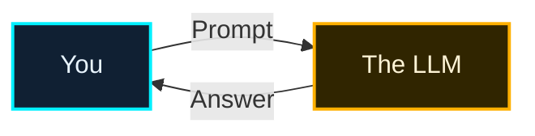
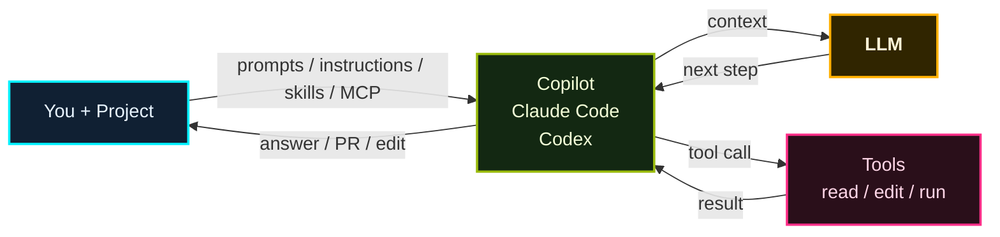
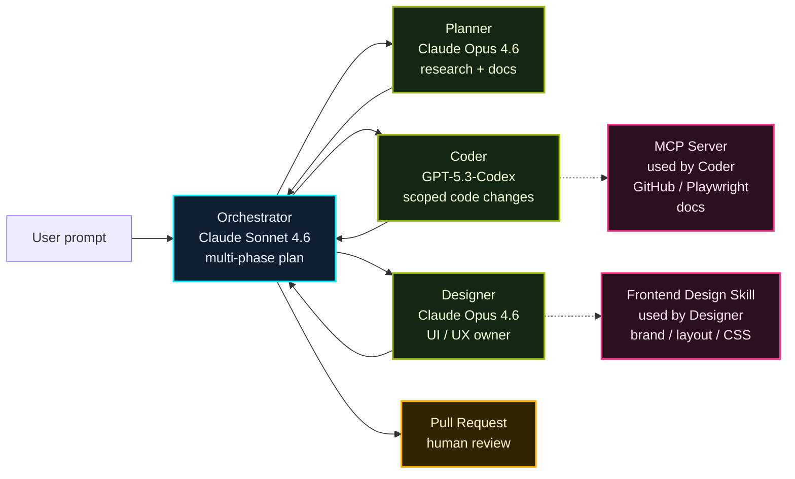

## At a Glance

<div class="hero-quote">
  <p>
    <strong>Harness Engineering</strong> means setting up the environment an AI agent works in.
  </p>
  <p>
    Define its goals and roles, provide context and tools, set guardrails, and check its results.
  </p>
</div>

## The Good Old Days

Old-school LLM chat was simple. You threw a prompt at the LLM, and the LLM returned an answer.



> In that world, context was almost entirely **assembled by hand inside the prompt**.

## Current

Today, an **agent / harness** with project context and tools stands in front of the LLM.



The agent manages **what to read, which tools to use, and how to return the result**.

## Under the Hood: Agent / Harness (Simplified) <input type="checkbox" id="code-harness-loop" class="demo-toggle" /><label class="h2-demo h2-info" for="code-harness-loop">&lt;/&gt; CODE</label>

<div class="demo-panel is-info">
<label class="demo-scrim" for="code-harness-loop" aria-label="Close code example"></label>
<div class="demo-window" role="group" aria-label="Simplified agent loop">
<div class="demo-head"><span class="demo-tag">CODE</span><span class="demo-name">Simplified agent loop</span><label class="demo-close" for="code-harness-loop" aria-label="Close">&#10005;</label></div>
<div class="info-body">
<p>Python-style pseudocode showing context setup and the execution loop.</p>

```python
# Setup
system_prompt = "You are a helpful coding assistant..."
available_tools = [search_web, read_file, edit_file, run_terminal]

# Agent loop
user_task = input("How can I help you?")
context = [system_prompt, available_tools, user_task]

while True:
    next_step = await llm.determine_next_step(context)
    context.append(next_step)

    if next_step.intent == "done":
        return next_step.final_answer

    result = await execute_tool(next_step.tool, next_step.args)
    context.append(result)
```

</div>
</div>
</div>

- **Execution loop**: The LLM chooses the next step. The harness runs the tool, adds its result to the context, and repeats until `done`.
- **Context management**: The harness supplies the system prompt, available tools, user task, and previous results with each LLM call.

## What to Harness With?

<div class="ctl-widget ctl-compact">
<div class="ctl-list">
<details class="ctl-item" name="harness-tools">
<summary class="ctl-btn"><span class="ctl-icon" aria-hidden="true">📋</span><span class="ctl-name">Repository-wide instructions</span><span class="ctl-when"><code>copilot-instructions.md</code></span><span class="ctl-toggle" aria-hidden="true"></span></summary>
<div class="ctl-body">
<p class="ctl-row"><span class="ctl-k">Location</span><span class="ctl-v"><code>.github/copilot-instructions.md</code></span></p>
<p class="ctl-row"><span class="ctl-k">Use</span><span class="ctl-v">Repository-wide custom instructions define conventions, guardrails, and verification commands.</span></p>
</div>
</details>
<details class="ctl-item" name="harness-tools">
<summary class="ctl-btn"><span class="ctl-icon" aria-hidden="true">📂</span><span class="ctl-name">Path-specific instructions</span><span class="ctl-when"><code>*.instructions.md</code></span><span class="ctl-toggle" aria-hidden="true"></span></summary>
<div class="ctl-body">
<p class="ctl-row"><span class="ctl-k">Location</span><span class="ctl-v"><code>.github/instructions/*.instructions.md</code> + <code>applyTo</code></span></p>
<p class="ctl-row"><span class="ctl-k">Use</span><span class="ctl-v">Path-specific custom instructions set rules for areas such as <code>tests/**</code> or <code>api/**</code>. VS Code also calls these file-based instructions.</span></p>
</div>
</details>
<details class="ctl-item" name="harness-tools">
<summary class="ctl-btn"><span class="ctl-icon" aria-hidden="true">🧩</span><span class="ctl-name">Agent skills</span><span class="ctl-when"><code>SKILL.md</code></span><span class="ctl-toggle" aria-hidden="true"></span></summary>
<div class="ctl-body">
<p class="ctl-row"><span class="ctl-k">Location</span><span class="ctl-v"><code>.github/skills/*/SKILL.md</code> or <code>~/.copilot/skills/</code></span></p>
<p class="ctl-row"><span class="ctl-k">Use</span><span class="ctl-v">Load specialized procedures when needed, such as writing PR descriptions or designing a frontend.</span></p>
</div>
</details>
<details class="ctl-item" name="harness-tools">
<summary class="ctl-btn"><span class="ctl-icon" aria-hidden="true">🤖</span><span class="ctl-name">Custom agents</span><span class="ctl-when"><code>*.agent.md</code></span><span class="ctl-toggle" aria-hidden="true"></span></summary>
<div class="ctl-body">
<p class="ctl-row"><span class="ctl-k">Location</span><span class="ctl-v"><code>.github/agents/*.agent.md</code> or <code>~/.copilot/agents/</code></span></p>
<p class="ctl-row"><span class="ctl-k">Use</span><span class="ctl-v">Switch roles, models, and available tools for the task.</span></p>
</div>
</details>
<details class="ctl-item" name="harness-tools">
<summary class="ctl-btn"><span class="ctl-icon" aria-hidden="true">🪝</span><span class="ctl-name">Hooks</span><span class="ctl-when"><code>*.json</code></span><span class="ctl-toggle" aria-hidden="true"></span></summary>
<div class="ctl-body">
<p class="ctl-row"><span class="ctl-k">Location</span><span class="ctl-v"><code>.github/hooks/*.json</code></span></p>
<p class="ctl-row"><span class="ctl-k">Use</span><span class="ctl-v">Run scripts before or after tool execution to deny an action, log it, or send a notification.</span></p>
</div>
</details>
<details class="ctl-item" name="harness-tools">
<summary class="ctl-btn"><span class="ctl-icon" aria-hidden="true">🔌</span><span class="ctl-name">MCP servers</span><span class="ctl-when">MCP config</span><span class="ctl-toggle" aria-hidden="true"></span></summary>
<div class="ctl-body">
<p class="ctl-row"><span class="ctl-k">Location</span><span class="ctl-v">Your agent's MCP configuration file.</span></p>
<p class="ctl-row"><span class="ctl-k">Use</span><span class="ctl-v">Connect to tools and services such as GitHub, Figma, Playwright, Jira, and Salesforce.</span></p>
</div>
</details>
<details class="ctl-item" name="harness-tools">
<summary class="ctl-btn"><span class="ctl-icon" aria-hidden="true">🔐</span><span class="ctl-name">Tool permissions</span><span class="ctl-when">Host settings</span><span class="ctl-toggle" aria-hidden="true"></span></summary>
<div class="ctl-body">
<p class="ctl-row"><span class="ctl-k">Location</span><span class="ctl-v">Your agent host's permission settings.</span></p>
<p class="ctl-row"><span class="ctl-k">Use</span><span class="ctl-v">Control whether the agent can read and search, edit files, or run commands.</span></p>
</div>
</details>
</div>
</div>

## Ecosystem Comparison

The same "AI scaffold" concept exists across ecosystems, but file locations and names differ slightly.

| Layer | GitHub / Copilot | Open Ecosystem |
| --- | --- | --- |
| Global instructions | `.github/copilot-instructions.md` | `AGENTS.md` |
| Path-specific rules | `.github/instructions/*.instructions.md` | nested `AGENTS.md` |
| Skills (project) | `.github/skills/*/SKILL.md` | `.agents/skills/*/SKILL.md` |
| Skills (personal) | `~/.copilot/skills/` | `~/.agents/skills/` |
| Custom agents | Copilot custom agents | agent definitions / plugins |
| MCP / tools | `mcp.config` | `mcp.config` |

> Copilot's strength is native support for the formats of major vendors. In the CLI, type `/help` to see available formats and commands.

## Common Concepts

A good harness is not just a collection of tools — it defines **how AI should proceed without getting lost**.

| Pattern | What does it do? | What improves? |
| --- | --- | --- |
| Spec-to-code / Spec-driven | Write the **what / why** as a spec first, then break it into plan → tasks → implement | The spec becomes the source of truth — predictable implementation instead of vibe coding |
| Multi-phase coding plan | The orchestrator decomposes implementation into multiple phases, each with a clear purpose, order, and completion criteria | Even large changes proceed step by step, without AI rushing ahead all at once |
| File assignment | The Planner explicitly lists files to touch; the orchestrator checks for file overlap before parallelizing | Multiple agents don't overwrite each other; Coder / Designer can run in parallel safely |
| Prompt engineering | When writing a Skill / Agent, clearly specify **role · objective · deliverable** | Keeps the agent consistent on who it is, what to achieve, and what to output |
| Context engineering | Deliver only the context needed for the task, structured appropriately | Avoids distraction from noise; answers stay aligned with the codebase, spec, and constraints |
| Approval gates | Humans review at key checkpoints — spec / plan / PR / release | Preserves automation speed while letting humans stop only the dangerous decisions |

> Designing **spec · phase · file ownership · role/objective/deliverable · context · approval** upfront makes AI not just faster, but produces fewer reworks too.

## Example: Ultralight

[Ultralight](https://burkeholland.github.io/ultralight/) is a multi-agent orchestration example by Burke Holland, Developer Advocate at Microsoft.  
It creates a multi-phase execution plan, detects file overlaps, and acts as a harness that distributes work in parallel to Planner / Coder / Designer.



> 🚀 I made a Codespace-ready template repo so you can try it in a few clicks: [theomonfort/ultralight-template](https://github.com/theomonfort/ultralight-template)

## Harness for coding this website

This playbook site is built with the same kind of harness. The Orchestrator (Theo) ties everything together with instruction files and prompts, then switches between CLI built-in agents, custom agents, skills, and MCP per phase.

<div class="harness-map">
  <svg viewBox="0 0 940 566" role="img" aria-label="Diagram of the harness that builds this site" xmlns="http://www.w3.org/2000/svg">
    <defs>
      <marker id="hm-arrow" viewBox="0 0 10 10" refX="9" refY="5" markerWidth="7" markerHeight="7" orient="auto-start-reverse">
        <path d="M0,0 L10,5 L0,10 z" fill="#9bbc0f"/>
      </marker>
    </defs>
    <path d="M310,290 H340 V175 H374" fill="none" stroke="#9bbc0f" stroke-width="2.5" marker-end="url(#hm-arrow)"/>
    <path d="M310,290 H374" fill="none" stroke="#9bbc0f" stroke-width="2.5" marker-end="url(#hm-arrow)"/>
    <path d="M499,140 V98" fill="none" stroke="#9bbc0f" stroke-width="2.5" marker-end="url(#hm-arrow)"/>
    <path d="M499,325 V367" fill="none" stroke="#9bbc0f" stroke-width="2.5" marker-end="url(#hm-arrow)"/>
    <path d="M374,303 H356 V520 H374" fill="none" stroke="#9bbc0f" stroke-width="2.5" marker-end="url(#hm-arrow)"/>
    <path d="M624,175 H652 V80 H688" fill="none" stroke="#9bbc0f" stroke-width="2.5" marker-end="url(#hm-arrow)"/>
    <path d="M624,290 H652 V195 H688" fill="none" stroke="#9bbc0f" stroke-width="2.5" marker-end="url(#hm-arrow)"/>
    <path d="M624,290 H688" fill="none" stroke="#9bbc0f" stroke-width="2.5" marker-end="url(#hm-arrow)"/>
    <path d="M624,290 H678 V390 H688" fill="none" stroke="#9bbc0f" stroke-width="2.5" marker-end="url(#hm-arrow)"/>
    <path d="M624,405 H668 V505 H688" fill="none" stroke="#9bbc0f" stroke-width="2.5" marker-end="url(#hm-arrow)"/>
    <rect x="24" y="249" width="290" height="90" rx="2" fill="#05060f"/>
    <rect x="20" y="245" width="290" height="90" rx="2" fill="#0a0e1f" stroke="#00f0ff" stroke-width="2"/>
    <text x="165" y="284" text-anchor="middle" font-family="'DotGothic16', monospace" font-size="19" font-weight="700" fill="#00f0ff">Orchestrator：Theo</text>
    <text x="165" y="306" text-anchor="middle" font-family="'DotGothic16', monospace" font-size="13" fill="#aeb6c2">+ instructions / prompts</text>
    <rect x="378" y="29" width="250" height="70" rx="2" fill="#05060f"/>
    <rect x="374" y="25" width="250" height="70" rx="2" fill="#0a0e1f" stroke="#8b949e" stroke-width="2"/>
    <text x="499" y="54" text-anchor="middle" font-family="'DotGothic16', monospace" font-size="19" font-weight="700" fill="#d0d7de">Explore / Research</text>
    <text x="499" y="76" text-anchor="middle" font-family="'DotGothic16', monospace" font-size="13" fill="#aeb6c2">CLI Built-in Agents</text>
    <rect x="378" y="144" width="250" height="70" rx="2" fill="#05060f"/>
    <rect x="374" y="140" width="250" height="70" rx="2" fill="#0a0e1f" stroke="#00f0ff" stroke-width="2"/>
    <text x="499" y="169" text-anchor="middle" font-family="'DotGothic16', monospace" font-size="19" font-weight="700" fill="#00f0ff">planner</text>
    <text x="499" y="191" text-anchor="middle" font-family="'DotGothic16', monospace" font-size="13" fill="#aeb6c2">Custom agent</text>
    <text x="616" y="201" text-anchor="end" font-family="'DotGothic16', monospace" font-size="11.5" letter-spacing="1" fill="#9bbc0f">LOCAL</text>
    <text x="382" y="201" text-anchor="start" font-family="'DotGothic16', monospace" font-size="11.5" letter-spacing="0.5" fill="#ffb000">Opus 4.8</text>
    <rect x="378" y="259" width="250" height="70" rx="2" fill="#05060f"/>
    <rect x="374" y="255" width="250" height="70" rx="2" fill="#0a0e1f" stroke="#8b949e" stroke-width="2"/>
    <text x="499" y="284" text-anchor="middle" font-family="'DotGothic16', monospace" font-size="19" font-weight="700" fill="#d0d7de">Coding</text>
    <text x="499" y="306" text-anchor="middle" font-family="'DotGothic16', monospace" font-size="13" fill="#aeb6c2">CLI Built-in Agents</text>
    <text x="382" y="316" text-anchor="start" font-family="'DotGothic16', monospace" font-size="11.5" letter-spacing="0.5" fill="#ffb000">Opus 4.8</text>
    <rect x="378" y="374" width="250" height="70" rx="2" fill="#05060f"/>
    <rect x="374" y="370" width="250" height="70" rx="2" fill="#0a0e1f" stroke="#00f0ff" stroke-width="2"/>
    <text x="499" y="399" text-anchor="middle" font-family="'DotGothic16', monospace" font-size="19" font-weight="700" fill="#00f0ff">Tester</text>
    <text x="499" y="421" text-anchor="middle" font-family="'DotGothic16', monospace" font-size="13" fill="#aeb6c2">Custom agent</text>
    <text x="616" y="431" text-anchor="end" font-family="'DotGothic16', monospace" font-size="11.5" letter-spacing="1" fill="#9bbc0f">LOCAL</text>
    <text x="382" y="431" text-anchor="start" font-family="'DotGothic16', monospace" font-size="11.5" letter-spacing="0.5" fill="#ffb000">GPT-5.5</text>
    <rect x="378" y="489" width="250" height="70" rx="2" fill="#05060f"/>
    <rect x="374" y="485" width="250" height="70" rx="2" fill="#0a0e1f" stroke="#8b949e" stroke-width="2"/>
    <text x="499" y="514" text-anchor="middle" font-family="'DotGothic16', monospace" font-size="19" font-weight="700" fill="#d0d7de">Review</text>
    <text x="499" y="536" text-anchor="middle" font-family="'DotGothic16', monospace" font-size="13" fill="#aeb6c2">CLI Built-in · Rubber Duck</text>
    <text x="382" y="546" text-anchor="start" font-family="'DotGothic16', monospace" font-size="11.5" letter-spacing="0.5" fill="#ffb000">GPT family</text>
    <rect x="692" y="51" width="240" height="66" rx="2" fill="#05060f"/>
    <rect x="688" y="47" width="240" height="66" rx="2" fill="#0a0e1f" stroke="#ff2e88" stroke-width="2"/>
    <text x="808" y="74" text-anchor="middle" font-family="'DotGothic16', monospace" font-size="19" font-weight="700" fill="#ff2e88">Grill-me</text>
    <text x="808" y="96" text-anchor="middle" font-family="'DotGothic16', monospace" font-size="13" fill="#aeb6c2">Skill</text>
    <text x="920" y="104" text-anchor="end" font-family="'DotGothic16', monospace" font-size="11.5" letter-spacing="1" fill="#9bbc0f">LOCAL</text>
    <rect x="692" y="166" width="240" height="66" rx="2" fill="#05060f"/>
    <rect x="688" y="162" width="240" height="66" rx="2" fill="#0a0e1f" stroke="#9bbc0f" stroke-width="2"/>
    <text x="808" y="189" text-anchor="middle" font-family="'DotGothic16', monospace" font-size="19" font-weight="700" fill="#9bbc0f">MCP Context7</text>
    <text x="808" y="211" text-anchor="middle" font-family="'DotGothic16', monospace" font-size="13" fill="#aeb6c2">MCP server</text>
    <text x="920" y="219" text-anchor="end" font-family="'DotGothic16', monospace" font-size="11.5" letter-spacing="1" fill="#9bbc0f">LOCAL</text>
    <rect x="692" y="261" width="240" height="66" rx="2" fill="#05060f"/>
    <rect x="688" y="257" width="240" height="66" rx="2" fill="#0a0e1f" stroke="#ff2e88" stroke-width="2"/>
    <text x="808" y="284" text-anchor="middle" font-family="'DotGothic16', monospace" font-size="19" font-weight="700" fill="#ff2e88">Slide Creator</text>
    <text x="808" y="306" text-anchor="middle" font-family="'DotGothic16', monospace" font-size="13" fill="#aeb6c2">Skill</text>
    <text x="920" y="314" text-anchor="end" font-family="'DotGothic16', monospace" font-size="11.5" letter-spacing="1" fill="#ffb000">REPO</text>
    <rect x="692" y="361" width="240" height="66" rx="2" fill="#05060f"/>
    <rect x="688" y="357" width="240" height="66" rx="2" fill="#0a0e1f" stroke="#ff2e88" stroke-width="2"/>
    <text x="808" y="384" text-anchor="middle" font-family="'DotGothic16', monospace" font-size="19" font-weight="700" fill="#ff2e88">Prototyper</text>
    <text x="808" y="406" text-anchor="middle" font-family="'DotGothic16', monospace" font-size="13" fill="#aeb6c2">Skill</text>
    <text x="920" y="414" text-anchor="end" font-family="'DotGothic16', monospace" font-size="11.5" letter-spacing="1" fill="#ffb000">REPO</text>
    <rect x="692" y="476" width="240" height="66" rx="2" fill="#05060f"/>
    <rect x="688" y="472" width="240" height="66" rx="2" fill="#0a0e1f" stroke="#9bbc0f" stroke-width="2"/>
    <text x="808" y="499" text-anchor="middle" font-family="'DotGothic16', monospace" font-size="19" font-weight="700" fill="#9bbc0f">MCP Playwright</text>
    <text x="808" y="521" text-anchor="middle" font-family="'DotGothic16', monospace" font-size="13" fill="#aeb6c2">MCP server</text>
    <text x="920" y="529" text-anchor="end" font-family="'DotGothic16', monospace" font-size="11.5" letter-spacing="1" fill="#9bbc0f">LOCAL</text>
  </svg>
</div>

> 🟦 Orchestrator / Custom agent · ⬜ CLI Built-in · 🟩 MCP · 🟥 Skill. `Local` = configured on my machine, `Repo` = checked into this repository.
