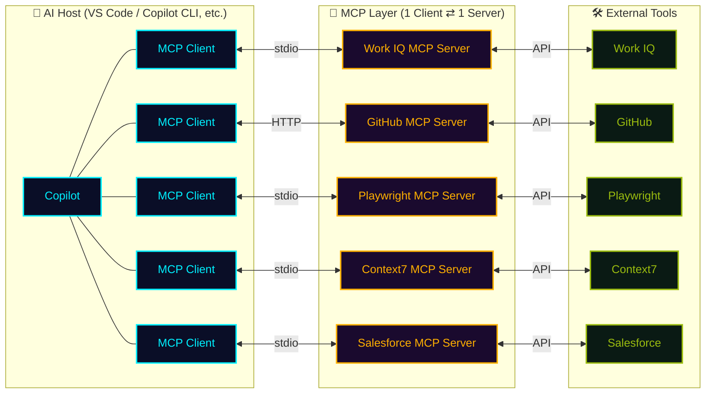

## In a nutshell

<div class="hero-quote">

MCP stands for "Model Context Protocol" — a protocol for providing additional context and capabilities to AI models.

</div>

## How it works



## Why does it matter?

Three values MCP brings:

- **🧩 Extensibility**: Make Copilot a **single entry point** for operating any external tool.
  - Read and write requirements (**Jira**)
  - Create designs (**Figma**)
  - Generate and print 3D designs (**Blender** + 3D printer)
  - Check and edit email and calendar (**Work IQ**)
  - Connect to internal databases for analysis
- **🔗 Workflow integration**: No more custom glue code between individual tools — Copilot acts as a **hub spanning multiple systems**.
- **🌐 Broad ecosystem support**: MCP is an **open protocol** that is rapidly becoming the **de facto standard**. AI assistants, development tools like **Visual Studio**, and many other applications already support MCP — **build once, connect anywhere**. Perfectly suited for coding integrations.

## Where does it run?

<div class="split-image">
  <div class="split-text">

There are **two ways** to run an MCP server.

1. With the **stdio method**, VS Code launches the MCP server as a **child process on your local machine**.
2. With the **HTTP method (SSE / streamable-http)**, the MCP server runs **in the cloud or on a remote server**, and VS Code simply **connects as a client**.

Choose based on your use case and security requirements.

  </div>
  <div class="split-figure">
    
    <figcaption>In Activity Monitor, you can see local MCP servers running as <strong>child processes</strong> of <code>npm exec</code></figcaption>
  </div>
</div>

## Configuration in VS Code <a class="h2-doc" href="https://code.visualstudio.com/docs/agent-customization/mcp-servers" target="_blank" rel="noopener noreferrer">📖 Docs</a>

For the **Copilot harness**, open **Customizations → MCP Servers**.

**Workspace +** (not User) → **HTTP** → server URL and ID. Review any trust or sign-in prompts.

<div class="setup-cards">
  <div class="setup-card">
    <div class="setup-card-head">
      <code>.mcp.json</code>
      <span class="setup-card-tag tag-cyan">▸ Shared with repo</span>
    </div>
    <p><strong>Workspace</strong>: save at the repo root, with a top-level <code>mcpServers</code> object. Share via Git, never include credentials.</p>
  </div>
  <div class="setup-card">
    <div class="setup-card-head">
      <code>User</code>
      <span class="setup-card-tag tag-magenta">▸ Your machine only</span>
    </div>
    <p><strong>Global → Copilot Global</strong>: personal setup across workspaces, normally in <code>~/.copilot/mcp-config.json</code>. Not committed to the project.</p>
  </div>
</div>

> ⚠️ Root-file destination: enable **`chat.mcp.workspaceRootConfig.enabled`** (Experimental). Local compatibility: `.vscode/mcp.json` uses `servers` (labeled deprecated in the guided flow).

## Getting started with Copilot CLI <a class="h2-doc" href="https://docs.github.com/en/copilot/reference/copilot-cli-reference/cli-command-reference#mcp-server-configuration" target="_blank" rel="noopener noreferrer">📖 Docs</a>

The CLI also reads workspace-root **`.mcp.json`** with a top-level **`mcpServers`** object after you trust the folder. Migrating from `.vscode/mcp.json` requires changing `servers` to `mcpServers`, not just renaming the file.

```bash
# Add an MCP server
copilot mcp add <server-name>

# List existing servers
copilot mcp list
```

The GitHub official MCP server is connected out of the box. AI can operate Issues, PRs, Actions, and Code search just like running `gh` commands.

## <span class="mcp-connectors-title">Copilot connectors</span> <span class="mcp-connectors-links"><a class="h2-doc" href="https://docs.github.com/en/copilot/concepts/customizations/copilot-connectors" target="_blank" rel="noopener noreferrer">📖 Docs</a><a class="mcp-connectors-explore" href="https://github.com/copilot/customize" target="_blank" rel="noopener noreferrer">Explore connectors ↗</a></span>

<div class="mcp-connectors">
<style>
.prose-akq .mcp-connectors{font:clamp(16px,1.3vw,20px)/1.35 var(--font-prose),sans-serif;color:#e8f4ff}
.prose-akq .mcp-connectors p{margin:0}
.prose-akq .mcp-connectors .mcp-connectors-status{padding:2px 6px;border:1px solid #ffb000;color:#ffb000;font-size:14px}
.prose-akq .mcp-connectors .mcp-connectors-lead{margin-bottom:10px;font-size:1.1em}
.prose-akq .mcp-connectors .mcp-connectors-compare{margin:0;table-layout:fixed;font-size:1em}
.prose-akq .mcp-connectors .mcp-connectors-compare th{font-size:1em;letter-spacing:0}
.prose-akq .mcp-connectors-compare th:first-child{width:17%}
.prose-akq .mcp-connectors-compare th:nth-child(2){width:40%}
.prose-akq .mcp-connectors-compare :is(th,td):last-child{background:#9bbc0f12}
.prose-akq .mcp-connectors-find{margin-top:10px}
.prose-akq .mcp-connectors-find-head{display:flex;flex-wrap:wrap;align-items:center;justify-content:space-between;gap:8px;margin-bottom:4px}
.prose-akq .mcp-connectors .mcp-connectors-find h3{margin:0;font-size:1em;line-height:1.3;color:#9bbc0f}
.prose-akq .mcp-connectors-locations{display:grid;grid-template-columns:repeat(4,minmax(0,1fr));gap:12px;margin:0}
.prose-akq .mcp-connectors-locations > div{padding-top:6px;border-top:1px solid #e8f4ff22}
.prose-akq .mcp-connectors-locations dt{margin-bottom:4px;font-weight:600;font-size:14px}
.prose-akq .mcp-connectors-locations dd{margin:0;color:#a8bed2}
.prose-akq > h2:has(.mcp-connectors-title){display:flex;flex-wrap:wrap;align-items:center;gap:8px 14px}
.prose-akq .mcp-connectors-links{display:inline-flex;flex-wrap:wrap;align-items:center;gap:6px}
.prose-akq h2 .mcp-connectors-links .h2-doc{margin:0;font-size:14px}
.prose-akq h2 .mcp-connectors-explore{display:inline-flex;padding:.2em .5em;border:1px solid #9bbc0f88;color:#9bbc0f;font-size:14px;font-weight:400;line-height:1.4;letter-spacing:0;text-decoration:none;white-space:nowrap}
.prose-akq h2 .mcp-connectors-explore:hover,.prose-akq h2 .mcp-connectors-explore:focus-visible{border-color:#9bbc0f;text-decoration:underline}
.prose-akq h2 .mcp-connectors-explore:focus-visible{outline:2px solid #9bbc0f;outline-offset:2px}
body.present-mode .playbook-detail:has(.mcp-connectors.akq-slide-active){padding-top:88px;padding-bottom:72px}
body.present-mode .prose-akq > h2:has(.mcp-connectors-title){margin:0 0 12px;font-size:clamp(28px,2.2vw,36px);line-height:1.2;letter-spacing:0}
body.present-mode .prose-akq > h2:has(.mcp-connectors-title)::before{top:.35em}
@media(max-height:720px){body.present-mode .mcp-connectors .mcp-connectors-compare :is(th,td){padding-top:.25em;padding-bottom:.25em}}
@media(max-width:767px){body.present-mode .playbook-detail:has(.mcp-connectors.akq-slide-active){padding-left:20px;padding-right:20px}}
@media(max-width:520px){.prose-akq .mcp-connectors-locations{grid-template-columns:1fr}.prose-akq .mcp-connectors-compare th:first-child{width:20%}.prose-akq .mcp-connectors-compare th:nth-child(2){width:38%}}
</style>
<p class="mcp-connectors-lead"><b>MCP is the standard.</b> Connectors use MCP, with GitHub-managed setup and authentication: a ready-to-use integration.</p>
<table class="compact-table mcp-connectors-compare">
<thead><tr><th scope="col">Aspect</th><th scope="col">Manual MCP server</th><th scope="col">Copilot connector</th></tr></thead>
<tbody>
<tr><th scope="row">What it is</th><td>Tools/context via MCP</td><td>GitHub-verified MCP integration</td></tr>
<tr><th scope="row">Setup</th><td>Configure server and authentication yourself</td><td>Select service, sign in once, approve access</td></tr>
<tr><th scope="row">Availability</th><td>Where you configure it</td><td>Reuse across supported surfaces (excluding GitHub Actions sessions).</td></tr>
<tr><th scope="row">Choice</th><td>Custom / third-party</td><td>GitHub's supported catalog</td></tr>
</tbody>
</table>
<div class="mcp-connectors-find">
<div class="mcp-connectors-find-head"><h3>Where to find them</h3><span class="mcp-connectors-status">Public preview</span></div>
<dl class="mcp-connectors-locations">
<div><dt>Web / cloud</dt><dd><a class="retro-link" href="https://github.com/copilot/customize" target="_blank" rel="noopener noreferrer">Customization page ↗</a></dd></div>
<div><dt>Copilot app</dt><dd>Customize → MCP → GitHub verified</dd></div>
<div><dt>CLI</dt><dd><code>/mcp</code> → Connectors</dd></div>
<div><dt>VS Code</dt><dd>Agents window → Customizations</dd></div>
</dl>
</div>
</div>
