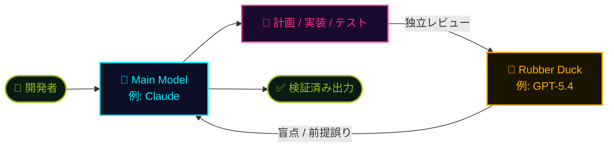

## 一言で

  

    <strong>Copilot CLI</strong> は、ターミナルの中にいる Copilot。
  

  

    基本は VS Code の Copilot と同じように、質問・計画・編集・実行を手伝う。ただし CLI ならではの機能と Harness があるので、ここから一緒に見ていく。
  

## 主要機能

ターミナル一枚に、フルスタックの AI 環境が乗る。

- **複数ファイルの文脈把握**：リポジトリ全体を一つのワークスペースとして扱う。
- **コード生成・編集**：ターミナルから修正し、差分を確認して承認できる。
- **コマンド実行**：ビルド・テスト・lint などを実行し、結果を読んで次に進む。
- **IDE を選ばない**：VS Code、Vim、SSH 先など、ターミナルがあれば使える。
- **Skills / MCP 対応**：必要な能力や外部ツールを追加できる。
- **非対話実行**：CI、cron、script から `copilot -p "..."` で実行できる。

## CLI と VS Code Chat の違い

🖥️UI

Copilot CLIとても軽い。ターミナル中心なので、コマンドを覚える必要があり、エディタ UI は最小限。一方で CLI をすぐ開けるので、folder、PowerPoint、Excel など手元の computer resource に対して作業しやすい。

VS Code Chat画面上で選択肢・設定・ファイル移動・inline diff・debugger を扱いやすい。

🧪新機能の速さ

Copilot CLI<code>/limits</code>、<code>/fleet</code>、<code>/share</code>、Rubber Duck など、新しい実験が入りやすい。

VS Code Chatより安定志向。CLI で育った良いアイデアを取り込んでいくことが多い。

🤖Sub-agent

Copilot CLIExplore、Task、Rubber Duck、Code Review など、built-in agent を多く持ち、native に起動できる。

VS Code Chat現時点では限定的だが、少しずつ追いついている。

🧭Session management

Copilot CLI<code>/context</code>、<code>/compact</code>、<code>/session</code> などで、session を細かく制御しやすい。

VS Code Chat改善中だが、今は CLI ほど細かくはない。

🔀Partner agent

Copilot CLICopilot CLI は Copilot の Harness 内で動く。Codex / Claude の Harness は使えず、使えるのはそれらの <strong>model</strong>。

VS Code ChatVS Code 内では、Copilot、Codex、Claude などの agent / extension を切り替えやすい。

🔎コード検索

CLI / appローカルのテキスト検索と、GitHub 上でインデックス済みのリポジトリのセマンティック検索。<a class="retro-link" href="https://github.com/github/copilot-cli/blob/main/changelog.md" target="_blank" rel="noopener noreferrer">CLI リリースノート ↗</a>

VS Code ChatWorkspace のテキスト検索とセマンティック検索に加え、エディタの文脈やシンボル参照を利用。<a class="retro-link" href="https://code.visualstudio.com/docs/agents/reference/workspace-context" target="_blank" rel="noopener noreferrer">Docs ↗</a>

BlackbirdGitHub 側のコード検索エンジン。エディタ専用のインデックスではない。<a class="retro-link" href="https://github.blog/engineering/architecture-optimization/the-technology-behind-githubs-new-code-search/" target="_blank" rel="noopener noreferrer">仕組み ↗</a>

## 強力なビルトインエージェント <a class="h2-doc" href="https://docs.github.com/en/copilot/concepts/agents/copilot-cli/about-custom-agents#built-in-agents" target="_blank" rel="noopener noreferrer">📖 Docs</a> <input type="checkbox" id="demo-cli-agent-definitions" class="demo-toggle" /><label class="h2-demo" for="demo-cli-agent-definitions">&#9658; DEMO</label>

<label class="demo-scrim" for="demo-cli-agent-definitions" aria-label="デモ手順を閉じる"></label>

DEMOAgent definitions発表者専用<label class="demo-close" for="demo-cli-agent-definitions" aria-label="閉じる">&#10005;</label>

<ol class="demo-steps">
<li>

インストール済みのバージョンを確認

<code class="demo-cmd">copilot --version</code>

表示された CLI のバージョンを控える。

</li>
<li>

定義フォルダーを開く

ローカルの CLI インストール先で <code class="demo-path">definitions/</code> を探す。Apple silicon 搭載 Mac の例：

<code class="demo-path">~/.copilot/pkg/darwin-arm64/&lt;version&gt;/definitions/</code>

<code class="demo-path">&lt;version&gt;</code> をインストール済みのバージョンに置き換える。場所は OS やインストール方法によって異なる。

</li>
<li>

エージェントの定義を読む

<code class="demo-path">explore.agent.yaml</code> などの <code class="demo-path">*.agent.yaml</code> をエディタで開く。

インストール済みファイルは変更せず、ビルトインエージェントの定義を確認する。

</li>
</ol>

Copilot CLI には、よくあるタスク向けのビルトインエージェントがある。**`/subagents`** で確認し、使うモデルを設定できる。

🔎Explore

できることコードをメインの文脈に追加せず、素早くコードベースを分析し、コードについて質問できるようにする。

🛠️Task

できることテストやビルドなどのコマンドを実行し、成功時は短い要約、失敗時は完全な出力を返す。

🧠General purpose

できることすべてのツールと高度な推論が必要な複雑な複数ステップのタスクを、メイン会話とは別の文脈で処理する。

📝Code review

できること本当に重要な問題だけを見つけることに集中してコード変更をレビューし、ノイズを最小化する。

📚Research

できることコードベース、関連リポジトリ、Web を横断して深く調査し、引用付きの詳細レポートを作成する。

🦆Rubber duck

できること複雑なタスクに対して建設的な批評役としてフィードバックを返す。Copilot CLI が自動的に使う。

## Rubber Duck — クロスモデルレビュー

> 🦆 **Experimental**：メインモデルとは **異なるモデルファミリー** が「セカンドオピニオン」として、計画・実装・テストの各段階で独立レビュー。

**なぜ効く？** ── 同じモデルが自分の出力をチェックすると、**同じ前提・同じ盲点** に引っかかる。別ファミリーのモデルなら、訓練データも価値観も違うので **見えていなかったロジックエラー** を拾える。

## その他の便利コマンド

CLI は slash command で、モデル・共有・実験機能・環境情報などをすぐ確認できる。

| コマンド | 使いどころ |
|---|---|
| `/help` | 利用できるコマンドやショートカットを確認する。 |
| `/model` | 使用するモデルを確認・切り替える。 |
| `/ide` | VS Code などの IDE と接続する。 |
| `/share` | 現在のセッションを共有する。 |
| `/experimental` | 実験的な機能を確認・有効化する。 |
| `/chronicle` | セッションの流れや作業履歴を確認する。 |
| `/task` | background で動いている agent や task を確認する。 |
| `/fleet [PROMPT]` | 計画をサブタスクに分け、subagent で並列実行する。<a class="retro-link" href="https://docs.github.com/en/copilot/concepts/agents/copilot-cli/fleet" target="_blank" rel="noopener noreferrer">Docs ↗</a> |
| `/limits set max-ai-credits N` | セッションの AI Credits 上限(soft cap)を設定する。<a class="retro-link" href="https://docs.github.com/en/copilot/how-tos/copilot-cli/use-copilot-cli/set-session-limit" target="_blank" rel="noopener noreferrer">Docs ↗</a> |
| `/ask` | 作業を進める前に、質問として Copilot に相談する。 |
| `/env` | CLI が見ている環境情報を確認する。 |

> 💰 **エージェントは予算を把握している**：使用量・残量・上限が `<session_limits_status>` としてモデルに渡るので、寄り道を控え、最後の 1 回はツールを使わず進捗と残作業をまとめて止まる。`/fleet` の subagent も同じ上限を共有する。非対話では `--max-ai-credits N`。

## 🖥️ TUI(ターミナル UI)

`/experimental on` で、再設計されたターミナル UI を試せる。テーマ対応のセマンティックカラーを備え、`/theme` で確認できる。GitHub リポジトリ内では `Tab` キーで下の表のメニューを行き来できる。

| タブ | 中身 |
|---|---|
| **Session** | 通常の対話セッション(デフォルト) |
| **Issues** | リポジトリの Issue を一覧・閲覧 |
| **Pull requests** | PR を一覧・閲覧 |
| **Gists** | 自分の Gist を一覧・閲覧 |

> 📝 スクリーンリーダー対応をはじめ、ほかにも多くの UI 改善が入っている。詳しくは <a class="retro-link" href="https://github.blog/changelog/2026-06-02-copilot-cli-improved-ui-rubber-duck-prompt-scheduling-and-voice-input/" target="_blank" rel="noopener noreferrer">changelog ↗</a>。

## 🛡️ Sandbox <a class="h2-doc" href="https://docs.github.com/en/copilot/concepts/security-governance-and-network-settings/about-cloud-and-local-sandboxes" target="_blank" rel="noopener noreferrer">📖 Docs</a>

どちらも **一般提供済み** (2026-11-06 時点)。

| | 🖥️ ローカル Sandbox | ☁️ クラウド Sandbox |
|---|---|---|
| **GA** | 2026-10-07 | 2026-10-28 |
| **起動** | `/sandbox enable` | `copilot --cloud` (対話専用) |
| **実行環境** | macOS / Linux / 対応更新済みの Windows 11 | GitHub ホストの Linux。再開可能 |

ローカルは **デフォルト OFF**。ファイルツールのポリシー適用はベストエフォート、リモート MCP は対象外。クラウドは **Copilot 有料プラン** が必要。

## 非対話モード ★ <a class="h2-doc" href="https://docs.github.com/en/copilot/how-tos/copilot-cli/automate-copilot-cli/run-cli-programmatically" target="_blank" rel="noopener noreferrer">📖 Docs</a>

1 つのプロンプトを実行して終了。**script、cron、バッチファイル、GitHub Actions** から定型作業を自動化。

▶️実行と出力

Run &amp; output

<code>copilot -p 'README.md を要約して' -s</code>  <code>-p</code> / <code>--prompt</code>: 1 ターン実行して終了。 <code>-s</code>: 応答テキストだけを出力。パイプ向け。 <code>--no-ask-user</code>: 確認質問を省略。

🛡️ツールの権限

Permissions

タスクに必要なツールだけ許可する: <code>--allow-tool='shell(npm:*), write'</code>  Sandbox 外で <code>--allow-all</code> は使わない。<code>--no-ask-user</code> はツールの権限を付与しない。

🔑認証

Authentication

優先順: <code>COPILOT_GITHUB_TOKEN</code> → <code>GH_TOKEN</code> → <code>GITHUB_TOKEN</code>  <b>Copilot Requests</b> 権限付きの <b>fine-grained PAT</b> を使用。classic PAT (<code>ghp_</code>) は非対応。

🎯再現性

Repeatability

<code>--model MODEL</code>: モデルを固定。 <code>--share='./session.md'</code>: 会話ログを保存。 <b>YES/NO</b> など出力形式も固定。対話モードで試してから <code>-p</code> で自動化する。

⚙️ユースケース

Use cases

コミットメッセージとリリースノート。 lint 修正とテスト生成。 <code>/review</code> による PR レビューと依存関係の監査。 README、JSDoc、翻訳。

項目を選択 ▸

