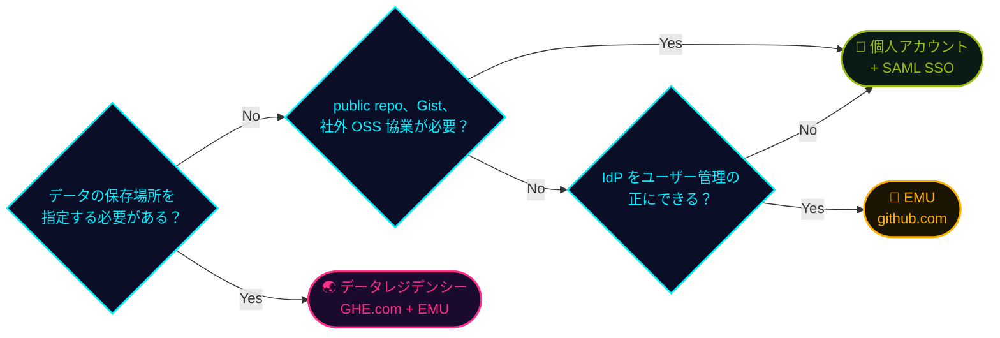

## 一言で

  

    GitHub Enterprise Cloud は <strong>誰がアカウントを管理するか</strong> と <strong>データをどこに置くか</strong> で 3 つの形態に分かれる。
  

  

    <strong>EMU</strong> は会社の IdP からアカウントを払い出す方式。<strong>データレジデンシー</strong> は EMU を前提に、<strong>GHE.com</strong> の専用サブドメインで <strong>日本などの指定リージョン</strong> にコードとデータを保存する方式。自社でホストしたい場合は <strong>GitHub Enterprise Server（GHES）</strong> という選択肢もある。
  

## GitHub Enterprise の 4 つの形態 <a class="h2-doc" href="https://docs.github.com/ja/enterprise-cloud@latest/admin/overview/about-github-for-enterprises" target="_blank" rel="noopener noreferrer">📖 Docs</a>

GHEC は作成時に **アカウントの種類** と **保存先** を選ぶ。**GHES** はオンプレか自社クラウドで運用する GitHub。

| | 個人アカウント | **EMU** | **データレジデンシー** | **GHES** |
| --- | --- | --- | --- | --- |
| 🏠 ホスト | github.com | github.com | `*.ghe.com` | **自社** |
| 👤 アカウント | 各自で作成 | IdP（**SCIM**） | IdP（**SCIM**） | インスタンスで作成 |
| 🔐 認証 | パスワード、SAML 任意 | **SAML / OIDC** | **SAML / OIDC** | LDAP、CAS、SAML |
| 🗾 保存先 | 米国 | 米国 | EU、豪州、米国、**日本** | **自社で選択** |
| 📢 Public repo、Gist | ✅ | ❌ | ❌ | ⚠️ インスタンス内のみ |
| 🤝 社外との協業 | ✅ | ❌ 閲覧のみ | ❌ | ❌ |
| 🔄 アップデート | 自動 | 自動 | 自動 | **管理者が実施** |
| 🤖 Copilot | ✅ | ✅ | ✅ | ⚠️ IDE / CLI のみ |
| ⚙️ ホストランナー | ✅ | ✅ | ⚠️ macOS なし | ❌ セルフホスト |

## GHE.com と GHES で使えない機能 <a class="h2-doc" href="https://docs.github.com/ja/enterprise-cloud@latest/admin/data-residency/feature-overview-for-github-enterprise-cloud-with-data-residency" target="_blank" rel="noopener noreferrer">📖 Docs</a>

GitHub.com の EMU と比べた差分。❌ は使えない、⚠️ は条件付き。

📖 <a class="retro-link" href="https://docs.github.com/ja/enterprise-cloud@latest/admin/data-residency/feature-overview-for-github-enterprise-cloud-with-data-residency" target="_blank" rel="noopener noreferrer">GHE.com の機能の概要 ↗</a>　📖 <a class="retro-link" href="https://docs.github.com/ja/enterprise-server@latest/admin/overview/about-github-enterprise-server" target="_blank" rel="noopener noreferrer">GHES について ↗</a>

▸ + をクリックして詳細を表示

⚙️ActionsmacOS、ホストランナー

🌏 GHE.com❌ <a class="retro-link" href="https://docs.github.com/ja/enterprise-cloud@latest/actions/concepts/runners/github-hosted-runners" target="_blank" rel="noopener noreferrer">macOS ランナー ↗</a> ❌ <a class="retro-link" href="https://docs.github.com/ja/enterprise-cloud@latest/admin/data-residency/feature-overview-for-github-enterprise-cloud-with-data-residency" target="_blank" rel="noopener noreferrer">Marketplace ↗</a>（Action や App はソースから導入）

🏢 GHES❌ <a class="retro-link" href="https://docs.github.com/ja/enterprise-server@latest/actions/concepts/runners/github-hosted-runners" target="_blank" rel="noopener noreferrer">GitHub ホストランナー ↗</a>（セルフホストのみ） ⚠️ <a class="retro-link" href="https://docs.github.com/ja/enterprise-server@latest/admin/managing-github-actions-for-your-enterprise/managing-access-to-actions-from-githubcom/enabling-automatic-access-to-githubcom-actions-using-github-connect" target="_blank" rel="noopener noreferrer">GitHub.com の Action ↗</a> は GitHub Connect で許可

📦PackagesMaven / Gradle

🌏 GHE.com❌ <a class="retro-link" href="https://docs.github.com/ja/enterprise-cloud@latest/packages/working-with-a-github-packages-registry/working-with-the-apache-maven-registry" target="_blank" rel="noopener noreferrer">Maven / Gradle ↗</a>（Java）

🏢 GHES✅ <a class="retro-link" href="https://docs.github.com/ja/enterprise-server@latest/packages/working-with-a-github-packages-registry/working-with-the-apache-maven-registry" target="_blank" rel="noopener noreferrer">Maven / Gradle ↗</a> も対応（Packages は管理者が有効化）

🔗依存関係insights、Dependabot

🌏 GHE.com❌ Org と Enterprise の <a class="retro-link" href="https://docs.github.com/ja/enterprise-cloud@latest/organizations/collaborating-with-groups-in-organizations/viewing-insights-for-dependencies-in-your-organization" target="_blank" rel="noopener noreferrer">dependency insights ↗</a> ❌ <a class="retro-link" href="https://docs.github.com/ja/enterprise-cloud@latest/code-security/how-tos/secure-your-supply-chain/establish-provenance-and-integrity/export-dependencies-as-sbom" target="_blank" rel="noopener noreferrer">SBOM ↗</a> のライセンス情報

🏢 GHES⚠️ <a class="retro-link" href="https://docs.github.com/ja/enterprise-server@latest/admin/configuring-settings/configuring-github-connect/enabling-dependabot-for-your-enterprise" target="_blank" rel="noopener noreferrer">Dependabot ↗</a> は GitHub Connect とセルフホストランナーが前提

🤖Copilotリージョン外、Web 機能

🌏 GHE.com⚠️ <a class="retro-link" href="https://docs.github.com/ja/enterprise-cloud@latest/admin/data-residency/github-copilot-with-data-residency" target="_blank" rel="noopener noreferrer">データは既定でリージョン外 ↗</a>（リージョン内推論は米国と EU のみ）

🏢 GHES❌ <a class="retro-link" href="https://docs.github.com/ja/enterprise-server@latest/copilot/copilot-on-ghes/about-copilot-on-ghes" target="_blank" rel="noopener noreferrer">Web の Chat ↗</a>、<a class="retro-link" href="https://docs.github.com/ja/enterprise-cloud@latest/copilot/concepts/copilot-surfaces/copilot-on-github" target="_blank" rel="noopener noreferrer">クラウドエージェント ↗</a>、<a class="retro-link" href="https://docs.github.com/ja/enterprise-cloud@latest/copilot/concepts/agents/code-review" target="_blank" rel="noopener noreferrer">コードレビュー ↗</a>、<a class="retro-link" href="https://docs.github.com/ja/enterprise-cloud@latest/copilot/concepts/context/spaces" target="_blank" rel="noopener noreferrer">Spaces ↗</a> ⚠️ ライセンスはクラウド側で付与。オフラインの CLI はプレビュー

🛡️セキュリティAI シークレット検出

🌏 GHE.com— 差分なし

🏢 GHES❌ <a class="retro-link" href="https://docs.github.com/ja/enterprise-cloud@latest/code-security/how-tos/secure-your-secrets/detect-secret-leaks/enabling-secret-scanning-for-ai-detected-secrets" target="_blank" rel="noopener noreferrer">AI による汎用シークレット検出 ↗</a>

💻開発環境Codespaces

🌏 GHE.com✅ <a class="retro-link" href="https://docs.github.com/ja/enterprise-cloud@latest/codespaces/developing-in-a-codespace/using-github-codespaces-in-visual-studio-code" target="_blank" rel="noopener noreferrer">Codespaces ↗</a>（VS Code の設定が必要）

🏢 GHES❌ <a class="retro-link" href="https://docs.github.com/ja/enterprise-cloud@latest/codespaces/quickstart" target="_blank" rel="noopener noreferrer">Codespaces ↗</a>

👤ID、その他EMU、Gist、Importer

🌏 GHE.com❌ <a class="retro-link" href="https://docs.github.com/ja/enterprise-cloud@latest/admin/managing-iam/understanding-iam-for-enterprises/abilities-and-restrictions-of-managed-user-accounts" target="_blank" rel="noopener noreferrer">Gist、public repo ↗</a>（EMU の制約） ❌ <a class="retro-link" href="https://docs.github.com/ja/enterprise-cloud@latest/migrations/importing-source-code/using-github-importer/about-github-importer" target="_blank" rel="noopener noreferrer">GitHub Importer ↗</a>、<a class="retro-link" href="https://docs.github.com/ja/enterprise-cloud@latest/admin/monitoring-activity-in-your-enterprise/reviewing-audit-logs-for-your-enterprise/streaming-the-audit-log-for-your-enterprise" target="_blank" rel="noopener noreferrer">S3 への OIDC 監査ログ配信 ↗</a>

🏢 GHES❌ EMU（<a class="retro-link" href="https://docs.github.com/ja/enterprise-server@latest/admin/managing-iam/understanding-iam-for-enterprises/about-identity-and-access-management" target="_blank" rel="noopener noreferrer">ビルトイン、LDAP、CAS、SAML ↗</a> で認証） ❌ <a class="retro-link" href="https://docs.github.com/ja/enterprise-cloud@latest/sponsors/getting-started-with-github-sponsors/about-github-sponsors" target="_blank" rel="noopener noreferrer">GitHub Sponsors ↗</a>

🆕新機能提供タイミング

🌏 GHE.com⚠️ 一部の <a class="retro-link" href="https://docs.github.com/ja/enterprise-cloud@latest/admin/data-residency/feature-overview-for-github-enterprise-cloud-with-data-residency" target="_blank" rel="noopener noreferrer">プレビュー機能 ↗</a> は GA まで未提供

🏢 GHES⚠️ GitHub.com が先行し、<a class="retro-link" href="https://docs.github.com/ja/enterprise-server@latest/admin/overview/about-github-enterprise-server" target="_blank" rel="noopener noreferrer">feature release ↗</a> で後から届く

## 個人アカウントの全体像 <a class="h2-doc" href="https://docs.github.com/ja/enterprise-cloud@latest/admin/concepts/enterprise-fundamentals/choose-an-enterprise-type" target="_blank" rel="noopener noreferrer">📖 Docs</a>

個人アカウントは Enterprise の **外側** にあり、招待されて Organization に参加します。

<svg viewBox="0 0 1000 392" role="img" aria-label="個人アカウントの構成図。github.com の中でユーザーは Enterprise の外側にあり、Enterprise 内の Organization にも社外の Organization にも所属できる。社外 Organization と個人リポジトリは管理者の影響範囲外。" style="width:100%;height:auto;display:block;font-family:inherit;">
<defs>
<marker id="pa-ok" viewBox="0 0 10 10" refX="8" refY="5" markerWidth="7" markerHeight="7" orient="auto-start-reverse"><path d="M0,0 L10,5 L0,10 z" fill="#00f0ff"/></marker>
<marker id="pa-warn" viewBox="0 0 10 10" refX="8" refY="5" markerWidth="7" markerHeight="7" orient="auto-start-reverse"><path d="M0,0 L10,5 L0,10 z" fill="#ffb000"/></marker>
</defs>
<rect x="6" y="26" width="988" height="358" rx="14" fill="rgba(5,6,15,0.55)" stroke="#e8f4ff" stroke-width="2.5"/>
<rect x="400" y="8" width="200" height="38" rx="6" fill="#05060f" stroke="#e8f4ff" stroke-width="2"/>
<text x="500" y="35" text-anchor="middle" font-size="24" fill="#e8f4ff">github.com</text>
<rect x="30" y="78" width="498" height="284" rx="12" fill="rgba(155,188,15,0.07)" stroke="#9bbc0f" stroke-width="3"/>
<rect x="48" y="62" width="150" height="32" rx="6" fill="#05060f" stroke="#9bbc0f" stroke-width="2"/>
<text x="123" y="85" text-anchor="middle" font-size="20" fill="#9bbc0f">Enterprise</text>
<rect x="548" y="78" width="436" height="284" rx="12" fill="rgba(255,176,0,0.05)" stroke="#ffb000" stroke-width="2" stroke-dasharray="8 6"/>
<rect x="748" y="62" width="222" height="32" rx="6" fill="#05060f" stroke="#ffb000" stroke-width="2"/>
<text x="859" y="85" text-anchor="middle" font-size="18" fill="#ffb000">⚠️ 管理者の影響範囲外</text>
<path d="M614 158 V122 H370 V156" stroke="#00f0ff" stroke-width="3" fill="none" marker-end="url(#pa-ok)"/>
<path d="M370 122 H138 V156" stroke="#00f0ff" stroke-width="3" fill="none" marker-end="url(#pa-ok)"/>
<text x="380" y="112" text-anchor="middle" font-size="20" fill="#00f0ff">✅ 所属可能（招待）</text>
<text x="58" y="182" font-size="21" fill="#e8f4ff">📁 Organization</text>
<path d="M78 196 V322 M78 236 H100 M78 322 H100" stroke="#7a8aa8" stroke-width="2" fill="none"/>
<text x="106" y="243" font-size="19" fill="#c9d6ea">🗄️ リポジトリ</text>
<text x="158" y="290" font-size="20" fill="#7a8aa8">⋮</text>
<text x="106" y="329" font-size="19" fill="#c9d6ea">🗄️ リポジトリ</text>
<text x="290" y="182" font-size="21" fill="#e8f4ff">📁 Organization</text>
<path d="M310 196 V322 M310 236 H332 M310 322 H332" stroke="#7a8aa8" stroke-width="2" fill="none"/>
<text x="338" y="243" font-size="19" fill="#c9d6ea">🗄️ リポジトリ</text>
<text x="390" y="290" font-size="20" fill="#7a8aa8">⋮</text>
<text x="338" y="329" font-size="19" fill="#c9d6ea">🗄️ リポジトリ</text>
<text x="572" y="182" font-size="21" fill="#ffb000">👤 ユーザー</text>
<path d="M592 196 V286 M592 236 H614 M592 286 H614" stroke="#7a8aa8" stroke-width="2" fill="none"/>
<text x="620" y="243" font-size="18" fill="#c9d6ea">🌐 public repo</text>
<text x="620" y="293" font-size="18" fill="#c9d6ea">🔒 private repo</text>
<path d="M684 176 H794" stroke="#ffb000" stroke-width="3" fill="none" marker-end="url(#pa-warn)"/>
<text x="739" y="164" text-anchor="middle" font-size="16" fill="#ffb000">所属可能</text>
<text x="800" y="182" font-size="21" fill="#e8f4ff">📁 Organization</text>
<path d="M820 196 V322 M820 236 H842 M820 322 H842" stroke="#7a8aa8" stroke-width="2" fill="none"/>
<text x="848" y="243" font-size="19" fill="#c9d6ea">🗄️ リポジトリ</text>
<text x="900" y="290" font-size="20" fill="#7a8aa8">⋮</text>
<text x="848" y="329" font-size="19" fill="#c9d6ea">🗄️ リポジトリ</text>
</svg>

- ✅ 管理者が制御できるのは Enterprise 内だけ（例: Organization で **public repo** の作成を許可するか）
- ⚠️ **管理者の影響範囲外**: 社外 Organization とそのポリシー、個人 repo（public / private）、Gist、社外 repo への PR や Star

## EMU の全体像 <a class="h2-doc" href="https://docs.github.com/ja/enterprise-cloud@latest/admin/managing-iam/understanding-iam-for-enterprises/abilities-and-restrictions-of-managed-user-accounts" target="_blank" rel="noopener noreferrer">📖 Docs</a>

EMU のユーザーは Enterprise の **内側** に作られます。

<svg viewBox="0 0 1000 392" role="img" aria-label="EMU の構成図。github.com の中に Enterprise があり、マネージドユーザーは Enterprise 内の Organization には所属できるが、Enterprise 外の Organization には所属できない。" style="width:100%;height:auto;display:block;font-family:inherit;">
<defs>
<marker id="emu-ok" viewBox="0 0 10 10" refX="8" refY="5" markerWidth="7" markerHeight="7" orient="auto-start-reverse"><path d="M0,0 L10,5 L0,10 z" fill="#00f0ff"/></marker>
<marker id="emu-ng" viewBox="0 0 10 10" refX="8" refY="5" markerWidth="7" markerHeight="7" orient="auto-start-reverse"><path d="M0,0 L10,5 L0,10 z" fill="#ff2e88"/></marker>
</defs>
<rect x="6" y="26" width="988" height="358" rx="14" fill="rgba(5,6,15,0.55)" stroke="#e8f4ff" stroke-width="2.5"/>
<rect x="400" y="8" width="200" height="38" rx="6" fill="#05060f" stroke="#e8f4ff" stroke-width="2"/>
<text x="500" y="35" text-anchor="middle" font-size="24" fill="#e8f4ff">github.com</text>
<rect x="30" y="78" width="704" height="284" rx="12" fill="rgba(155,188,15,0.07)" stroke="#9bbc0f" stroke-width="3"/>
<rect x="48" y="62" width="150" height="32" rx="6" fill="#05060f" stroke="#9bbc0f" stroke-width="2"/>
<text x="123" y="85" text-anchor="middle" font-size="20" fill="#9bbc0f">Enterprise</text>
<path d="M572 158 V122 H366 V156" stroke="#00f0ff" stroke-width="3" fill="none" marker-end="url(#emu-ok)"/>
<path d="M366 122 H142 V156" stroke="#00f0ff" stroke-width="3" fill="none" marker-end="url(#emu-ok)"/>
<text x="466" y="112" text-anchor="middle" font-size="20" fill="#00f0ff">✅ 所属可能</text>
<text x="62" y="182" font-size="21" fill="#e8f4ff">📁 Organization</text>
<path d="M82 196 V322 M82 236 H104 M82 322 H104" stroke="#7a8aa8" stroke-width="2" fill="none"/>
<text x="110" y="243" font-size="19" fill="#c9d6ea">🗄️ リポジトリ</text>
<text x="162" y="290" font-size="20" fill="#7a8aa8">⋮</text>
<text x="110" y="329" font-size="19" fill="#c9d6ea">🗄️ リポジトリ</text>
<text x="286" y="182" font-size="21" fill="#e8f4ff">📁 Organization</text>
<path d="M306 196 V322 M306 236 H328 M306 322 H328" stroke="#7a8aa8" stroke-width="2" fill="none"/>
<text x="334" y="243" font-size="19" fill="#c9d6ea">🗄️ リポジトリ</text>
<text x="386" y="290" font-size="20" fill="#7a8aa8">⋮</text>
<text x="334" y="329" font-size="19" fill="#c9d6ea">🗄️ リポジトリ</text>
<text x="522" y="182" font-size="21" fill="#ffb000">👤 ユーザー</text>
<path d="M542 196 V236 H562" stroke="#7a8aa8" stroke-width="2" fill="none"/>
<text x="568" y="243" font-size="18" fill="#c9d6ea">🔒 private repo</text>
<path d="M640 176 H762" stroke="#ff2e88" stroke-width="3" stroke-dasharray="7 6" fill="none" marker-end="url(#emu-ng)"/>
<circle cx="734" cy="176" r="15" fill="#05060f" stroke="#ff2e88" stroke-width="2"/>
<text x="734" y="183" text-anchor="middle" font-size="18" fill="#ff2e88">✕</text>
<text x="866" y="120" text-anchor="middle" font-size="19" fill="#ff2e88">❌ Enterprise 外は所属不可</text>
<text x="768" y="182" font-size="21" fill="#e8f4ff">📁 Organization</text>
<path d="M788 196 V322 M788 236 H810 M788 322 H810" stroke="#7a8aa8" stroke-width="2" fill="none"/>
<text x="816" y="243" font-size="19" fill="#c9d6ea">🗄️ リポジトリ</text>
<text x="868" y="290" font-size="20" fill="#7a8aa8">⋮</text>
<text x="816" y="329" font-size="19" fill="#c9d6ea">🗄️ リポジトリ</text>
</svg>

- ✅ Enterprise 内の Organization には所属可能。個人 repo は **private のみ** で、ポリシーで許可または禁止
- 🚫 public repo と Gist は作成不可、社外 Organization には所属不可。github.com の public repo は **閲覧のみ**（PR、Issue、Star 不可）

## EMU と SAML 連携の違い <a class="h2-doc" href="https://docs.github.com/ja/enterprise-cloud@latest/admin/concepts/identity-and-access-management/enterprise-managed-users" target="_blank" rel="noopener noreferrer">📖 Docs</a>

個人アカウントでも SAML SSO は使えます。違いは **アカウントの持ち主** と **ログインの流れ** です。

| | 個人アカウント + SAML | **EMU** |
| --- | --- | --- |
| 🔐 SSO プロトコル | **SAML** のみ | **SAML**、または **OIDC**（Entra ID のみ） |
| 🔗 SSO の設定単位 | Enterprise または Org | **Enterprise のみ** |
| 🔄 SCIM | 任意。Org へのアクセス管理のみ | **必須**。アカウントを作成、停止 |
| 🚪 ログイン | GitHub の ID とパスワード + IdP | 最初から IdP でログイン |
| 🏷️ ユーザー名 | 利用者が管理 | IdP が管理（`mona_octocorp`） |

## EMU の制約事項 <a class="h2-doc" href="https://docs.github.com/ja/enterprise-cloud@latest/admin/managing-iam/understanding-iam-for-enterprises/abilities-and-restrictions-of-managed-user-accounts" target="_blank" rel="noopener noreferrer">📖 Docs</a>

管理しやすさの裏返しとして、導入前に次の 4 点を確認します。

▸ + をクリックして詳細を表示

👥全員が EMU アカウント社外メンバーも IdP に登録<a class="ctl-doc" href="https://docs.github.com/ja/enterprise-cloud@latest/admin/managing-accounts-and-repositories/managing-users-in-your-enterprise/enabling-guest-collaborators" target="_blank" rel="noopener noreferrer">Docs</a>

対象協力会社や社外の開発者も、Entra ID や Okta 上にアカウントが必要

対策IdP からプロビジョニングし、<b>Guest collaborator</b> ロールで internal repo へのアクセスを絞る

🔑連携できる IdP は 1 つ認証と SCIM は同じ IdP で<a class="ctl-doc" href="https://docs.github.com/ja/enterprise-cloud@latest/admin/concepts/identity-and-access-management/enterprise-managed-users" target="_blank" rel="noopener noreferrer">Docs</a>

パートナーEntra ID（SAML / OIDC）、Okta（SAML）、PingFederate（SAML）

注意<b>Okta と Entra ID の組み合わせ</b>（認証と SCIM で別々）はサポート対象外

🚫公開コンテンツは作れないpublic repo、Gist、公開 Pages<a class="ctl-doc" href="https://docs.github.com/ja/enterprise-cloud@latest/admin/managing-iam/understanding-iam-for-enterprises/abilities-and-restrictions-of-managed-user-accounts" target="_blank" rel="noopener noreferrer">Docs</a>

可視性作れるのは <b>private と internal</b> のみ。InnerSource は internal repo で実現

その他Gist の作成やコメント不可、Enterprise 外に公開する GitHub Pages 不可

🤝社外との協業は不可OSS 貢献は別アカウント<a class="ctl-doc" href="https://docs.github.com/ja/enterprise-cloud@latest/admin/managing-iam/understanding-iam-for-enterprises/getting-started-with-enterprise-managed-users" target="_blank" rel="noopener noreferrer">Docs</a>

範囲Enterprise 外の repo には push、PR、Issue、Star、Fork ができない（public repo は閲覧のみ）

影響OSS に貢献する開発者は個人アカウントも併用。切り替えミスによる誤公開リスクに注意

## データレジデンシー（GHE.com）とは <a class="h2-doc" href="https://docs.github.com/ja/enterprise-cloud@latest/admin/data-residency/about-github-enterprise-cloud-with-data-residency" target="_blank" rel="noopener noreferrer">📖 Docs</a>

GitHub.com のデータは既定で **米国** に保存されます。データレジデンシーを選ぶと、Enterprise は **GHE.com の専用サブドメイン**（例: `octocorp.ghe.com`）に作られ、コードとデータを指定リージョンに保存できます。

- 🗺️ **リージョン**: EU、オーストラリア、米国、**日本**（2025 年 12 月 GA）
- 🔐 **ID**: **EMU のみ**。GitHub.com のコミュニティからは分離
- ☁️ **GHES との比較**: Copilot などの最新機能をすぐ使え、アップグレードの停止も不要

| 📍 リージョン内に保存 | 🌐 リージョン外に置かれ得るもの |
| --- | --- |
| リポジトリ、コード、PR、コメント | 個人を直接特定しない ID 入りテレメトリ |
| Actions のデータとログ、BCDR | 請求、ライセンス、サポートの情報 |
| メール、ユーザー名、氏名、IP | Copilot のデータ（既定）、Secret の有効性チェック |

## GitHub.com との違い <a class="h2-doc" href="https://docs.github.com/ja/enterprise-cloud@latest/admin/data-residency/feature-overview-for-github-enterprise-cloud-with-data-residency" target="_blank" rel="noopener noreferrer">📖 Docs</a>

使える機能は GitHub.com 上の EMU とほぼ同じです。ただし一部は未提供で、**URL も変わります**。

- 🛒 **GitHub Marketplace** なし。Action や App はソースから導入
- 🍎 **macOS ランナー** と Packages の **Maven / Gradle** は未提供
- 📊 Org / Enterprise の **dependency insights** は未提供

| 用途 | GitHub.com | GHE.com |
| --- | --- | --- |
| API | `api.github.com` | `api.SUBDOMAIN.ghe.com` |
| Container registry | `ghcr.io` | `containers.SUBDOMAIN.ghe.com` |
| SSH clone | `git@github.com:` | `SUBDOMAIN@SUBDOMAIN.ghe.com:` |

> ⚠️ IP 範囲と SSH フィンガープリントも GitHub.com とは別。ファイアウォールや IdP、ストレージの許可リストを GHE.com 用に更新する。

## Copilot × データレジデンシー <a class="h2-doc" href="https://docs.github.com/ja/enterprise-cloud@latest/admin/data-residency/github-copilot-with-data-residency" target="_blank" rel="noopener noreferrer">📖 Docs</a>

GHE.com でも **Copilot Business / Enterprise** を割り当てれば利用できます（Copilot Pro と Free は不可）。ただし Copilot のデータは **既定ではリージョン外** で処理されます。リージョン内に閉じるには Enterprise の Copilot ポリシーで **Restrict Copilot to data residency compliant models** を有効化します（既定は OFF）。

| | 既定 | **ポリシー有効時** |
| --- | --- | --- |
| 🧠 推論、プロンプト、ログ | リージョン外の場合あり | **リージョン内** |
| 🤖 利用できるモデル | すべてのモデル | リージョンで認定されたモデルのみ |
| 💰 AI クレジット消費 | 通常 | **+10%** |
| 🗺️ 対応リージョン | 全リージョン | **米国と EU のみ** |

> ⚠️ 日本リージョンは現時点で Copilot のリージョン内推論に未対応。日本の Enterprise でも Copilot のデータはリージョン外で処理される。

## ★ どれを選ぶ？ <a class="h2-doc" href="https://docs.github.com/ja/enterprise-cloud@latest/admin/concepts/enterprise-fundamentals/choose-an-enterprise-type" target="_blank" rel="noopener noreferrer">📖 Docs</a>

形態は **Enterprise を作る前に** 決めます。次の 3 つの質問で判断します。

> ⚠️ 作成後に形態は切り替えられない。既存の個人アカウント Enterprise から EMU や GHE.com へ移るには、新しい Enterprise を作って移行（GitHub Enterprise Importer など）する。
