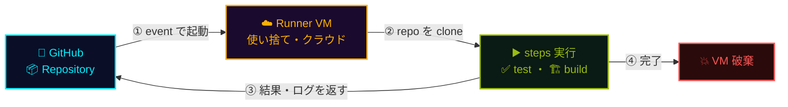

## 一言で

<div class="hero-quote">
  <p>
    <strong>GitHub Actions</strong> は「継続的インテグレーション / 継続的デリバリー(CI/CD)」のプラットフォーム。
  </p>
  <p>
    でも <strong>DevOps だけじゃない</strong>。push・PR・issue・label・schedule など <strong>リポジトリで起きるあらゆるイベント</strong> で workflow を走らせられる = <strong>ほぼ何でも自動化</strong> できる基盤。
  </p>
</div>

## どんな workflow を自動化できる?

CI/CD だけでなく、**SDLC のあらゆる工程** をイベント起点で自動化できる。


## 改善する指標(DORA メトリクス)

自動化(CI/CD・テスト・レビュー)の狙いは、開発の **スピードと安定性** を両立させること。ものさしは <a class="retro-link" href="https://dora.dev/" target="_blank" rel="noopener noreferrer">DORA の 4 指標 ↗</a>、これを Elite に近づける。

<div class="tbl-fit">

| DORA 指標 | 🟢 Elite | 🟣 High | 🟠 Medium | 🔴 Low |
| --- | --- | --- | --- | --- |
| 🚀 デプロイ頻度 | 1 日に複数回 | 日〜週に 1 回 | 週〜月に 1 回 | 月〜半年に 1 回 |
| ⏱️ リードタイム | < 1 日 | 1 日〜1 週 | 1 週〜1 月 | 1〜6 か月 |
| ❌ 変更失敗率 | 0–15% | 0–15% | 0–15% | 46–60% |
| 🔧 平均復旧時間(MTTR) | < 1 時間 | < 1 日 | < 1 日 | 1 週〜1 月 |

</div>

> 🎯 スピード(頻度・リードタイム)と安定性(失敗率・復旧時間)を **同時に** 上げるのが自動化の価値。

## アーキテクチャ:clone → 実行 → 破棄

GitHub 上の repo が **クラウドの使い捨て VM** に clone され、そこで test 等を実行 → 結果を返して **VM は破棄** される。



> 🔁 結果は checks・ログ・artifact として GitHub に戻り、VM は毎回破棄される。

## 仕組み(コアコンセプト)

すごくシンプル: **イベントが起きたら、まっさらな VM を借りて、リポを clone して、書いた手順を順に走らせる**。

- 📁 **配置場所** — `.github/workflows/*.yml`(複数ファイル可)
- ⚡ **トリガー** — `push` / `pull_request` / `schedule`(cron) / `workflow_dispatch`(手動) / `issues` / `release` ほか 35+ イベント
- 🖥️ **実行環境** — ジョブごとに新品の **GitHub-hosted runner**(Linux / Windows / macOS の VM)が起動
- 📦 **リポは毎回 clone** — `actions/checkout` で `$GITHUB_WORKSPACE` に full clone(状態は前回のジョブから引き継がない)
- ⏱️ **時間制限** — 1 ジョブ最大 6 時間、1 workflow 最大 35 日(matrix で並列もできる)
- 🔐 **シークレット** — `Settings → Secrets` に保存 → `${{ secrets.NAME }}` で参照(ログにマスク)

> 🧠 「毎回ゼロから」が GitHub Actions の鉄則。状態を保ちたいなら `actions/cache` か artifact、デプロイ済みのものに頼る。

## Runner を選ぶ <a class="h2-doc" href="https://docs.github.com/en/actions/concepts/runners/github-hosted-runners" target="_blank" rel="noopener noreferrer">📖 Docs</a>

**管理を任せるなら GitHub-hosted。自社環境で動かすなら Self-hosted。**

| | GitHub-hosted | Self-hosted |
| --- | --- | --- |
| 保守 | GitHub が環境を管理 | 更新とセキュリティは自社で管理 |
| 容量 | プランの上限内で自動起動 | 自社設備、Kubernetes なら ARC |
| 接続 | 公開ネットワーク / 構成したプライベート接続 | 自社ネットワークと専用機器 |
| 実行料金 | public の標準 runner は無料、ほかは従量課金 | インフラ代のみ、Actions の実行課金なし |

管理を任せたまま高性能にするなら、Team / Enterprise Cloud の **larger runners**。

## Marketplace で部品を再利用 <a class="h2-doc" href="https://docs.github.com/en/actions/reference/security/secure-use" target="_blank" rel="noopener noreferrer">📖 Docs</a>

各 step を自作せず、既存の action を組み合わせる。

| やりたいこと | 再利用する action |
| --- | --- |
| コードを取得 | `actions/checkout` |
| Node.js を準備 | `actions/setup-node` |
| コンテナーをビルド | `docker/build-push-action` |

- **ソースを確認**。認証済みの公開者でもレビューは必要。
- **lockfile または完全な SHA で固定**。タグは移動できる。
- **Org の許可リスト**は Settings → Actions → General で設定。

## Workflow を 1 つ作る <a class="h2-doc" href="https://docs.github.com/en/actions/writing-workflows/workflow-syntax-for-github-actions" target="_blank" rel="noopener noreferrer">📖 Docs</a>

Node.js プロジェクトに <code>.github/<wbr>workflows/<wbr>ci.yml</code> を追加:

```yaml
name: CI
on: { push: { branches: [main] }, pull_request: {} }
permissions: { contents: read }
jobs:
  test:
    runs-on: ubuntu-latest
    steps:
      - uses: actions/checkout@v7
      - uses: actions/setup-node@v7
        with: { node-version: 24 }
      - run: npm ci && npm test
```

push → **Actions のログと PR のチェック**。action の参照は lockfile または完全な SHA で固定する。

## 実行料金と無料枠 <a class="h2-doc" href="https://docs.github.com/en/billing/concepts/product-billing/github-actions" target="_blank" rel="noopener noreferrer">📖 Docs</a> <input type="checkbox" id="info-actions-pricing" class="demo-toggle" /><label class="h2-demo h2-info" for="info-actions-pricing">&#9432; INFO</label>

<div class="demo-panel is-info">
<label class="demo-scrim" for="info-actions-pricing" aria-label="料金の詳細を閉じる"></label>
<div class="demo-window" role="group" aria-label="実行料金とストレージ料金">
<div class="demo-head"><span class="demo-tag">INFO</span><span class="demo-name">実行料金とストレージ</span><label class="demo-close" for="info-actions-pricing" aria-label="閉じる">&#10005;</label></div>
<div class="info-body">
<p>USD、2026-11-11 時点。無料の実行枠は固定の分数ではなく月ごとの金額。対象 runner とクラウドサンドボックスの CPU / メモリが同じ枠を使う。</p>
<ul class="info-list">
<li><b>標準単価:</b> Linux x64 2-core は $0.006/分、Windows x64 2-core は $0.010/分、macOS 3/4-core は $0.062/分。<a class="retro-link" href="https://docs.github.com/en/billing/reference/actions-runner-pricing" target="_blank" rel="noopener noreferrer">全サイズと料金 ↗</a>。</li>
<li><b>Larger runners:</b> public repo でも有料。Team / Enterprise Cloud では対象の利用分を無料の実行枠から差し引ける。</li>
<li><b>Artifact:</b> Free 500 MB、Pro 1 GB、Team 2 GB、Enterprise Cloud 50 GB。Packages と共有。超過は $0.25/GB-month。</li>
<li><b>Cache:</b> repo ごとに別枠で 10 GB。追加容量を設定した場合、超過は $0.07/GB-month。カスタムイメージも別枠で、超過単価は同じ。</li>
<li><b>請求:</b> リポジトリ所有者が支払う。ストレージは時間単位で累積し、削除しても過去の利用料金は消えない。</li>
</ul>
</div>
</div>
</div>

**Public の標準 runner と self-hosted の実行は無料**。それ以外の対象利用は共通の無料枠から消費。

| プラン | 月の実行無料枠 |
| --- | ---: |
| Free | $12 |
| Pro / Team | $18 |
| Enterprise Cloud | $300 |

USD、**2026-11-11 時点**。$300 は Linux 2-core **50,000 分**相当（$0.006/分）。超過分は従量課金、ストレージは別枠。

## CI 以外の利用も予算に含める <a class="h2-doc" href="https://docs.github.com/en/billing/how-tos/set-up-budgets" target="_blank" rel="noopener noreferrer">📖 Docs</a>

**自動化は実行枠を共有。AI クレジットは別のメーター。**

| 利用元 | 実行枠の消費 |
| --- | --- |
| CI、<a class="retro-link" href="/theomonfort/playbook/code-scanning/">CodeQL</a>、<a class="retro-link" href="/theomonfort/playbook/code-quality/">Code Quality</a> | ホスト型 runner での実行 / スキャン |
| <a class="retro-link" href="/theomonfort/playbook/copilot-code-review/">Copilot Code Review</a> | エージェントの文脈取得とツール実行 |
| <a class="retro-link" href="/theomonfort/playbook/cloud-agent/">Copilot のクラウドタスク</a> | Actions またはサンドボックスの実行 |

- **まず監視:** soft budget で **75 / 90 / 100%** の通知を設定し、Actions の利用指標を確認。
- **停止は慎重に:** “Stop usage when budget limit is reached” は、**その予算の対象範囲**で追加の有料利用を止める。

Code Review は Actions によるエージェント機能なしでも動作可能。Actions 予算で **Copilot 全体が止まるわけではない**。

## Workflow lockfiles (GA) <a class="h2-doc" href="https://docs.github.com/en/actions/concepts/security/workflow-dependency-lockfiles" target="_blank" rel="noopener noreferrer">📖 Docs</a> <input type="checkbox" id="demo-actions-lockfiles" class="demo-toggle" /><label class="h2-demo" for="demo-actions-lockfiles">&#9658; DEMO</label>

<div class="demo-panel">
<label class="demo-scrim" for="demo-actions-lockfiles" aria-label="デモ手順を閉じる"></label>
<div class="demo-window" role="group" aria-label="デモ手順">
<div class="demo-head"><span class="demo-tag">DEMO</span><span class="demo-name">このサイトの workflow を固定</span><span class="demo-note">発表者専用</span><label class="demo-close" for="demo-actions-lockfiles" aria-label="閉じる">&#10005;</label></div>
<ol class="demo-steps">
<li>
<p class="demo-step-title">タグとコミットを比較</p>
<p><a class="retro-link" href="https://github.com/actions/checkout/tree/v4" target="_blank" rel="noopener noreferrer">checkout@v4 ↗</a> と、<a class="retro-link" href="https://github.com/actions/checkout/commit/11d5960a326750d5838078e36cf38b85af677262" target="_blank" rel="noopener noreferrer">固定したコミット ↗</a> を開く。</p>
<p class="demo-out">タグは移動できるが、完全な SHA は特定のリビジョンを識別する。<code>v4.4.0</code> もタグ。</p>
</li>
<li>
<p class="demo-step-title">既存の LOCKFILE を開く</p>
<p><a class="retro-link" href="https://github.com/theomonfort/theomonfort/blob/main/.github/workflows/actions.lock" target="_blank" rel="noopener noreferrer">このサイトの actions.lock ↗</a> を開き、<code class="demo-path">workflows</code> と <code class="demo-path">dependencies</code> を見せる。</p>
<p class="demo-out">checkout の SHA をコミット画面と照合。<code>owner_id</code>、<code>repo_id</code>、推移的依存の <code>upload-artifact</code> も確認する。</p>
</li>
<li>
<p class="demo-step-title">ファイルを変更せず検証</p>
<p>最新のサイトを checkout し、<code>gh-actions-lock</code> を導入済みの環境で実行:</p>
<code class="demo-cmd">gh actions-lock --verify .github/workflows/deploy.yml</code>
<p class="demo-out">workflow と lockfile が一致すれば成功。現在の <code>v4</code> タグが、記録した <code>v4.4.0</code> のコミットと同じとは限らない。</p>
</li>
<li>
<p class="demo-step-title">LOCKFILE を段階的に必須化</p>
<p>権限のある管理者として <a class="retro-link" href="https://github.com/organizations/theomonfort-org/settings/actions/rules" target="_blank" rel="noopener noreferrer">theomonfort-org → Actions Policies ↗</a> を開く。</p>
<p>場所: Organization の <code class="demo-path">Settings → Actions → Policies → New policy → New policy</code>（ドロップダウン内）。名前とデモ対象 repo / workflow を設定し、<code class="demo-path">Require lockfile</code> をオンにして保存。</p>
<p class="demo-out">Enterprise Cloud では <code>Evaluate</code> から開始し、<code>Policy insights</code> を確認。対象 workflow の導入完了後に <code>Active</code> にする。</p>
</li>
</ol>
</div>
</div>

**なぜ重要？** `v4` のような action のタグは、別のコードを指すように変更できる。workflow を変更していなくても、次のビルドで未確認の変更や悪意のあるコードが実行されるおそれがある。

**何をする？** lockfile は、各 action と、その action が依存する action の正確なコミットを記録する。GitHub Actions は、移動するタグではなく、記録されたコミットを実行する。

- **更新をレビュー:** Dependabot が <a class="retro-link" href="https://github.com/theomonfort/theomonfort/blob/main/.github/dependabot.yml" target="_blank" rel="noopener noreferrer">action の更新 ↗</a>と lockfile の変更を、同じプルリクエストで提案する。
- **導入を必須化:** 管理者は、選択した workflow が lockfile を使うまで<a class="retro-link" href="https://github.com/organizations/theomonfort-org/settings/actions/rules" target="_blank" rel="noopener noreferrer">実行をブロック ↗</a>できる。
