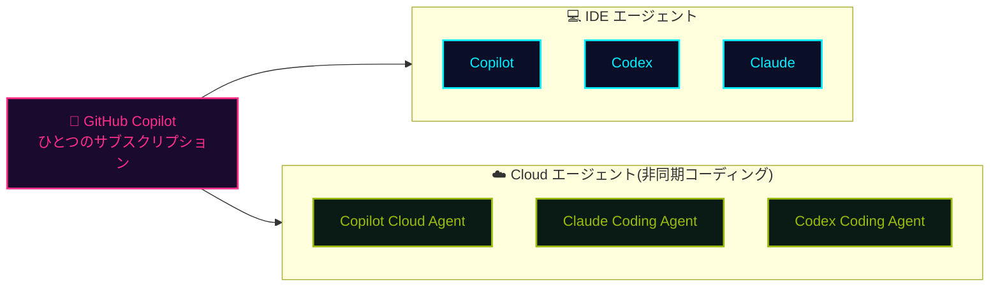

## 一言で

  
GitHub Copilot は世界で最もご活用いただいている <strong>AI 開発ツール</strong>。

  
IDE、ターミナル、GitHub.com の<strong>あらゆる場面</strong>で、開発者の<strong>フロー</strong>を加速します。

## GitHub Copilot の歴史

  
「副操縦士」(copilot) の時代

  
Agent の台頭

  
IDE 以外への展開

  

  

    
LLM による コード補完

    
  

  

    
Copilot Chat Ask Mode

    
  

  

    
Copilot Chat Edit Mode

    
  

  

    
GitHub Copilot Agent Mode

    
  

  

    
IDE 以外での GitHub Copilot

    
  

  
コード補完だけ

  
言われたことに応答する

  
自律的に動く

  
IDE 外でも利用可能

## AI モデルと利用サーフェス <a class="h2-doc" href="https://docs.github.com/en/copilot/reference/ai-models/supported-models" target="_blank" rel="noopener noreferrer">📖 Docs</a>

**モデル：** GPT / Claude / Gemini / Grok / MAI / Kimi。対応クライアントではカスタムモデルと **BYOK** も利用可能。提供範囲はプラン、クライアント、ポリシーにより異なります。

| 利用する場所 | できること |
| --- | --- |
| **IDE** | VS Code、Visual Studio、JetBrains、Xcode、Eclipse、Neovim で開発 |
| <a class="retro-link" href="/theomonfort/playbook/copilot-app">Copilot App ↗</a> | 複数エージェントの並列実行、Issue 整理、PR 管理 |
| <a class="retro-link" href="/theomonfort/playbook/cli">ターミナル ↗</a> | Copilot CLI でシェルから作業 |
| <a class="retro-link" href="/theomonfort/playbook/cloud-agent">Cloud Agent ↗</a> / <a class="retro-link" href="/theomonfort/playbook/copilot-code-review">Code Review ↗</a> | 実装を委任 / PR をレビュー |
| <a class="retro-link" href="https://github.com/github/copilot-sdk" target="_blank" rel="noopener noreferrer">SDK ↗</a> | 自分のアプリに Copilot を組み込む |
| <a class="retro-link" href="/theomonfort/playbook/agentic-workflow">自動化 ↗</a> | リポジトリの作業をエージェント型ワークフローに |
| **Web / モバイル** | チャット、リモートセッション操作、クラウドでの作業開始 |

## 開発者へのインパクト

GitHub Copilot がもたらす開発者へのインパクト  
Accenture 社の開発者 450 名を対象にした 6 か月間の調査結果（2025）

| 活動 | 生産性 | 効率性 | 満足度 |
|---:|---:|---:|---:|
| 94% 作業の「フロー状態」を維持できたと回答 | 90% より良いコードを書けていると実感 | 50% ビルド数が増加 | 96% 初日から成功を実感 |
| 90% 情報探索に費やす時間が減少 | 88% Copilot が提案したコードがそのまま採用された割合 | 84% ビルド成功率が向上 | 90% 仕事への満足度が向上 |

## ひとつのサブスクで Codex・Claude も使える

GitHub Copilot のサブスクリプションがあれば、**Codex** と **Claude** の **エージェント（ハーネス）** を、**IDE** でも **Cloud Agent** としても使える。利用分は **Copilot AI クレジット** から直接支払われるので、追加契約は不要。

## Copilot Fusion <a class="h2-doc" href="https://docs.github.com/en/copilot/concepts/models/copilot-fusion" target="_blank" rel="noopener noreferrer">📖 Docs</a>

<strong>人が労力を選び、</strong>Fusion がモデルを選ぶ。

01
<strong>モデルの切り替えはお任せ</strong>
Fusion と Standard / High / Max を選ぶ。

02
<strong>プロンプトごとに実行プラン</strong>
タスクに合うモデル、推論、パターンを選択。

03
<strong>最終回答は 1 つ</strong>
追加のレビューは、必要なタスクだけ。

<strong>60</strong>Coding Agent Index比較対象との差は 2 点以内

<strong>約 ½</strong>タスクあたりの API 費用$5.59 対 $11.42

<strong>約 ½</strong>トークン / タスク平均 720 万

<strong>約 40%</strong>タスクあたりの時間を短縮ベンチマーク平均

<strong>2026-10-28 に GA。</strong> VS Code / Copilot CLI / Copilot App / JetBrains。

<a href="https://artificialanalysis.ai/articles/github-copilot-fusion-orchestrates-anthropic-and-openai-models-to-balance-performance-and-cost" target="_blank" rel="noopener noreferrer">Artificial Analysis、2026-10-28</a>：Coding Agent Index v2.0。Copilot CLI / Fusion Max と Claude Code / Opus 5.5 Max の比較。平均値であり、実タスクでの削減は保証されません。

## Fusion：労力を選ぶ <a class="h2-doc" href="https://docs.github.com/en/copilot/concepts/models/copilot-fusion" target="_blank" rel="noopener noreferrer">📖 Docs</a>

人が選ぶのは優先度。<strong>実行手順は固定しない。</strong>

<section class="fusion-choice" aria-label="労力レベル">

人が選ぶ：労力レベル

<strong>Standard</strong>
日常の作業を 1 モデルで。<small>すべての Copilot プラン</small>

<strong>High</strong>
複雑なバグ修正、複数ファイルの変更。

<strong>Max</strong>
最も深い推論と徹底した分析。

<b>High / Max：</b>Pro+、Max、Business、Enterprise。

</section>
<section class="fusion-choice" aria-label="実行パターン">

Fusion が選ぶ：実行パターン

<strong>Single</strong>
1 モデルで直接タスクを解く。

<strong>Cascade</strong>
効率的に生成 → 判定 → 採用か強化。

<strong>Critique</strong>
生成 → 並列レビュー → 集約 → 修正。

次のプロンプトでは別のパターンも選択。

</section>

<strong>労力レベル ≠ モデルの推論レベル。</strong> モデルポリシーは適用され、必要なモデルが無効だと Max が使えない場合があります。

<b>Fast：</b>VS Code インラインチャット専用、手動選択不可。2026-11-11 時点。

## Fusion の仕組み <a class="h2-doc" href="https://docs.github.com/en/copilot/concepts/models/copilot-fusion" target="_blank" rel="noopener noreferrer">📖 Docs</a> <input type="checkbox" id="info-fusion-runtime" class="demo-toggle" /><label class="h2-demo h2-info" for="info-fusion-runtime">&#9432; INFO</label>

<label class="demo-scrim" for="info-fusion-runtime" aria-label="Fusion の詳細を閉じる"></label>

INFO公開情報に基づく仕組み<label class="demo-close" for="info-fusion-runtime" aria-label="閉じる">&#10005;</label>

<b>ポリシーに従うモデル候補：</b>プラン、管理者、データ所在地、FedRAMP の制限を適用。モデル候補は変わる場合があります。

<b>状況に応じたルーティング：</b>稼働状況と可用性を考慮。自然なキャッシュ境界や、会話の複雑さが大きく変わる場面で経路を選びます。

<b>ステップごとの実行：</b>モデル、推論レベル、コンテキスト上限は各ステップに依存。進行状況と使用モデルを追跡でき、提示される回答は最終版だけです。

<b>作業ファイルの扱い：</b>Fusion 自体はサブエージェントを起動しません。下書きの破棄でファイル編集は元に戻らないため、コミット前に確認してください。

<section class="fusion-zone fusion-input">

01 / 利用者の作業環境

<strong>プロンプト + 労力</strong>

Standard / High / Max

プラン + モデルポリシー

</section>

<section class="fusion-zone fusion-plan">

02 / FUSION が計画

推論コードデバッグツール

<strong>パターンと、各段階のモデル、推論を選択。</strong>

ポリシー、稼働状況、可用性を考慮。

</section>

↓ 実行プラン

<section class="fusion-zone fusion-execution">

03 / 実行とレビュー
プロンプトごとに 1 つの経路

<h3>Single</h3>
モデル<b aria-hidden="true">→</b>回答

直接解決。追加レビューは不要。

<h3>Cascade</h3>
生成<b aria-hidden="true">→</b>判定

下書きを<b>採用</b>、または<b>強力なモデル</b>で解き直す。

<h3>Critique</h3>
生成<b aria-hidden="true">→</b>並列レビュー

指摘を集約 → 元のモデルが修正。

</section>

04<strong>1 つの最終回答</strong>途中の下書きは修正、破棄される場合も。

サブエージェントは起動しない。下書きの破棄でファイル編集は戻らない。

## Fusion：料金 <a class="h2-doc" href="https://docs.github.com/en/copilot/concepts/models/copilot-fusion#billing-for-copilot-fusion" target="_blank" rel="noopener noreferrer">📖 Docs</a>

期間限定オファー

<strong>30%</strong>モデル費用を割引Copilot Fusion 経由の利用のみ

<section class="fusion-zone" aria-label="割引の条件">

対象と期限

<strong>対象</strong>
<b>有料 Copilot プラン</b>のユーザー。

<strong>終了日</strong>
<strong><time datetime="2026-11-30">2026-11-30</time></strong><small>公表されている期限</small>

</section>

<strong>モデル費用のみ。</strong> サブスクリプション料金の割引ではありません。

01
<strong>通常の課金</strong>
各モデルの標準料金で計算。Fusion 固有の追加料金はなし。

02
<strong>労力で費用も変わる</strong>
High / Max は Standard より多くのモデルと AI クレジットを使う場合があります。

2026-11-11 時点。期限後の継続は前提にせず、最新条件は Docs で確認してください。

## なぜ企業は Copilot を選ぶのか

-  **オーケストレーション** 　コーディングだけでなく、SDLC 全体にわたる AI
-  **モデル・エージェント・サーフェス全体での選択の自由** 　あらゆるワークフローに最適なモデルとインターフェース。ベンダーロックインなし
-  **エンタープライズコントロール** 　一元化されたガバナンス、可視性、セキュリティ
-  **コンプライアンス** 　Copilot Proxy、ポリシー制御、公開コードフィルタ、対象利用に対する Microsoft の IP 保護
-  **最高のコストパフォーマンス** 　プール型使用量、充実した組み込みエンタイトルメント、ACD による価格優位性の最大化

## セキュアでコンプライアントなアーキテクチャ

プロンプトや生成されたコードは **Copilot Proxy** を経由し、安心してエンタープライズで使える設計。 
🔗 詳細は <a href="https://resources.github.com/ja/copilot-trust-center/" target="_blank" rel="noopener noreferrer" class="retro-link">Copilot Trust Center</a> を参照。

Copilot Proxy で行われる処理：

- 🔒 文脈から **PII（個人識別情報）** を除去
- 🚫 文脈から **不適切な表現** をフィルタリング
- 🛡️ 文脈の **一般的なセキュリティ脆弱性** をチェック
- ⚖️ 生成提案を **IP（知的財産）フィルター** に通す
- 🔐 すべてのデータは **転送中に暗号化**
