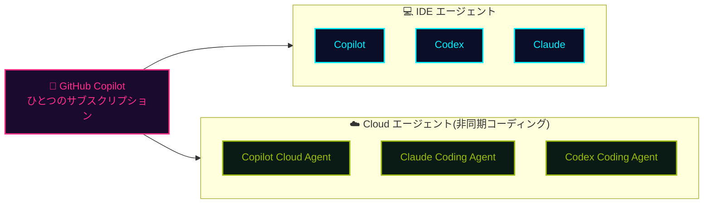
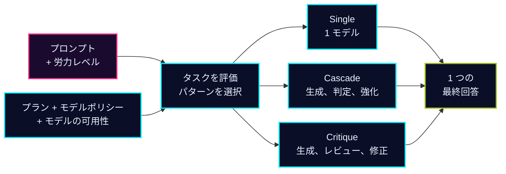

## 一言で

  
GitHub Copilot は世界で最もご活用いただいている <strong>AI 開発ツール</strong>。

  
IDE、ターミナル、GitHub.com の<strong>あらゆる場面</strong>で、開発者の<strong>フロー</strong>を加速します。

## GitHub Copilot の歴史

  
「副操縦士」(copilot) の時代

  
Agent の台頭

  
IDE 以外への展開

  

  

    
LLM による コード補完

    
  

  

    
Copilot Chat Ask Mode

    
  

  

    
Copilot Chat Edit Mode

    
  

  

    
GitHub Copilot Agent Mode

    
  

  

    
IDE 以外での GitHub Copilot

    
  

  
コード補完だけ

  
言われたことに応答する

  
自律的に動く

  
IDE 外でも利用可能

## AI モデルと利用サーフェス <a class="h2-doc" href="https://docs.github.com/en/copilot/reference/ai-models/supported-models" target="_blank" rel="noopener noreferrer">📖 Docs</a>

**モデル：** GPT / Claude / Gemini / Grok / MAI / Kimi。対応クライアントではカスタムモデルと **BYOK** も利用可能。提供範囲はプラン、クライアント、ポリシーにより異なります。

| 利用する場所 | できること |
| --- | --- |
| **IDE** | VS Code、Visual Studio、JetBrains、Xcode、Eclipse、Neovim で開発 |
| <a class="retro-link" href="/theomonfort/playbook/copilot-app">Copilot App ↗</a> | 複数エージェントの並列実行、Issue 整理、PR 管理 |
| <a class="retro-link" href="/theomonfort/playbook/cli">ターミナル ↗</a> | Copilot CLI でシェルから作業 |
| <a class="retro-link" href="/theomonfort/playbook/cloud-agent">Cloud Agent ↗</a> / <a class="retro-link" href="/theomonfort/playbook/copilot-code-review">Code Review ↗</a> | 実装を委任 / PR をレビュー |
| <a class="retro-link" href="https://github.com/github/copilot-sdk" target="_blank" rel="noopener noreferrer">SDK ↗</a> | 自分のアプリに Copilot を組み込む |
| <a class="retro-link" href="/theomonfort/playbook/agentic-workflow">自動化 ↗</a> | リポジトリの作業をエージェント型ワークフローに |
| **Web / モバイル** | チャット、リモートセッション操作、クラウドでの作業開始 |

## 開発者へのインパクト

GitHub Copilot がもたらす開発者へのインパクト  
Accenture 社の開発者 450 名を対象にした 6 か月間の調査結果（2025）

| 活動 | 生産性 | 効率性 | 満足度 |
|---:|---:|---:|---:|
| 94% 作業の「フロー状態」を維持できたと回答 | 90% より良いコードを書けていると実感 | 50% ビルド数が増加 | 96% 初日から成功を実感 |
| 90% 情報探索に費やす時間が減少 | 88% Copilot が提案したコードがそのまま採用された割合 | 84% ビルド成功率が向上 | 90% 仕事への満足度が向上 |

## ひとつのサブスクで Codex・Claude も使える

GitHub Copilot のサブスクリプションがあれば、**Codex** と **Claude** の **エージェント（ハーネス）** を、**IDE** でも **Cloud Agent** としても使える。利用分は **Copilot AI クレジット** から直接支払われるので、追加契約は不要。

## Fusion：モデルではなく労力を選ぶ <a class="h2-doc" href="https://docs.github.com/en/copilot/concepts/models/copilot-fusion" target="_blank" rel="noopener noreferrer">📖 Docs</a>

**Copilot Fusion** と労力レベルを選ぶだけ。Copilot がモデルと連携方法を選び、**1 つの最終回答**を返します。

- **自動で実行プランを決定：** 推論、コード生成、デバッグ、ツール利用の特性から、実行パターンと各ステップの推論レベルを選択。
- **2026-10-28 に GA：** VS Code、Copilot CLI、Copilot App、JetBrains で利用可能。

| **60** のスコア | 費用とトークンは **約 ½** | 所要時間は **約 40% 減** |
| --- | --- | --- |
| 比較対象との差は 2 ポイント以内 | 平均 API 費用：**$5.59 対 $11.42** / タスク | タスクあたりの平均時間 |

**比較条件：** Copilot CLI の Fusion Max と Claude Code の Opus 5.5 Max。Artificial Analysis Coding Agent Index v2.0、2026-10-28 公表。ベンチマーク結果であり、実際のタスクでの削減を保証するものではありません。

## Fusion：労力レベルと実行パターン <a class="h2-doc" href="https://docs.github.com/en/copilot/concepts/models/copilot-fusion" target="_blank" rel="noopener noreferrer">📖 Docs</a>

**人が労力を選び、Fusion が実行パターンを選びます。**

| 労力レベル | 主な用途 | 対象プラン |
| --- | --- | --- |
| **Standard** | 日常の作業、タスクごとに 1 モデル | 全プラン |
| **High** | 複雑なバグ修正、複数ファイルの変更 | Pro+、Max、Business、Enterprise |
| **Max** | 深い推論と徹底した分析 | Pro+、Max、Business、Enterprise |

| パターン | 処理の流れ |
| --- | --- |
| **Single** | 1 つのモデルでタスクを完了 |
| **Cascade** | 効率的なモデルで生成 → 判定 → 必要なら強力なモデルへ |
| **Critique** | 生成 → 複数モデルが並列レビュー → 指摘を集約 → 修正 |

**2026-11-11 時点。** モデルポリシーに従います。**Fast：** VS Code インラインチャット専用、手動選択不可。労力レベル ≠ モデルの推論レベル。

## Fusion：プロンプトから回答まで <a class="h2-doc" href="https://docs.github.com/en/copilot/concepts/models/copilot-fusion" target="_blank" rel="noopener noreferrer">📖 Docs</a>

公開情報に基づく**概念図：** モデルと推論レベルはステップごとに選択。

Fusion 自体は**サブエージェントを起動しません**。下書きが破棄されても**ファイル変更は元に戻らない**ため、コミット前に確認してください。

## Fusion：課金と期間限定割引 <a class="h2-doc" href="https://docs.github.com/en/copilot/concepts/models/copilot-fusion#billing-for-copilot-fusion" target="_blank" rel="noopener noreferrer">📖 Docs</a>

**2026-11-11 時点で確認した期間限定施策。** 公表されている終了日は **2026-11-30** です。

| 30% モデル費用を割引 | 対象 | 終了日 |
| --- | --- | --- |
| **Copilot Fusion 経由の利用のみ** | **有料 Copilot プラン**のユーザー | **2026 年 11 月 30 日** |

- **通常の課金：** 各モデルの標準料金で計算。Fusion 固有の追加料金はなし。
- **モデル費用のみ：** サブスクリプション料金の割引ではありません。
- **予算：** High / Max は Standard より多くのモデルと AI クレジットを使う場合があります。

終了日以降も割引が続くとは限りません。最新の条件は課金ドキュメントで確認してください。

## なぜ企業は Copilot を選ぶのか

-  **オーケストレーション** 　コーディングだけでなく、SDLC 全体にわたる AI
-  **モデル・エージェント・サーフェス全体での選択の自由** 　あらゆるワークフローに最適なモデルとインターフェース。ベンダーロックインなし
-  **エンタープライズコントロール** 　一元化されたガバナンス、可視性、セキュリティ
-  **コンプライアンス** 　Copilot Proxy、ポリシー制御、公開コードフィルタ、対象利用に対する Microsoft の IP 保護
-  **最高のコストパフォーマンス** 　プール型使用量、充実した組み込みエンタイトルメント、ACD による価格優位性の最大化

## セキュアでコンプライアントなアーキテクチャ

プロンプトや生成されたコードは **Copilot Proxy** を経由し、安心してエンタープライズで使える設計。 
🔗 詳細は <a href="https://resources.github.com/ja/copilot-trust-center/" target="_blank" rel="noopener noreferrer" class="retro-link">Copilot Trust Center</a> を参照。

Copilot Proxy で行われる処理：

- 🔒 文脈から **PII（個人識別情報）** を除去
- 🚫 文脈から **不適切な表現** をフィルタリング
- 🛡️ 文脈の **一般的なセキュリティ脆弱性** をチェック
- ⚖️ 生成提案を **IP（知的財産）フィルター** に通す
- 🔐 すべてのデータは **転送中に暗号化**
