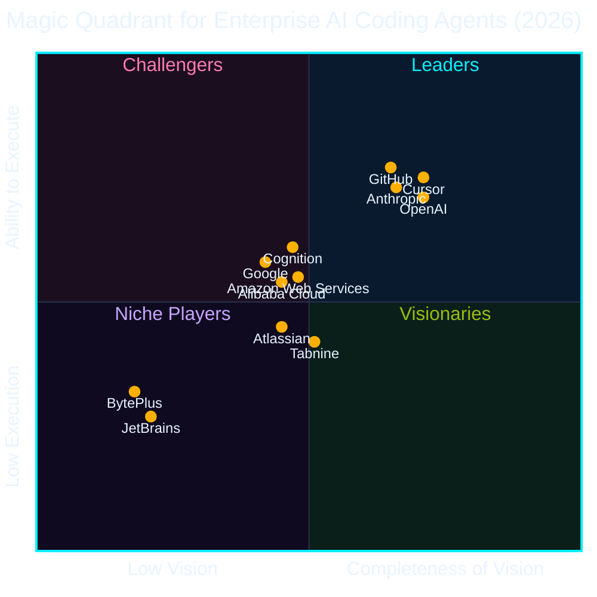

## 一言で

  
こんにちは、<strong>Mona</strong> です！<strong>GitHub</strong> の顔として世界中の開発者を見守っています。

  
今日お話しする <strong>GitHub</strong> は、<strong>2.25 億人以上</strong>の開発者が集う世界最大の AI ネイティブ開発者プラットフォームです（Octoverse、2026 年 9 月時点）。

## 進化の歴史

GitHub の歩みを振り返れば、現在地が見えてくる。

<figure class="rpi-pipeline" style="margin:2em 0;">
<svg viewBox="0 0 1100 480" xmlns="http://www.w3.org/2000/svg" style="width:100%;height:auto;display:block;font-family: 'Noto Sans JP', sans-serif;">
  <defs>
    <marker id="ghTimelineArrow" viewBox="0 0 10 10" refX="9" refY="5" markerWidth="9" markerHeight="9" orient="auto">
      <path d="M 0 0 L 10 5 L 0 10 Z" fill="#00f0ff"/>
    </marker>
    <filter id="ghTimelineGlow" x="-60%" y="-60%" width="220%" height="220%">
      <feGaussianBlur stdDeviation="4.5" result="blur"/>
      <feMerge>
        <feMergeNode in="blur"/>
        <feMergeNode in="SourceGraphic"/>
      </feMerge>
    </filter>
  </defs>
  <rect x="0" y="0" width="1100" height="480" fill="none"/>
  <path d="M 80 430 C 260 440, 380 410, 530 330 C 680 250, 820 160, 1050 30" stroke="#0a0e27" stroke-width="14" fill="none" stroke-linecap="round"/>
  <path d="M 80 430 C 260 440, 380 410, 530 330 C 680 250, 820 160, 1050 30" stroke="#00f0ff" stroke-width="2.5" fill="none" stroke-linecap="round" marker-end="url(#ghTimelineArrow)"/>
  <g>
    <line x1="80" y1="422" x2="80" y2="404" stroke="#00f0ff" stroke-width="1" stroke-dasharray="3 3" opacity="0.55"/>
    <circle cx="80" cy="430" r="7" fill="#0a0e27" stroke="#00f0ff" stroke-width="2.5"/>
    <rect x="40" y="372" width="80" height="32" rx="16" fill="#0a0e27" stroke="#00f0ff" stroke-width="1.5"/>
    <text x="80" y="394" text-anchor="middle" fill="#00f0ff" font-size="16" font-weight="bold">2008</text>
    <text x="80" y="340" text-anchor="middle" fill="#e8f4ff" font-size="18" font-weight="bold">Pull Request</text>
    <text x="80" y="358" text-anchor="middle" fill="#e8f4ff" font-size="11">共有とコラボの業界標準</text>
  </g>
  <g>
    <line x1="316" y1="406" x2="316" y2="390" stroke="#00f0ff" stroke-width="1" stroke-dasharray="3 3" opacity="0.55"/>
    <circle cx="316" cy="414" r="7" fill="#0a0e27" stroke="#00f0ff" stroke-width="2.5"/>
    <rect x="244" y="358" width="144" height="32" rx="16" fill="#0a0e27" stroke="#00f0ff" stroke-width="1.5"/>
    <text x="316" y="380" text-anchor="middle" fill="#00f0ff" font-size="16" font-weight="bold">2012</text>
    <text x="316" y="325" text-anchor="middle" fill="#e8f4ff" font-size="18" font-weight="bold">GitHub Enterprise</text>
    <text x="316" y="345" text-anchor="middle" fill="#e8f4ff" font-size="11">大企業の管理・セキュリティ</text>
  </g>
  <g>
    <line x1="530" y1="322" x2="530" y2="302" stroke="#00f0ff" stroke-width="1" stroke-dasharray="3 3" opacity="0.55"/>
    <circle cx="530" cy="330" r="7" fill="#0a0e27" stroke="#00f0ff" stroke-width="2.5"/>
    <rect x="450" y="270" width="160" height="32" rx="16" fill="#0a0e27" stroke="#00f0ff" stroke-width="1.5"/>
    <text x="530" y="292" text-anchor="middle" fill="#00f0ff" font-size="16" font-weight="bold">2019</text>
    <text x="530" y="237" text-anchor="middle" fill="#e8f4ff" font-size="18" font-weight="bold">Actions / GHAS</text>
    <text x="530" y="257" text-anchor="middle" fill="#e8f4ff" font-size="11">CI/CD と DevSecOps をワークフローに統合</text>
  </g>
  <g>
    <line x1="760" y1="207" x2="760" y2="240" stroke="#00f0ff" stroke-width="1" stroke-dasharray="3 3" opacity="0.55"/>
    <circle cx="760" cy="199" r="7" fill="#0a0e27" stroke="#00f0ff" stroke-width="2.5"/>
    <rect x="688" y="240" width="144" height="32" rx="16" fill="#0a0e27" stroke="#00f0ff" stroke-width="1.5"/>
    <text x="760" y="262" text-anchor="middle" fill="#00f0ff" font-size="16" font-weight="bold">2021</text>
    <text x="760" y="290" text-anchor="middle" fill="#e8f4ff" font-size="18" font-weight="bold">GitHub Copilot</text>
    <text x="760" y="308" text-anchor="middle" fill="#e8f4ff" font-size="11">世界初の AI コーディングアシスタント</text>
  </g>
  <g>
    <line x1="984" y1="80" x2="984" y2="118" stroke="#00f0ff" stroke-width="1.5" stroke-dasharray="3 3" opacity="0.85"/>
    <g filter="url(#ghTimelineGlow)">
      <circle cx="984" cy="68" r="11" fill="#00f0ff"/>
      <circle cx="984" cy="68" r="4" fill="#05060f"/>
    </g>
    <rect x="924" y="118" width="120" height="38" rx="19" fill="#00f0ff" stroke="#00f0ff" stroke-width="2"/>
    <text x="984" y="144" text-anchor="middle" fill="#05060f" font-size="18" font-weight="bold">2025</text>
    <text x="984" y="176" text-anchor="middle" fill="#00f0ff" font-size="20" font-weight="bold">Agent HQ</text>
    <text x="984" y="196" text-anchor="middle" fill="#e8f4ff" font-size="11">AI が自律的に開発を支える時代へ</text>
    <text x="984" y="216" text-anchor="middle" fill="#e8f4ff" font-size="11">★ 本日はここを中心に</text>
  </g>
</svg>
</figure>

## AI 開発者プラットフォーム

SDLC の **計画 → 実装 → レビュー → テスト・セキュリティ → 運用** を、すべて GitHub 上の AI が一気通貫で支える。

<figure class="rpi-pipeline" style="margin:2em 0;">

  <button type="button" data-f="all" class="on">すべて</button>
  <button type="button" data-f="cop">🤖 Copilot</button>
  <button type="button" data-f="nat">その他</button>

<svg viewBox="0 0 1080 510" xmlns="http://www.w3.org/2000/svg"
     shape-rendering="crispEdges"
     style="width:100%;height:auto;display:block;font-family: 'Noto Sans JP', sans-serif;">
  <rect x="0" y="0" width="1080" height="510" fill="none"/>
  <!-- ── Card 1: PLAN ── green ─────────────────────────────────── -->
  <g>
    <rect x="16" y="64" width="200" height="400" fill="#0f1604"/>
    <rect x="12" y="60" width="200" height="400" fill="#0a0e27" stroke="#9bbc0f" stroke-width="3"/>
    <path d="M 18 66 h 12 M 18 66 v 12 M 206 66 h -12 M 206 66 v 12 M 18 454 h 12 M 18 454 v -12 M 206 454 h -12 M 206 454 v -12" stroke="#9bbc0f" stroke-width="2" fill="none"/>
    <rect x="32" y="38" width="160" height="44" fill="#05060f" stroke="#9bbc0f" stroke-width="3"/>
    <text x="112" y="67" text-anchor="middle" fill="#9bbc0f" font-size="18" font-weight="bold">▮ PLAN</text>
    <line x1="22" y1="100" x2="202" y2="100" stroke="#9bbc0f" stroke-width="1" stroke-dasharray="4 4" opacity="0.55"/>
    <g>
      <g class="plat-item" data-cop="0"><rect x="22" y="118" width="180" height="38" fill="#0e1430" stroke="#9bbc0f" stroke-width="2"/>
      <text x="112" y="143" text-anchor="middle" fill="#e8f4ff" font-size="14">▶ GitHub Projects</text></g>
      <g class="plat-item" data-cop="0"><rect x="22" y="166" width="180" height="38" fill="#0e1430" stroke="#9bbc0f" stroke-width="2"/>
      <text x="112" y="191" text-anchor="middle" fill="#e8f4ff" font-size="13">▶ Issues/Discussions</text></g>
      <g class="plat-item" data-cop="1"><rect x="22" y="214" width="180" height="38" fill="#0e1430" stroke="#9bbc0f" stroke-width="2"/>
      <text x="112" y="239" text-anchor="middle" fill="#e8f4ff" font-size="14">▶ Plan mode</text></g>
      <g class="plat-item" data-cop="1"><rect x="22" y="262" width="180" height="38" fill="#0e1430" stroke="#9bbc0f" stroke-width="2"/>
      <text x="112" y="287" text-anchor="middle" fill="#e8f4ff" font-size="14">▶ MCP</text></g>
      <g class="plat-item" data-cop="1"><rect x="22" y="310" width="180" height="38" fill="#0e1430" stroke="#9bbc0f" stroke-width="2"/>
      <text x="112" y="335" text-anchor="middle" fill="#e8f4ff" font-size="12">▶ Skills/Instructions ...</text></g>
    </g>
  </g>
  <!-- ── Card 2: CODE ── magenta ────────────────────────────────────── -->
  <g>
    <rect x="230" y="64" width="200" height="400" fill="#1a0610"/>
    <rect x="226" y="60" width="200" height="400" fill="#0a0e27" stroke="#ff2e88" stroke-width="3"/>
    <path d="M 232 66 h 12 M 232 66 v 12 M 420 66 h -12 M 420 66 v 12 M 232 454 h 12 M 232 454 v -12 M 420 454 h -12 M 420 454 v -12" stroke="#ff2e88" stroke-width="2" fill="none"/>
    <rect x="246" y="38" width="160" height="44" fill="#05060f" stroke="#ff2e88" stroke-width="3"/>
    <text x="326" y="67" text-anchor="middle" fill="#ff2e88" font-size="18" font-weight="bold">▮ CODE</text>
    <line x1="236" y1="100" x2="416" y2="100" stroke="#ff2e88" stroke-width="1" stroke-dasharray="4 4" opacity="0.55"/>
    <g>
      <g class="plat-item" data-cop="1"><rect x="236" y="118" width="180" height="38" fill="#0e1430" stroke="#ff2e88" stroke-width="2"/>
      <text x="326" y="143" text-anchor="middle" fill="#e8f4ff" font-size="14">▶ Copilot Chat</text></g>
      <g class="plat-item" data-cop="1"><rect x="236" y="166" width="180" height="38" fill="#0e1430" stroke="#ff2e88" stroke-width="2"/>
      <text x="326" y="191" text-anchor="middle" fill="#e8f4ff" font-size="14">▶ Cloud Agent</text></g>
      <g class="plat-item" data-cop="1"><rect x="236" y="214" width="180" height="38" fill="#0e1430" stroke="#ff2e88" stroke-width="2"/>
      <text x="326" y="239" text-anchor="middle" fill="#e8f4ff" font-size="14">▶ CLI</text></g>
      <g class="plat-item" data-cop="1"><rect x="236" y="262" width="180" height="38" fill="#0e1430" stroke="#ff2e88" stroke-width="2"/>
      <text x="326" y="287" text-anchor="middle" fill="#e8f4ff" font-size="14">▶ Copilot App</text></g>
      <g class="plat-item" data-cop="0"><rect x="236" y="310" width="180" height="38" fill="#0e1430" stroke="#ff2e88" stroke-width="2"/>
      <text x="326" y="335" text-anchor="middle" fill="#e8f4ff" font-size="14">▶ Codespaces</text></g>
    </g>
  </g>
  <!-- ── Card 3: REVIEW ── amber ─────────────────────────────────── -->
  <g>
    <rect x="444" y="64" width="200" height="400" fill="#1f1404"/>
    <rect x="440" y="60" width="200" height="400" fill="#0a0e27" stroke="#ffb000" stroke-width="3"/>
    <path d="M 446 66 h 12 M 446 66 v 12 M 634 66 h -12 M 634 66 v 12 M 446 454 h 12 M 446 454 v -12 M 634 454 h -12 M 634 454 v -12" stroke="#ffb000" stroke-width="2" fill="none"/>
    <rect x="460" y="38" width="160" height="44" fill="#05060f" stroke="#ffb000" stroke-width="3"/>
    <text x="540" y="67" text-anchor="middle" fill="#ffb000" font-size="18" font-weight="bold">▮ REVIEW</text>
    <line x1="450" y1="100" x2="630" y2="100" stroke="#ffb000" stroke-width="1" stroke-dasharray="4 4" opacity="0.55"/>
    <g>
      <g class="plat-item" data-cop="0"><rect x="450" y="118" width="180" height="44" fill="#0e1430" stroke="#ffb000" stroke-width="2"/>
      <text x="540" y="146" text-anchor="middle" fill="#e8f4ff" font-size="14">▶ Pull Requests</text></g>
      <g class="plat-item" data-cop="1"><rect x="450" y="178" width="180" height="44" fill="#0e1430" stroke="#ffb000" stroke-width="2"/>
      <text x="540" y="206" text-anchor="middle" fill="#e8f4ff" font-size="14">▶ Code Review</text></g>
      <g class="plat-item" data-cop="1"><rect x="450" y="238" width="180" height="44" fill="#0e1430" stroke="#ffb000" stroke-width="2"/>
      <text x="540" y="266" text-anchor="middle" fill="#e8f4ff" font-size="14">▶ Playwright</text></g>
      <g class="plat-item" data-cop="1"><rect x="450" y="298" width="180" height="44" fill="#0e1430" stroke="#ffb000" stroke-width="2"/>
      <text x="540" y="326" text-anchor="middle" fill="#e8f4ff" font-size="14">▶ Rubber Duck</text></g>
    </g>
  </g>
  <!-- ── Card 4: TEST &amp; SECURE ── cyan ──────────────────────── -->
  <g>
    <rect x="658" y="64" width="200" height="400" fill="#02181c"/>
    <rect x="654" y="60" width="200" height="400" fill="#0a0e27" stroke="#00f0ff" stroke-width="3"/>
    <path d="M 660 66 h 12 M 660 66 v 12 M 848 66 h -12 M 848 66 v 12 M 660 454 h 12 M 660 454 v -12 M 848 454 h -12 M 848 454 v -12" stroke="#00f0ff" stroke-width="2" fill="none"/>
    <rect x="668" y="38" width="172" height="44" fill="#05060f" stroke="#00f0ff" stroke-width="3"/>
    <text x="754" y="67" text-anchor="middle" fill="#00f0ff" font-size="15" font-weight="bold">▮ TEST &amp; SECURE</text>
    <line x1="664" y1="100" x2="844" y2="100" stroke="#00f0ff" stroke-width="1" stroke-dasharray="4 4" opacity="0.55"/>
    <g>
      <g class="plat-item" data-cop="0"><rect x="664" y="118" width="180" height="38" fill="#0e1430" stroke="#00f0ff" stroke-width="2"/>
      <text x="754" y="143" text-anchor="middle" fill="#e8f4ff" font-size="14">▶ Actions</text></g>
      <g class="plat-item" data-cop="1"><rect x="664" y="166" width="180" height="38" fill="#0e1430" stroke="#00f0ff" stroke-width="2"/>
      <text x="754" y="191" text-anchor="middle" fill="#e8f4ff" font-size="14">▶ Autofix</text></g>
      <g class="plat-item" data-cop="0"><rect x="664" y="214" width="180" height="38" fill="#0e1430" stroke="#00f0ff" stroke-width="2"/>
      <text x="754" y="239" text-anchor="middle" fill="#e8f4ff" font-size="14">▶ Code Quality</text></g>
      <g class="plat-item" data-cop="0"><rect x="664" y="262" width="180" height="38" fill="#0e1430" stroke="#00f0ff" stroke-width="2"/>
      <text x="754" y="287" text-anchor="middle" fill="#e8f4ff" font-size="13">▶ Code Scanning</text></g>
      <g class="plat-item" data-cop="0"><rect x="664" y="310" width="180" height="38" fill="#0e1430" stroke="#00f0ff" stroke-width="2"/>
      <text x="754" y="335" text-anchor="middle" fill="#e8f4ff" font-size="13">▶ Secret Scanning</text></g>
    </g>
  </g>
  <!-- ── Card 5: OPERATE ── green ──────────────────────────────── -->
  <g>
    <rect x="872" y="64" width="200" height="400" fill="#0f1604"/>
    <rect x="868" y="60" width="200" height="400" fill="#0a0e27" stroke="#9bbc0f" stroke-width="3"/>
    <path d="M 874 66 h 12 M 874 66 v 12 M 1062 66 h -12 M 1062 66 v 12 M 874 454 h 12 M 874 454 v -12 M 1062 454 h -12 M 1062 454 v -12" stroke="#9bbc0f" stroke-width="2" fill="none"/>
    <rect x="888" y="38" width="160" height="44" fill="#05060f" stroke="#9bbc0f" stroke-width="3"/>
    <text x="968" y="67" text-anchor="middle" fill="#9bbc0f" font-size="18" font-weight="bold">▮ OPERATE</text>
    <line x1="878" y1="100" x2="1058" y2="100" stroke="#9bbc0f" stroke-width="1" stroke-dasharray="4 4" opacity="0.55"/>
    <g>
      <g class="plat-item" data-cop="1"><rect x="878" y="118" width="180" height="38" fill="#0e1430" stroke="#9bbc0f" stroke-width="2"/>
      <text x="968" y="143" text-anchor="middle" fill="#e8f4ff" font-size="13">▶ Agentic Workflows</text></g>
      <g class="plat-item" data-cop="1"><rect x="878" y="166" width="180" height="38" fill="#0e1430" stroke="#9bbc0f" stroke-width="2"/>
      <text x="968" y="191" text-anchor="middle" fill="#e8f4ff" font-size="13">▶ Copilot Memory</text></g>
      <g class="plat-item" data-cop="1"><rect x="878" y="214" width="180" height="38" fill="#0e1430" stroke="#9bbc0f" stroke-width="2"/>
      <text x="968" y="239" text-anchor="middle" fill="#e8f4ff" font-size="13">▶ Copilot Metrics</text></g>
      <g class="plat-item" data-cop="0"><rect x="878" y="262" width="180" height="38" fill="#0e1430" stroke="#9bbc0f" stroke-width="2"/>
      <text x="968" y="287" text-anchor="middle" fill="#e8f4ff" font-size="12">▶ REST/GraphQL API</text></g>
      <g class="plat-item" data-cop="0"><rect x="878" y="310" width="180" height="38" fill="#0e1430" stroke="#9bbc0f" stroke-width="2"/>
      <text x="968" y="335" text-anchor="middle" fill="#e8f4ff" font-size="11">▶ Packages/Registry</text></g>
    </g>
  </g>
  <!-- ── scanline overlay (subtle CRT vibe) ──────────────────────── -->
  <g opacity="0.08">
    <line x1="0" y1="80"  x2="1080" y2="80"  stroke="#e8f4ff" stroke-width="1"/>
    <line x1="0" y1="140" x2="1080" y2="140" stroke="#e8f4ff" stroke-width="1"/>
    <line x1="0" y1="200" x2="1080" y2="200" stroke="#e8f4ff" stroke-width="1"/>
    <line x1="0" y1="260" x2="1080" y2="260" stroke="#e8f4ff" stroke-width="1"/>
    <line x1="0" y1="320" x2="1080" y2="320" stroke="#e8f4ff" stroke-width="1"/>
    <line x1="0" y1="380" x2="1080" y2="380" stroke="#e8f4ff" stroke-width="1"/>
    <line x1="0" y1="440" x2="1080" y2="440" stroke="#e8f4ff" stroke-width="1"/>
  </g>
</svg>
</figure>

## 数字で見る GitHub

- GitHub 開発者：世界で **2.25 億人以上**（2026 年 9 月時点、<a class="retro-link" href="https://github.blog/news-insights/octoverse/octoverse-commits-pushes-reach-new-highs-in-2026-as-developers-build-with-agents/" target="_blank" rel="noopener noreferrer">Octoverse 2026 ↗</a>）
- 2025 年は平均で **毎秒 1 人超の開発者が新規参加**（<a class="retro-link" href="https://github.blog/news-insights/octoverse/octoverse-a-new-developer-joins-github-every-second-as-ai-leads-typescript-to-1/" target="_blank" rel="noopener noreferrer">Octoverse 2025 ↗</a>）
- 公開コントリビューション：**25 億件**（2025 年 10 月〜2026 年 9 月、<a class="retro-link" href="https://github.blog/news-insights/octoverse/octoverse-commits-pushes-reach-new-highs-in-2026-as-developers-build-with-agents/" target="_blank" rel="noopener noreferrer">Octoverse 2026 ↗</a>）
- Fortune 100 の **約 90%** が Copilot を採用（[2025](https://www.microsoft.com/en-us/investor/events/fy-2025/earnings-fy-2025-q4.aspx)）
- 有料 AI コーディングツール市場シェア **約 42%**（[2025](https://www.secondtalent.com/resources/github-copilot-statistics/)）

## プラットフォームの活動が急増中 <a class="h2-doc" href="https://github.blog/news-insights/octoverse/octoverse-commits-pushes-reach-new-highs-in-2026-as-developers-build-with-agents/" target="_blank" rel="noopener noreferrer">📖 Docs</a>

AI によって、ソフトウェアを作りやすくなりました。**GitHub 上の開発活動は、かつてないペースで増えています。**

<figure class="rpi-pipeline gh-growth">

<svg viewBox="0 0 520 390" role="img" aria-labelledby="gh-commits-title gh-commits-desc">
<title id="gh-commits-title">GitHub の年間コミット数</title>
<desc id="gh-commits-desc">2024 年：100 億。2025 年：129 億。2026 年：343 億。縦軸は 0〜400 億の線形スケール。</desc>
<defs><linearGradient id="gh-commit-fill" x1="0" y1="0" x2="0" y2="1"><stop stop-color="#9bbc0f"/><stop offset="1" stop-color="#0a0e27"/></linearGradient></defs>
<rect class="gh-frame" x="8" y="24" width="504" height="358"/>
<path class="gh-corners" d="M 14 42 v -12 h 12 M 486 30 h 20 v 12 M 14 364 v 12 h 12 M 486 376 h 20 v -12"/>
<rect x="28" y="4" width="250" height="38" fill="#05060f" stroke="currentColor" stroke-width="2"/>
<text class="gh-label" x="153" y="30">▮ コミット数 / 年</text>
<path class="gh-grid" d="M 74 70 H 470 M 74 185 H 470"/>
<path d="M 74 300 H 470" stroke="#2a3050" stroke-width="2"/>
<text class="gh-axis" x="44" y="75">400億</text><text class="gh-axis" x="44" y="190">200億</text><text class="gh-axis" x="44" y="305">0</text>
<rect x="85" y="242.5" width="60" height="57.5" fill="#0e1430" stroke="currentColor" stroke-width="2"/>
<rect x="215" y="225.825" width="60" height="74.175" fill="#0e1430" stroke="currentColor" stroke-width="2"/>
<rect x="345" y="102.775" width="60" height="197.225" fill="url(#gh-commit-fill)" stroke="currentColor" stroke-width="2"/>
<text x="115" y="230">100 億</text><text x="245" y="213">129 億</text><text class="gh-peak gh-glow" x="375" y="88">343 億</text>
<text class="gh-axis" x="115" y="325">2024</text><text class="gh-axis" x="245" y="325">2025</text><text class="gh-axis" x="375" y="325">2026</text>
<text class="gh-label" x="260" y="360">2024 年の 3.4 倍</text>
</svg>
<svg viewBox="0 0 520 390" role="img" aria-labelledby="gh-actions-title gh-actions-desc" style="color:#00f0ff">
<title id="gh-actions-title">GitHub Actions の年間ジョブ数</title>
<desc id="gh-actions-desc">2024 年：80 億ジョブ。2025 年：140 億ジョブ。2026 年：454 億ジョブ。縦軸は 0〜500 億の線形スケール。</desc>
<rect class="gh-frame" x="8" y="24" width="504" height="358"/>
<path class="gh-corners" d="M 14 42 v -12 h 12 M 486 30 h 20 v 12 M 14 364 v 12 h 12 M 486 376 h 20 v -12"/>
<rect x="28" y="4" width="310" height="38" fill="#05060f" stroke="currentColor" stroke-width="2"/>
<text class="gh-label" x="183" y="30">▮ Actions ジョブ数 / 年</text>
<path class="gh-grid" d="M 74 70 H 470 M 74 185 H 470"/>
<path d="M 74 300 H 470" stroke="#2a3050" stroke-width="2"/>
<text class="gh-axis" x="44" y="75">500億</text><text class="gh-axis" x="44" y="190">250億</text><text class="gh-axis" x="44" y="305">0</text>
<path d="M 115 300 V 263.2 L 245 235.6 L 375 91.16 V 300 Z" fill="currentColor" opacity=".08"/>
<polyline class="gh-line" points="115,263.2 245,235.6 375,91.16"/>
<circle class="gh-point" cx="115" cy="263.2" r="6"/><circle class="gh-point" cx="245" cy="235.6" r="6"/><circle class="gh-point gh-glow" cx="375" cy="91.16" r="9"/>
<text x="115" y="248">80 億</text><text x="245" y="267">140 億</text><text class="gh-peak" x="375" y="74">454 億</text>
<text class="gh-axis" x="115" y="325">2024</text><text class="gh-axis" x="245" y="325">2025</text><text class="gh-axis" x="375" y="325">2026</text>
<text class="gh-label" x="260" y="360">2024 年の 5.7 倍</text>
</svg>
<figcaption>公開・非公開リポジトリの年間合計（各年 9 月 30 日までの 12 か月）。</figcaption>
</figure>

## 開発アウトプットも急増中 <a class="h2-doc" href="https://github.blog/news-insights/octoverse/octoverse-commits-pushes-reach-new-highs-in-2026-as-developers-build-with-agents/" target="_blank" rel="noopener noreferrer">📖 Docs</a>

**作る人が増え、作られるソフトウェアも増えています。** リポジトリや PR が増え、GitHub のトラフィックも急増しています。

<figure class="rpi-pipeline gh-growth">
<svg viewBox="0 0 520 390" role="img" aria-labelledby="gh-prs-title gh-prs-desc">
<title id="gh-prs-title">年間のマージされたプルリクエスト数</title>
<desc id="gh-prs-desc">2024 年：4.02 億。2025 年：5.38 億。2026 年：13 億。縦軸は 0〜15 億の線形スケール。</desc>
<rect class="gh-frame" x="8" y="24" width="504" height="358"/>
<path class="gh-corners" d="M 14 42 v -12 h 12 M 486 30 h 20 v 12 M 14 364 v 12 h 12 M 486 376 h 20 v -12"/>
<rect x="28" y="4" width="300" height="38" fill="#05060f" stroke="currentColor" stroke-width="2"/>
<text class="gh-label" x="178" y="30">▮ マージされた PR / 年</text>
<path class="gh-grid" d="M 74 70 H 470 M 74 185 H 470"/>
<path d="M 74 300 H 470" stroke="#2a3050" stroke-width="2"/>
<text class="gh-axis" x="44" y="75">15億</text><text class="gh-axis" x="44" y="190">7.5億</text><text class="gh-axis" x="44" y="305">0</text>
<path d="M 115 300 V 238.36 L 245 217.507 L 375 100.667 V 300 Z" fill="currentColor" opacity=".08"/>
<polyline class="gh-line" points="115,238.36 245,217.507 375,100.667"/>
<circle class="gh-point" cx="115" cy="238.36" r="6"/><circle class="gh-point" cx="245" cy="217.507" r="6"/><circle class="gh-point gh-glow" cx="375" cy="100.667" r="9"/>
<text x="115" y="222">4.02 億</text><text x="245" y="249">5.38 億</text><text class="gh-peak" x="375" y="83">13 億</text>
<text class="gh-axis" x="115" y="325">2024</text><text class="gh-axis" x="245" y="325">2025</text><text class="gh-axis" x="375" y="325">2026</text>
<text class="gh-label" x="260" y="360">2024 年の 3.2 倍</text>
</svg>
<svg viewBox="0 0 520 390" role="img" aria-labelledby="gh-pushes-title gh-pushes-desc" style="color:#ffb000">
<title id="gh-pushes-title">年間のコードプッシュ数</title>
<desc id="gh-pushes-desc">2024 年：52 億。2025 年：67 億。2026 年：179 億。縦軸は 0〜200 億の線形スケール。</desc>
<rect class="gh-frame" x="8" y="24" width="504" height="358"/>
<path class="gh-corners" d="M 14 42 v -12 h 12 M 486 30 h 20 v 12 M 14 364 v 12 h 12 M 486 376 h 20 v -12"/>
<rect x="28" y="4" width="300" height="38" fill="#05060f" stroke="currentColor" stroke-width="2"/>
<text class="gh-label" x="178" y="30">▮ コードのプッシュ / 年</text>
<path class="gh-grid" d="M 74 70 H 470 M 74 185 H 470"/>
<path d="M 74 300 H 470" stroke="#2a3050" stroke-width="2"/>
<text class="gh-axis" x="44" y="75">200億</text><text class="gh-axis" x="44" y="190">100億</text><text class="gh-axis" x="44" y="305">0</text>
<path d="M 115 300 V 240.2 L 245 222.95 L 375 94.15 V 300 Z" fill="currentColor" opacity=".08"/>
<polyline class="gh-line" points="115,240.2 245,222.95 375,94.15"/>
<circle class="gh-point" cx="115" cy="240.2" r="6"/><circle class="gh-point" cx="245" cy="222.95" r="6"/><circle class="gh-point gh-glow" cx="375" cy="94.15" r="9"/>
<text x="115" y="224">52 億</text><text x="245" y="254">67 億</text><text class="gh-peak" x="375" y="77">179 億</text>
<text class="gh-axis" x="115" y="325">2024</text><text class="gh-axis" x="245" y="325">2025</text><text class="gh-axis" x="375" y="325">2026</text>
<text class="gh-label" x="260" y="360">2024 年の 3.4 倍</text>
</svg>
<figcaption>公開・非公開リポジトリの年間合計（各年 9 月 30 日までの 12 か月）。</figcaption>
</figure>

## 月間の開発活動も急増

毎月、さらに多くのソフトウェアが生まれています。

<figure class="rpi-pipeline gh-growth gh-monthly">

<!-- Curves visually traced from the supplied Universe keynote chart, not a reconstructed monthly dataset. -->
<svg viewBox="0 0 420 360" role="img" aria-labelledby="gh-monthly-prs-title gh-monthly-prs-desc">
<title id="gh-monthly-prs-title">月間 2.2 億件のマージされたプルリクエスト</title>
<desc id="gh-monthly-prs-desc">GitHub Universe 2026 の基調講演のグラフをもとにした、2023〜2026 年の月間推移。2026 年に急増し、月間 2.2 億件に到達。</desc>
<rect class="gh-frame" x="4" y="4" width="412" height="352"/>
<text class="gh-peak" x="26" y="52">2.2 億</text><text class="gh-label" x="26" y="82">マージされた PR / 月</text>
<path class="gh-grid" d="M 35 133.18 H 343 M 35 224.09 H 343"/><path d="M 35 315 H 343 V 105" fill="none" stroke="#2a3050" stroke-width="2"/>
<text class="gh-scale" x="350" y="133.18">2億</text><text class="gh-scale" x="350" y="224.09">1億</text><text class="gh-scale" x="350" y="315">0</text>
<polyline class="gh-line" points="35,289.4 42.5,288.4 50,289.2 57.5,289.7 65,290.6 72.5,289.3 80,288.3 87.5,288.0 95,289.1 102.5,289.3 110,288.0 117.5,285.9 125,285.8 132.5,286.3 140,286.2 147.5,284.4 155,281.9 162.5,281.8 170,281.8 177.5,280.5 185,278.6 192.5,275.0 200,273.7 207.5,273.3 215,272.1 222.5,268.1 230,263.6 237.5,260.5 245,259.3 252.5,257.1 260,254.0 267.5,247.1 275,244.1 282.5,231.8 290,221.6 297.5,217.9 305,205.3 312.5,190.6 320,173.9 327.5,158.0 335,115.0"/>
<circle class="gh-point gh-glow" cx="335" cy="115" r="6"/>
<text class="gh-axis" x="35" y="340">2023</text><text class="gh-axis" x="120" y="340">2024</text><text class="gh-axis" x="205" y="340">2025</text><text class="gh-axis" x="290" y="340">2026</text>
</svg>
<svg viewBox="0 0 420 360" role="img" aria-labelledby="gh-monthly-commits-title gh-monthly-commits-desc" style="color:#ff2e88">
<title id="gh-monthly-commits-title">月間 73.8 億件のコミット</title>
<desc id="gh-monthly-commits-desc">GitHub Universe 2026 の基調講演のグラフをもとにした、2023〜2026 年の月間推移。2026 年に急増し、月間 73.8 億件に到達。</desc>
<rect class="gh-frame" x="4" y="4" width="412" height="352"/>
<text class="gh-peak" x="26" y="52">73.8 億</text><text class="gh-label" x="26" y="82">コミット / 月</text>
<path class="gh-grid" d="M 35 152.40 H 343 M 35 206.60 H 343 M 35 260.80 H 343"/><path d="M 35 315 H 343 V 105" fill="none" stroke="#2a3050" stroke-width="2"/>
<text class="gh-scale" x="350" y="152.40">60億</text><text class="gh-scale" x="350" y="206.60">40億</text><text class="gh-scale" x="350" y="260.80">20億</text><text class="gh-scale" x="350" y="315">0</text>
<polyline class="gh-line" points="35,302.8 42.5,302.5 50,302.7 57.5,303.2 65,303.7 72.5,302.8 80,302.5 87.5,302.5 95,303.0 102.5,302.9 110,302.3 117.5,301.7 125,301.9 132.5,301.6 140,301.5 147.5,300.4 155,299.8 162.5,299.1 170,299.1 177.5,298.5 185,297.0 192.5,295.6 200,295.0 207.5,294.4 215,291.6 222.5,288.2 230,287.0 237.5,285.3 245,282.5 252.5,279.4 260,276.9 267.5,274.1 275,271.2 282.5,268.4 290,263.7 297.5,258.4 305,253.1 312.5,247.5 320,236.9 327.5,188.5 335,115.0"/>
<circle class="gh-point gh-glow" cx="335" cy="115" r="6"/>
<text class="gh-axis" x="35" y="340">2023</text><text class="gh-axis" x="120" y="340">2024</text><text class="gh-axis" x="205" y="340">2025</text><text class="gh-axis" x="290" y="340">2026</text>
</svg>
<svg viewBox="0 0 420 360" role="img" aria-labelledby="gh-monthly-repos-title gh-monthly-repos-desc" style="color:#ffb000">
<title id="gh-monthly-repos-title">月間 3,030 万件の新規リポジトリ</title>
<desc id="gh-monthly-repos-desc">GitHub Universe 2026 の基調講演のグラフをもとにした、2023〜2026 年の月間推移。2026 年に急増し、月間 3,030 万件に到達。</desc>
<rect class="gh-frame" x="4" y="4" width="412" height="352"/>
<text class="gh-peak" x="26" y="52">3,030 万</text><text class="gh-label" x="26" y="82">新規リポジトリ / 月</text>
<path class="gh-grid" d="M 35 116.98 H 343 M 35 182.99 H 343 M 35 248.99 H 343"/><path d="M 35 315 H 343 V 105" fill="none" stroke="#2a3050" stroke-width="2"/>
<text class="gh-scale" x="350" y="116.98">3,000万</text><text class="gh-scale" x="350" y="182.99">2,000万</text><text class="gh-scale" x="350" y="248.99">1,000万</text><text class="gh-scale" x="350" y="315">0</text>
<polyline class="gh-line" points="35,281.7 42.5,279.6 50,281.4 57.5,284.6 65,283.8 72.5,280.0 80,278.5 87.5,280.5 95,282.5 102.5,281.2 110,277.5 117.5,275.7 125,277.4 132.5,279.0 140,276.9 147.5,272.0 155,270.2 162.5,271.3 170,272.3 177.5,270.0 185,265.6 192.5,261.4 200,261.5 207.5,262.1 215,259.8 222.5,252.9 230,246.8 237.5,245.0 245,244.9 252.5,242.8 260,235.0 267.5,226.0 275,221.1 282.5,220.0 290,217.5 297.5,209.4 305,195.9 312.5,184.2 320,172.6 327.5,164.3 335,115.0"/>
<circle class="gh-point gh-glow" cx="335" cy="115" r="6"/>
<text class="gh-axis" x="35" y="340">2023</text><text class="gh-axis" x="120" y="340">2024</text><text class="gh-axis" x="205" y="340">2025</text><text class="gh-axis" x="290" y="340">2026</text>
</svg>
<figcaption>2023〜2026 年の月間推移。出典：<a class="retro-link" href="https://github.com/events/universe/recap" target="_blank" rel="noopener noreferrer">GitHub Universe 2026 ↗</a></figcaption>
</figure>

## AI 開発への投資 <a class="h2-doc" href="https://github.blog/news-insights/company-news/github-universe-2026-evolving-every-layer-of-the-stack/" target="_blank" rel="noopener noreferrer">📖 Docs</a>

世界の AI 開発をリードするプラットフォームであり続けるために、GitHub は **大規模なインフラ投資**を続けています。

| インフラ | 2026 年に追加した容量 |
| --- | --- |
| 計算リソース | **CPU コア +400 万** |
| 高速ストレージ | **+160 PB** |
| ネットワーク容量 | **+50 Tb/s** |

Git インフラも刷新中。負荷テストでは、<strong>1 つのモノレポで 5,000 の「angry agents」が毎秒 7,200 件の書き込みを達成</strong>。さらなる処理能力の向上を進めています。<a class="retro-link" href="https://www.youtube.com/watch?v=MZfqId_rrB0" target="_blank" rel="noopener noreferrer">Universe セッション ↗</a>

## 業界からの評価

第三者機関からの評価でも、GitHub は **AI コーディング領域のリーダー** として認められている。

- **IDC**：AI コーディングとソフトウェアエンジニアリングテクノロジーで **リーダー** に選出
- **Gartner**：[2026 マジック・クアドラント](https://github.com/resources/whitepapers/gartner-magic-quadrant-for-enterprise-ai-coding-agents?locale=ja)、**エンタープライズ AI コーディングエージェント** 部門で **3 年連続リーダー**に選出。実行能力（Ability to Execute）で **最高位**（[Gartner レポート](https://www.gartner.com/doc/reprints?id=1-2NEACZCW&ct=260520&st=sb)）

