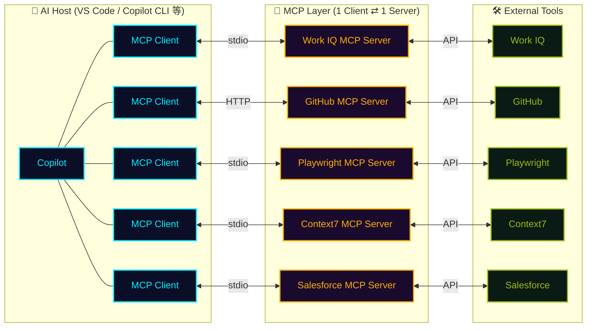

## 一言で

<div class="hero-quote">

MCP は「Model Context Protocol」の略称で、AI モデルに対して追加の文脈や機能を提供するプロトコルである。

</div>

## 仕組み



## なぜ重要?

MCP がもたらす 3 つの価値：

- **🧩 機能拡張**：Copilot を **一つの起点** にして、あらゆる外部ツールを操作できる。
  - 要件を読み書きする (**Jira**)
  - デザインを作る (**Figma**)
  - 3D デザインを生成して印刷する (**Blender** + 3D プリンター)
  - メール・カレンダーを確認・編集する (**Work IQ**)
  - 社内データベースに接続して分析する
- **🔗 ワークフローを統合**：個別ツールを繋ぐカスタム実装が不要になり、Copilot が **複数システムを横断するハブ** として機能する。
- **🌐 広いエコシステム対応**：MCP は **オープンなプロトコル** で、すでに **事実上の標準** になりつつあります。AI アシスタント、**Visual Studio** などの開発ツール、その他多くのアプリケーションが MCP をサポートしており、**一度作れば、どこでも繋がる**。コーディング統合との相性も抜群。

## どこで動く?

<div class="split-image">
  <div class="split-text">

MCP サーバーの実行場所は **2 種類** あります。

1. **stdio 方式** では、VS Code が **ローカルマシン上で子プロセス** として MCP サーバーを起動します。
2. **HTTP 方式（SSE / streamable-http）** では、MCP サーバーが **クラウドやリモートサーバー上で稼働** し、VS Code は **クライアントとして接続するだけ** です。

用途やセキュリティ要件に応じて使い分けが可能です。

  </div>
  <div class="split-figure">
    
    <figcaption>Activity Monitor で見ると、ローカル MCP サーバーが <code>npm exec</code> の <strong>子プロセス</strong> として動いているのが分かる</figcaption>
  </div>
</div>

## VS Code での設定 <a class="h2-doc" href="https://code.visualstudio.com/docs/agent-customization/mcp-servers" target="_blank" rel="noopener noreferrer">📖 Docs</a>

**Copilot ハーネス** で **Customizations → MCP Servers** を開きます。

**Workspace +**（User ではない）→ **HTTP** → サーバーの URL と ID を入力。信頼やサインインの確認に対応します。

<div class="setup-cards">
  <div class="setup-card">
    <div class="setup-card-head">
      <code>.mcp.json</code>
      <span class="setup-card-tag tag-cyan">▸ リポジトリ共有</span>
    </div>
    <p><strong>Workspace</strong>：repo のルートに保存し、トップレベルの <code>mcpServers</code> に設定。Git で共有するが、認証情報は含めない。</p>
  </div>
  <div class="setup-card">
    <div class="setup-card-head">
      <code>User</code>
      <span class="setup-card-tag tag-magenta">▸ 自分の PC のみ</span>
    </div>
    <p><strong>Global → Copilot Global</strong>：ワークスペース共通の個人設定。通常は <code>~/.copilot/mcp-config.json</code> に保存し、プロジェクトにはコミットしない。</p>
  </div>
</div>

> ⚠️ ルートへの保存には **`chat.mcp.workspaceRootConfig.enabled`**（Experimental）を有効化。Local 互換用の `.vscode/mcp.json` は `servers` を使い、追加画面では deprecated と表示されます。

## Copilot CLI で始める <a class="h2-doc" href="https://docs.github.com/en/copilot/reference/copilot-cli-reference/cli-command-reference#mcp-server-configuration" target="_blank" rel="noopener noreferrer">📖 Docs</a>

CLI も、フォルダーを信頼するとルートの **`.mcp.json`**（トップレベルは **`mcpServers`**）を読み込みます。`.vscode/mcp.json` から移行する場合は、ファイル名だけでなく `servers` を `mcpServers` に変更します。

```bash
# MCP server を追加
copilot mcp add <server-name>

# 既存サーバ一覧
copilot mcp list
```

GitHub 公式 MCP server は最初から接続済み。`gh` コマンドを叩く感覚で、AI が Issues / PRs / Actions / Code search を操作できる。

## <span class="mcp-connectors-title">Copilot connectors</span> <span class="mcp-connectors-links"><a class="h2-doc" href="https://docs.github.com/en/copilot/concepts/customizations/copilot-connectors" target="_blank" rel="noopener noreferrer">📖 Docs</a><a class="mcp-connectors-explore" href="https://github.com/copilot/customize" target="_blank" rel="noopener noreferrer">コネクターを探す ↗</a></span>

<div class="mcp-connectors">
<style>
.prose-akq .mcp-connectors{font:clamp(16px,1.3vw,20px)/1.35 var(--font-prose),sans-serif;color:#e8f4ff}
.prose-akq .mcp-connectors p{margin:0}
.prose-akq .mcp-connectors .mcp-connectors-status{padding:2px 6px;border:1px solid #ffb000;color:#ffb000;font-size:14px}
.prose-akq .mcp-connectors .mcp-connectors-lead{margin-bottom:10px;font-size:1.1em}
.prose-akq .mcp-connectors .mcp-connectors-compare{margin:0;table-layout:fixed;font-size:1em}
.prose-akq .mcp-connectors .mcp-connectors-compare th{font-size:1em;letter-spacing:0}
.prose-akq .mcp-connectors-compare th:first-child{width:17%}
.prose-akq .mcp-connectors-compare th:nth-child(2){width:40%}
.prose-akq .mcp-connectors-compare :is(th,td):last-child{background:#9bbc0f12}
.prose-akq .mcp-connectors-find{margin-top:10px}
.prose-akq .mcp-connectors-find-head{display:flex;flex-wrap:wrap;align-items:center;justify-content:space-between;gap:8px;margin-bottom:4px}
.prose-akq .mcp-connectors .mcp-connectors-find h3{margin:0;font-size:1em;line-height:1.3;color:#9bbc0f}
.prose-akq .mcp-connectors-locations{display:grid;grid-template-columns:repeat(4,minmax(0,1fr));gap:12px;margin:0}
.prose-akq .mcp-connectors-locations > div{padding-top:6px;border-top:1px solid #e8f4ff22}
.prose-akq .mcp-connectors-locations dt{margin-bottom:4px;font-weight:600;font-size:14px}
.prose-akq .mcp-connectors-locations dd{margin:0;color:#a8bed2}
.prose-akq .mcp-connectors .mcp-connectors-scope{margin-top:6px;font-size:14px;color:#a8bed2}
.prose-akq > h2:has(.mcp-connectors-title){display:flex;flex-wrap:wrap;align-items:center;gap:8px 14px}
.prose-akq .mcp-connectors-links{display:inline-flex;flex-wrap:wrap;align-items:center;gap:6px}
.prose-akq h2 .mcp-connectors-links .h2-doc{margin:0;font-size:14px}
.prose-akq h2 .mcp-connectors-explore{display:inline-flex;padding:.2em .5em;border:1px solid #9bbc0f88;color:#9bbc0f;font-size:14px;font-weight:400;line-height:1.4;letter-spacing:0;text-decoration:none;white-space:nowrap}
.prose-akq h2 .mcp-connectors-explore:hover,.prose-akq h2 .mcp-connectors-explore:focus-visible{border-color:#9bbc0f;text-decoration:underline}
.prose-akq h2 .mcp-connectors-explore:focus-visible{outline:2px solid #9bbc0f;outline-offset:2px}
body.present-mode .playbook-detail:has(.mcp-connectors.akq-slide-active){padding-top:88px;padding-bottom:72px}
body.present-mode .prose-akq > h2:has(.mcp-connectors-title){margin:0 0 12px;font-size:clamp(28px,2.2vw,36px);line-height:1.2;letter-spacing:0}
body.present-mode .prose-akq > h2:has(.mcp-connectors-title)::before{top:.35em}
@media(max-width:767px){body.present-mode .playbook-detail:has(.mcp-connectors.akq-slide-active){padding-left:20px;padding-right:20px}}
@media(max-width:520px){.prose-akq .mcp-connectors-locations{grid-template-columns:1fr}.prose-akq .mcp-connectors-compare th:first-child{width:20%}.prose-akq .mcp-connectors-compare th:nth-child(2){width:38%}}
</style>
<p class="mcp-connectors-lead"><b>MCP は共通の規格。</b>コネクターは、GitHub が設定と認証を管理する、すぐ使える MCP 連携。</p>
<table class="compact-table mcp-connectors-compare">
<thead><tr><th scope="col">観点</th><th scope="col">MCP サーバー（手動設定）</th><th scope="col">Copilot connector</th></tr></thead>
<tbody>
<tr><th scope="row">何か</th><td>MCP でツールや文脈を提供</td><td>GitHub が検証した MCP 連携</td></tr>
<tr><th scope="row">設定</th><td>サーバーと認証を自分で設定</td><td>サービス選択 → 一度サインイン → アクセス承認</td></tr>
<tr><th scope="row">利用環境</th><td>設定した環境で利用</td><td>対応する Copilot 環境で再利用</td></tr>
<tr><th scope="row">選択肢</th><td>独自／サードパーティ製</td><td>GitHub の対応カタログ</td></tr>
</tbody>
</table>
<div class="mcp-connectors-find">
<div class="mcp-connectors-find-head"><h3>どこで見つかる？</h3><span class="mcp-connectors-status">パブリックプレビュー</span></div>
<dl class="mcp-connectors-locations">
<div><dt>Web / cloud</dt><dd><a class="retro-link" href="https://github.com/copilot/customize" target="_blank" rel="noopener noreferrer">カスタマイズページ ↗</a></dd></div>
<div><dt>Copilot app</dt><dd>Customize → MCP → GitHub verified</dd></div>
<div><dt>CLI</dt><dd><code>/mcp</code> → Connectors</dd></div>
<div><dt>VS Code</dt><dd>Agents window → Customizations</dd></div>
</dl>
</div>
<p class="mcp-connectors-scope">ローカル／クラウドサンドボックスが対象。GitHub Actions セッションは対象外。</p>
</div>
